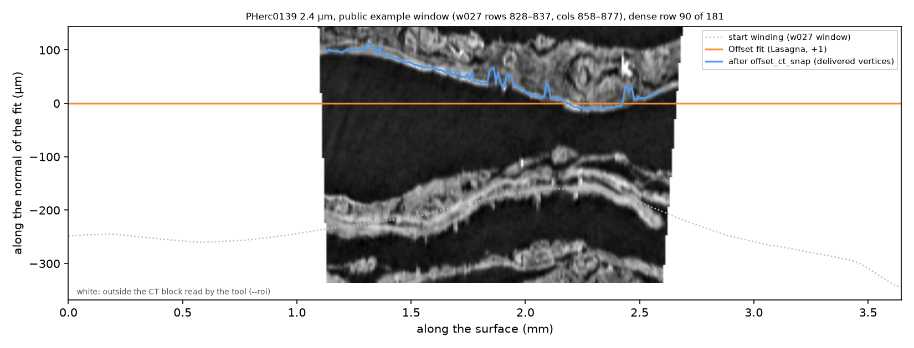

# offset_ct_snap — put an Offset surface back on the papyrus

`lasagna-offset-ct-snap` (module `offset_ct_snap.py`, command `snap_offset_surface.py`) takes the surface written by a
Lasagna Offset fit and the CT, and returns the same surface snapped onto the papyrus, with a per-vertex state and a
verdict for the surface as a whole. It needs NumPy, SciPy and `vc_reader`; no GPU, no PyTorch.

## What it does

1. **Snap.** Each vertex of the dense grid is moved along the surface normal onto the nearest papyrus ridge of the CT.
   Vertices already on paper anchor first; their neighbours follow if their ridge agrees with the local median; only
   the largest continuous patch is kept.
2. **Check.** Rays are marched from the start winding along the offset direction. The surface is **accepted** only if
   the rays that crossed exactly one air gap lead both rivals (no gap, two gaps) by more than 5 % of the rays
   (`accept_margin_share`) and at least 55 % of vertices in the domain were placed. A surface that stayed on the start
   winding, went two windings away, is a near tie, or kept too few vertices is **refused**: by default, it is reported
   with its reason (`refusal_reason`) and nothing is delivered.
3. **Recover.** On an accepted surface, vertices the snap left out although a ridge exists are hooked if that ridge is
   within 12 voxels of the median move of their placed neighbours.
4. **Filter.** Vertices that remained on the start winding are removed.
5. **Opt-in modes.** Off by default. **All of them are experimental: they were designed and measured on development
   surfaces and on a diagnostic set of public windows; see "What was measured" for what is and is not validated.**
   - `--smooth-within-paper`: smooths normal offsets toward their 5 x 5 spatial median, clamped to +/- 4 voxels and
     restricted to positions that stay strictly above the paper threshold in the CT. It lowers neighbour jumps.
   - `--fallback-march`: delivers a surface the air-gap check did not accept, when other evidence supports it. It never
     looks for a winding the fit does not point to, and it never modifies an accepted surface. Two cases:
     - **the sheet the fit sits on** (`delivery_basis: fit_sheet`). Where two windings touch, there is no air gap to
       count: the check refuses a fit that sits on the right sheet, and a march to "the first sheet beyond the air"
       lands one winding too far. If the fit moved at least one sheet thickness (`fit_sheet_min_step_vox` = 18 voxels)
       and still lies partly inside the start packet (the raw fit is above the top of that packet on fewer than 80 % of
       the rays), the fit is snapped again with every ridge closer to the start than one sheet thickness excluded, and
       that sheet is delivered. Vertices closer to the start than half the step are left out. No air gap confirms this
       step: which winding it is rests on the Offset fit alone, and the report says so.
     - **a march to the first sheet beyond the air** (`delivery_basis: ct_march`, `snap_state` 4), the V6-F march, only
       when the raw fit went past the middle of the first air gap on at least half of the rays
       (`march_min_past_mid_gap_share`): a fit floating in the lower half of that gap is nearer the start than the next
       sheet and gives a march nothing to rely on. Heights come from the CT dark-gap consensus, or from the projected fit
       when the start drifted or a blister was detected (`fallback_height_from`).
     Neither runs when the fit did not move forward (wrong `--offset` sign, fit left on the start), when the check was
     undecided (verdict -1), or when fewer than 55 % of the domain would be placed. A delivered surface exits with code
     **4** and a warning on stderr; a refusal is explained in `refusal_reason` / `fallback_refused`.
   - `--repair-start-pockets`: on an **accepted** surface with a detected start-winding pocket, re-places the trapped
     vertices past the gap. **Transactional**: before and after are compared, and a repaired vertex is kept only if it was
     a depression (lower than 0.6 x the level set locally by the vertices that crossed one air gap) and is brought back
     to that level (within 30 % of it, at least 12 voxels). A vertex that was already at the level of the accepted
     surface was not trapped; moving it by about one winding is rolled back. If what is kept adds steps longer than
     8 voxels to the surface, everything is rolled back. The report gives `start_pockets_repaired` (kept) and
     `start_pockets_rolled_back`; the command still exits 0 and says on stderr what it kept and undid.
   - `--auto-orient`: flips `--offset` when the fit moved strongly to the opposite side of the start grid's row x column
     normal (for example on a transposed `tifxyz` grid). **With `--fallback-march`, it disables the sign guard**, since
     the sign is then taken from the fit; the report and the stderr warning say so.

**The report states what the delivery rests on.** `snap_report.json` gives `delivery_basis` (`air_gap`, `fit_sheet`,
`ct_march` or null), `refusal_reason`, and `evidence`: the shares of rays that crossed no, one or two air gaps and the
lead of "one gap" (`acceptance_margin`), the median move of the fit, the share of rays where the raw fit left the start
packet or went past the middle of the first air gap, and the step height of the delivered surface. Confidence that the
vertices are on papyrus (states, counts) and confidence in which sheet was reached (`delivery_basis`, shares) are two
different things; only an accepted surface has the second confirmed by the CT.

**Recommended experimental command** (the configuration measured below as "full"):
`--fallback-march --repair-start-pockets --smooth-within-paper`. Check every surface that exits with code 4.

## Use

```bash
lasagna-offset-ct-snap --start START.tifxyz --fit FIT.tifxyz --offset 1 --ct /path/or/url/volume.zarr/0 --out OUT.tifxyz
```

| Argument | Meaning |
|---|---|
| `--start` | tifxyz of the surface the Offset fit started from; every vertex must be present |
| `--fit` | tifxyz written by the Offset fit; same grid as `--start` |
| `--offset` | `+1` or `-1`: the side of the start surface to look on. `+1` is the side of cross(d/d row, d/d column) of the `--start` grid; pass `--auto-orient` to orient from the fit when a grid is transposed |
| `--ct` | CT Zarr array, uint8, at the level the surfaces are expressed in; local path or `http(s)` / `s3` URL |
| `--out` | output tifxyz folder; must not exist — an existing surface is never overwritten |
| `--roi x0 y0 z0 x1 y1 z1` | optional: only load the CT inside this box |
| `--smooth-within-paper` | optional: regularize normal displacements strictly inside the CT papyrus layer |
| `--fallback-march` | optional, experimental: deliver a refused fit on other evidence (the sheet the fit sits on, or a march to the first sheet beyond the air); exit code 4 when it delivers |
| `--repair-start-pockets` | optional, experimental: bring back vertices of an accepted surface left in a start-winding pocket; transactional (unjustified repairs are rolled back) |
| `--auto-orient` | optional: flip `--offset` if `--fit` moved strongly to the opposite side of `--start` |

Output folder: `x.tif`, `y.tif`, `z.tif` (dense grid, about 4 voxels between vertices, absent vertices `(-1, -1, -1)`),
`snap_state.tif` (uint8: 0 not delivered, 1 anchored, 2 lifted, 3 recovered, 4 marched; declared in `meta.json`
under `extra_channels`), `meta.json`, `snap_report.json` (verdict, counts, `delivery_basis`, `refusal_reason`, `evidence`,
parameters, CT region read, identity of the CT).

## Requirements on the Offset fit

The tool checks and corrects a fit; it does not run one. The default gains measured below need an Offset fit that reached
the next winding. On `main` (8e21d01):

- `lasagna/configs/offset_snap.json` does not parse (`JSONDecodeError: Expecting ',' delimiter: line 44 column 3`).
  PR #2418, by another contributor and not part of this tool, adds the comma.
- With the comma alone, on prediction sets that have no `pred_dt` channel (the published PHerc0139 set has `cos`,
  `grad_mag`, `nx`, `ny`), the fit stops in its snap stage: `active loss 'pred_dt' missing forward artifact(s)`. The
  second line of #2418 sets `pred_dt` to 0.0 in that stage.
- `lasagna/configs/offset.json` runs, but on PHerc0139 its fits stay on the start winding. By default this tool refuses
  them (verdict 0, 118 of 119 surfaces on the new zones): that is the expected answer, not a failure of the tool.
  `--fallback-march` does not deliver them either: a fit that moved less than one sheet thickness designates no other sheet.

Check the configuration before fitting (from the repository root):

```bash
python -c "import json; c = json.load(open('lasagna/configs/offset_snap.json')); print({s['name']: c['base']['pred_dt'] * s['w_fac'].get('pred_dt', 1.0) for s in c['stages']})"
```

It prints the effective `pred_dt` weight of each stage (the `base` weight times the stage factor); the `snap` stage must show `0.0`. When a surface is refused, the command says why on stderr (verdict 0, 2 or -1), distinguishing a fit that did not move from one that moved to the opposite side of the start normal.

**Which CT was read.** `snap_report.json` names it under `ct_identity`: location, shape, chunks, dtype and the SHA-256
of the block that was loaded. When a surface states the volume it was made in (`base_shape_zyx` in its `meta.json`, the
shape of the volume its coordinates are in, at any `export_coordinate_scale`) and `--ct` has another shape, the run stops with exit code 3: coordinates of one
volume are not snapped onto the grey levels of another. A surface that does not state its volume cannot be checked;
the report says so (`checked_against`). The command keeps no CT cache of its own.

**Inputs that are refused** (exit code 3, nothing written): a grid smaller than 2 x 2, with absent or non-finite
vertices, with two neighbouring vertices at the same place, or whose vertices all lie on one line; start and fit grids
of different shapes; a CT that is not 3D uint8, that is empty, or that holds a single grey level (masked or empty
region); an `--offset` other than `+1` or `-1`; a `--roi` that is inverted or does not touch the surfaces; surfaces of
which no vertex has its whole profile inside the CT that was loaded.

Exit code: `0` accepted (with `--repair-start-pockets`, possibly modified: see stderr, `start_pockets_repaired` and
`start_pockets_rolled_back`); `4` not accepted by the air-gap check but delivered by `--fallback-march` on the basis
stated in the report (check it before use); `2` refused (the folder is written, nothing is delivered); `3` bad input or
CT not available (nothing is written). The report also gives `median_fit_normal_move_vox`, `valid_rays` and
`start_vertices_on_paper`, so a reader can see how much the check and the fallback rested on.

From Python: `offset_ct_snap.snap_offset_surface(start_xyz, fit_xyz, vol, org, offset_sign)`; the optional `stages`
dict collects the arrays and the wall-clock time of each pass for viewers and does not change any result.

## Tests

```bash
PYTHONPATH=lasagna:. python -m pytest -q lasagna/tests/test_offset_ct_snap.py                                   # fast tests, synthetic block
LASAGNA_OFFSET_CT_SNAP_REAL=1 PYTHONPATH=lasagna:. python -m pytest -q lasagna/tests/test_offset_ct_snap.py     # + one real window of PHerc0139
```

Run them from the repository root (`lasagna/tests/conftest.py` also needs `torch`).
The real test reads about 200 MB of the published PHerc0139 volume and checks the output against recorded hashes.
The two input surfaces are in `tests/data/offset_ct_snap/` (10 x 20 vertices each). They are derived from Vesuvius
Challenge open data and stay under its CC BY-NC 4.0 license, not MIT; source, selection and hashes are in `provenance.json`.

## What was measured, and on what

Three sets, two judges, and they do not say the same thing: read both.

**Development zones (private judge).** Zones of 1 mm² of PHerc0139 (2.4 µm) chosen where a continuous air layer
separates the two windings. "Right" means: on the target side of the air layers traced in the zone, and on paper. Where
two windings touch, this judge cannot score the touching sheet (it counts it as not delivered or wrong) and rewards any
surface that crossed the air. These zones were used to tune every version, this one included: development figures,
not a validation.

| 119 surfaces of lots 4 and 4b, 1,065,430 vertices | Right | Wrong side | Not delivered | Wrong among delivered | Pairs > 8 vox | Folded cells | Flipped triangles | s / surface |
|---|---:|---:|---:|---:|---:|---:|---:|---:|
| Offset fit alone (`offset_snap` + #2418) | 39.27 % | 7.83 % | 9.81 % (out of box) | — | — | — | — | — |
| default | 76.25 % | 3.11 % | 20.41 % | 3.91 % | 8.45 % | 15.38 % | 0.213 % | 3.7 |
| `--fallback-march --smooth-within-paper` | 89.75 % | 4.40 % | 5.58 % | 4.65 % | 6.11 % | 13.42 % | 0.205 % | 3.9 |
| **full**: `--fallback-march --repair-start-pockets --smooth-within-paper` | **89.76 %** | **4.39 %** | **5.58 %** | 4.65 % | 6.11 % | 13.43 % | 0.207 % | 4.1 |
| for reference, the V6-F march this fallback replaces (same surfaces, same judge) | 93.36 % | 2.64 % | 3.71 % | 2.74 % | 6.43 % | 13.69 % | 0.360 % | 3.9 |

| 92 surfaces used to tune the default mode, 790,680 vertices | Right | Wrong side | Not delivered | Pairs > 8 vox | Folded cells | Flipped triangles |
|---|---:|---:|---:|---:|---:|---:|
| default | 86.07 % | 1.25 % | 12.47 % | 7.87 % | 14.74 % | 0.047 % |
| full | 93.57 % | 1.38 % | 4.83 % | 5.47 % | 12.68 % | 0.050 % |
| V6-F march, for reference | 94.27 % | 2.49 % | 3.01 % | 5.80 % | 12.94 % | 0.089 % |

On the 119 surfaces the full mode is **3.6 points below the march it replaces**. Two reasons, both by design: on these
zones the target trace is always beyond an air layer, so "march to the first sheet beyond the air" is right by
construction of the zone selection, while the fit-sheet fallback delivers the sheet the fit sits on (4 surfaces, scored
0 to 45 % right here); and the transactional pocket repair rolls back repairs this judge rewards on 6 surfaces (the same
repair that destroys accepted surfaces on public windows, below). The default mode differs from the previous one on 3 of
the 211 development surfaces: near ties (lead under 5 points) that are now refused; all three were right (97 to 99.6 %).

Negative controls, 119 surfaces, full mode: with the `--offset` sign inverted, **0** surfaces are delivered; with fits
from the `offset.json` configuration of `main`, 2 surfaces are delivered (1.28 % of the vertices right, 0.01 % wrong).

**Public windows, first set (IND1, public judge) — a diagnostic set.** 18 windows of 10 × 20 vertices of the published
traces of PHerc0139, drawn far from every development zone, judged with a public evaluator (published traces and public
CT only): a vertex is right when the nearest published trace is the target trace and it is on papyrus. These windows
were read before this version was designed and were used to design it: the figures show that the known failures are
fixed or explained, not that the tool generalizes. Windows 01 to 17, 1,136,621 vertices:

| Mode | Right | Wrong side | Not delivered | Wrong among delivered | Windows delivered | Delivered and mostly wrong |
|---|---:|---:|---:|---:|---:|---:|
| Offset fit alone | 45.31 % | 16.49 % | 0 (38.19 % in the dark) | 16.49 % | 17 | 3 |
| first default (strict plurality, no margin) | 40.52 % | 5.38 % | 54.08 % | 11.72 % | 8 | 1 |
| V6-F march | 62.74 % | 26.19 % | 11.04 % | 29.44 % | 17 | 3 |
| default | 34.54 % | 0.34 % | 65.10 % | 0.98 % | 6 | 0 |
| **full** | **78.31 %** | **16.72 %** | **4.94 %** | 17.59 % | 17 | 2 |

Three windows carry 12.6 of the 16.7 points of wrong side of the full mode, and in none of them are the two published
traces one winding step apart: in two the target trace runs 5 to 10 voxels from the start trace, on the same sheet (any
step of one winding is scored wrong); in the third a real sheet lies between the two traces (they are 107 voxels apart).
Without them the full mode gives 90.33 % right, 4.79 % wrong side, 4.84 % not delivered. That reading was made after
the fact and is not a criterion.

**Public windows, second set (IND2, public judge) — the independent check.** 12 windows drawn after this version was
frozen, under a protocol frozen before the draw, with three validity rules on the traces learnt from IND1 (target trace at
least 20 voxels from the start; a trace beyond the target present; target side not shared). 10 were judged (2 not processed: CT budget). They lie 800 to 1,440
voxels from a development zone (no shared voxel): a weaker independence than IND1. 841,321 vertices:

| Mode | Right | Wrong side | Not delivered | Wrong among delivered | Windows delivered | Delivered and mostly wrong |
|---|---:|---:|---:|---:|---:|---:|
| Offset fit alone | 42.32 % | 14.30 % | 0 (43.37 % in the dark) | 14.30 % | 10 | — |
| first default (strict plurality, no margin) | 55.78 % | 8.88 % | 35.31 % | 13.72 % | 7 | 0 |
| V6-F march | 63.69 % | 25.51 % | 10.76 % | 28.58 % | 10 | 1 |
| previous full mode (45-voxel guard, untransacted repair) | 60.27 % | 21.66 % | 18.03 % | 26.42 % | 9 | 1 |
| default | 44.84 % | 6.65 % | 48.48 % | 12.91 % | 6 | 0 |
| **full** | 73.87 % | 9.90 % | 16.19 % | 11.81 % | 9 | 0 |

By the rule frozen in advance the full mode is **not validated** on IND2: gain of right vertices over the first default +18.09 points (95 % CI -0.20 to +42.44; needed: lower bound above 0, not held); wrong side added +1.02 points (allowed +0.5, **not held**); wrong side among delivered vertices 11.81 % (allowed 5 %, **not held**); sign inverted: 0 window(s) delivered; accepted windows that are mostly wrong: 0; pocket repair: at most +0.00 point of wrong side added on any window. Against the V6-F march on the same
windows: +10.18 points right, -15.61 points wrong side.

## A cross-section of the public PHerc0139 example



This is the centre row of the dense output grid for the real-data test above. The dotted line marks the starting winding. White areas lie outside the CT crop. Of 19,704 vertices inside the test domain, the default mode delivered 19,452. The image shows local placement on paper. Adjacent windings can touch, so identifying the intended winding is a separate test.

The image uses the public PHerc0139 scan at 2.399 µm and the w027 window recorded in the [fixture provenance](../tests/data/offset_ct_snap/pherc0139_lot4_23_w027/provenance.json). The CT-derived image carries the same [CC BY-NC 4.0 license](https://creativecommons.org/licenses/by-nc/4.0/) as the source data.

## Held-out PHerc0139 windows

On 24 windows (IND3), the full experimental mode placed 73.33% of the scored domain on paper nearest the target trace, versus 59.14% for the earlier march. It delivered 93.04% of the domain. Among delivered vertices for which the winding could be scored unambiguously, 87.91% were correct (window-bootstrap 95% interval 80.26–93.91%). Four default-mode acceptances had a majority on the wrong side under the protocol's whole-domain scoring rule. IND3 missed its preregistered acceptance criteria.

In a later draw (IND4), this exact module was a frozen comparison arm. Of 221,003 scored vertices across three windows, the input Offset fit had 75,817 correct. The full mode had 146,396 correct, 44,086 on the wrong side, four dark and 30,517 undelivered. It delivered 86.19% of the domain. The observed ratio of correct counts was 1.931. The draw yielded three windows from two neighboring starting windings on the same scroll. The protocol required at least 16 windows to reach a conclusion.

## Limits

- One scroll, one resolution. Parameters are in voxels and were set on PHerc0139 at 2.4 µm (a sheet is about 18 voxels
  thick there: `fit_sheet_min_step_vox`).
- One air gap is read as one winding step. A gap inside a winding (delamination) breaks that reading: the check then
  refuses the surface, or accepts a wrong one.
- **Where two windings touch, nothing in the CT tells "the fit sits on the next winding" from "the fit stopped short
  inside a thick start packet".** The same evidence (no air gap crossed, the fit 30 to 50 voxels above the start in the
  same packet) is the right sheet on public windows and a short fit on development zones. `--fallback-march` then
  delivers the sheet the fit sits on, flags it (`fit_sheet`, exit code 4) and leaves the decision to the reader. On zones
  known to have an air layer everywhere, set `fit_sheet_max_left_share` to 0 to keep only the march.
- A surface delivered as `fit_sheet` is exactly as right as the Offset fit was about which sheet is next; the tool adds
  the papyrus, not the identity.
- `--repair-start-pockets` now undoes most of what it attempts (transaction). It no longer destroys accepted surfaces;
  it also no longer brings the gain it showed on the 119 development surfaces.
- The acceptance margin (5 % of the rays) was set on the development surfaces and on IND1. It refuses a few right
  surfaces (3 of 211 development surfaces; 1 of 8 on IND1; 1 of 7 on IND2, 79 % right) to refuse the near ties that are
  wrong. On IND2 it did not make the default mode safer (12.9 % wrong among delivered, against 13.7 % without it), and one
  surface accepted with a comfortable lead is 43.7 % wrong: a lead is not a proof. `accept_margin_share = 0` restores the
  strict plurality.
- The snapped surface is rougher than the fitted one (6 to 8 % of neighbouring vertex pairs more than 8 voxels apart).
- The default mode refuses, and does not repair, every surface whose windings touch (10 of 18 public windows on IND1,
  3 of 10 on IND2).
- `--offset` is read in the grid's own orientation (row × column) unless `--auto-orient` is passed.
- "Air gap" means a run of at least 14 voxels below the paper / air threshold of the crop (a dark gap in the CT). The
  check counts dark gaps; it does not see what the dark is.
- The check does not catch every wrong surface: 3 of the 100 accepted development surfaces have more than half of their
  vertices on the wrong side of the air layer (75.9 %, 60.7 %, 55.0 %).
- Neither judge proves which sheet was reached: one says which side of an air layer, the other which published trace
  is nearest; a published trace can itself be one sheet off.
- Measured on windows of about 1 mm². On a larger surface the paper / air threshold is computed over the whole crop;
  this was not measured.
- About 4 s per 1 mm² on one CPU core (measured with five benchmark processes in parallel); 1.5 to 2 s more when the
  fit-sheet fallback runs.
- The judges, the zones and the windows come from the authors of the tool.
