# vc_reader

## Source discovery

Describe published labels, derived representations, and explicit local/remote
sources without opening storage. Query `volume.labels()`,
`volume.level(2).representations()`, or `volume.registered_volumes()`; use
`SourceCollection` to include user annotations. See [source discovery](docs/discovery.md)
for registration, serialization, examples, and validation commands.

Open local/HTTP/S3 Zarr v2/v3, PNG/JPEG/TIFF, and ordered image stacks with
`source.open()` for exact spatial crops, explicit label encodings, resolved
registration, and bounded caching. Published sharded Zarr v3 ink labels and
their companion masks share the existing native reader and authentication.
See [source reading](docs/source-reading.md) for formats, worker lifecycle,
examples, and [acceptance measurements](docs/source-reading-benchmarks.md).

## PyTorch CUDA batches

Keep your ordinary PyTorch dataset and DataLoader. Wrap the loader to upload
whole batches and run normalization and augmentation on the training GPU:

```python
from torch.utils.data import DataLoader
from vc_reader import augment as A
from vc_reader.torch import CudaLoader

def train(dataset, model):
    # Each dataset item is a dict, e.g. image: (C, Z, Y, X), label: (C, Z, Y, X).
    cpu_loader = DataLoader(
        dataset, batch_size=4, num_workers=4,
        multiprocessing_context="spawn", pin_memory=True, persistent_workers=True,
    )
    pipeline = A.Pipeline(
        [A.Normalize("minmax"), A.Flip(axes="xyz"), A.Gamma((0.8, 1.2))],
        targets={"image": A.Image(), "label": A.Label()},
        backend="cuda",
    )
    loader = CudaLoader(cpu_loader, pipeline, device="cuda:0", seed=123)
    for epoch in range(10):
        loader.set_epoch(epoch)
        for batch in loader:
            prediction = model(batch["image"])
            # batch["label"] is also a CUDA tensor, with its original dtype.
            # Compute loss, backward, and optimizer step here.

# Call train(...) under `if __name__ == "__main__":` when using spawn workers.
```

This requires PyTorch (the optional `torch` extra), a CUDA-enabled vc_reader
build (`VC_READER_ENABLE_CUDA=ON`), and an accessible CUDA device. Importing the
catalog, reader, or ordinary augmentation API does not import PyTorch.

The dataset can use `ZarrReader` to return CPU crops. CUDA work belongs in the
training process: wrap the **DataLoader**, rather than calling a CUDA pipeline
inside `Dataset.__getitem__` or a worker's `collate_fn`. The wrapper also accepts
an iterable that supplies already-resident CUDA batches in that process. It
does not change your sampler, dataset, or worker configuration.

- Dense batch targets have shape `(B, C, Y, X)` or `(B, C, Z, Y, X)`. Include the
  channel axis even for one-channel images and labels. Points/vectors use the
  existing per-sample shapes with a leading batch axis.
- Each declared target is uploaded as one batch. `uint8` continuous targets
  become `float32` **on the GPU**; float32/float64 and label dtypes are preserved.
  Other continuous integer types and reduced-precision floats require an
  explicit conversion. Existing CUDA inputs must be on the selected device.
- Only fields declared in `pipeline.targets` are processed. Metadata—including
  CPU tensors of sample IDs or seeds—passes through unchanged. All target
  inputs are preserved; this preprocessing API does not accept autograd inputs.
- Normalization and augmentation stay on device. Results are ordinary
  PyTorch-owned tensors, safe to retain after advancing or closing the iterator.
  Equal output shapes are stacked; variable shapes produce per-sample lists.
  Deep-supervision outputs are lists of levels, each stacked when shapes agree.
- The default `prefetch=True` queues one batch ahead on a private CUDA stream.
  Completion and data-validation errors are checked before a batch is yielded.
  Only small validation flags return to CPU. Use `prefetch=False` for on-demand
  iteration. If keeping an iterator after an early break, call `iterator.close()`
  (or use `contextlib.closing`) to promptly release the prefetched batch.

For custom training loops, use the same executor directly:

```python
# CPU/NumPy targets are uploaded; CUDA tensors or DeviceArrays stay on device.
result = pipeline.batch(batch, seeds=per_sample_seeds, device="cuda:0")
```

`Pipeline.batch()` infers the device from resident targets when `device` is
omitted, otherwise uses the current CUDA device. It uses PyTorch's current
stream and completes/checks once per batch before returning. As with normal
PyTorch tensors, callers switching streams after the return must coordinate
those streams. Native batch execution currently loops over samples internally;
the public API submits the full batch and does not synchronize between samples.

Default loader seeds depend on `seed`, `epoch`, and sample position in the
local iteration order. `set_epoch()` changes augmentation seeds only: call
`DistributedSampler.set_epoch()` separately when using DDP, and create one
`CudaLoader` per training rank with its assigned device. For seeds independent
of batching, ordering, or rank, supply a CPU metadata field and set
`CudaLoader(..., seed_key="aug_seed")`. Each entry must be a uint64-range integer;
`np.asarray(A.seed(run_seed, epoch, sample_id), dtype=np.uint64)` is suitable for
dataset items and default PyTorch collation. Explicit seeds override generated
seeds, so `set_epoch()` does not change them.

See the [loader benchmark and regression commands](benchmarks/README.md#pytorch-cuda-batches)
for timing scope and validation.

## Performance

Low-resolution simulation composes nearest reduction and linear reconstruction
into one sampling pass on CPU and CUDA. It avoids the reduced image and, for
single-channel CUDA crops, two full-volume copies. See the
[composed resize measurements](benchmarks/README.md#composed-low-resolution-sampling-2026-10-17)
for transform timings and full-loader throughput.

Local brightness, contrast, gamma and smoothing use separable float32 fields:
a 128³ field needs 388 floats (1.52 KiB), with weights evaluated during image
processing. See the [compact local-field measurements](benchmarks/README.md#compact-local-fields-2026-10-17)
for CPU/CUDA timings and full-loader throughput.

### Reading and sampling

Median milliseconds per request, including sampling where needed: six requests
× ten repetitions per workload/backend, after validation and two warmups, with
eight reader workers. CUDA includes fresh source uploads and final host downloads.
TensorStore and zarr-python use SciPy to interpolate identical coordinate grids.
The curved surface uses the [bundled tifxyz strip](benchmarks/README.md#reusable-tifxyz-surface).

| Workload | zarr-python | TensorStore | vc_reader CPU | vc_reader CUDA |
| --- | ---: | ---: | ---: | ---: |
| ML batch: 8 × 128³ crops | 14.158 | 4.894 | 1.147 | 4.796 |
| Curved tifxyz surface: 96 × 512 | 10.824 | 6.645 | 0.868 | 1.792 |
| Axis-aligned slab: 16 × 512² | 6.263 | 2.900 | 0.401 | 2.314 |
| Rotated box: 128³ | 69.288 | 65.259 | 13.792 | 1.629 |

CPU is faster for direct batches, slabs, and these surface tiles. For rotated
boxes, CUDA is 8.46× faster than vc_reader CPU

### Axis-aligned single-crop latency (12 augmentations, CPU output)

Axis-aligned crops are the default workload here. Each request reads a 128³
box, applies min-max normalization, then runs 12 augmentations: elastic
deformation, median filtering, flipping, Gaussian blur, brightness multiplication
and addition, contrast, gamma, local contrast, local smoothing, sharpening, and
low-resolution simulation. These benchmarks measure input preparation only;
no model forward or backward pass is included.

Reading on CPU and then moving to CUDA is the fastest measured route. Each
route uses six crops × ten repetitions, with fresh GPU uploads and final host
downloads.

| Pipeline | Median total (ms) | Crops/s | Speedup over CPU |
| --- | ---: | ---: | ---: |
| CPU throughout | 149.723 | 6.68 | 1.00× |
| CUDA reading + processing | 2.468 | 389.54 | 60.65× |
| CPU reading → CUDA processing | 1.833 | 534.70 | 81.68× |

The hybrid route is **1.35× faster** than CUDA reading and processing for these
boxes. All routes passed output correctness checks; full distributions and
validation results are in the [benchmark guide](benchmarks/README.md).

### PyTorch batch throughput (12 augmentations, GPU output)

This benchmark compares ways to feed batches to a PyTorch model, including
loader workers and prefetching. It uses the same min-max normalization and
12 augmentations as the axis-aligned single-crop benchmark, with identical
parameters and order. Batches use axis-aligned reads, warm reader caches and GPU outputs;
the single-crop timings above include final CPU outputs. No model forward or
backward pass is included.

Batches contain four 128³ crops. Three timed epochs of 64 batches follow a
validation/warmup epoch per route. Four loader workers and four reader threads
per worker serve the batch routes. Epoch throughput includes reading, transfers,
augmentation, collation and disposal; outputs remain on the GPU.

| Route | Mean batch ms | p50 ms | p95 ms | Crops/s |
| --- | ---: | ---: | ---: | ---: |
| Per-sample CUDA, `num_workers=0` | 4.873 | 4.714 | 5.933 | 820.23 |
| `Pipeline.batch()` | 3.638 | 3.306 | 4.022 | 1098.67 |
| `CudaLoader`, one batch ahead | 3.281 | 2.927 | 3.935 | 1218.34 |

### Special case: rotated-crop sampling

When a crop must be read at an angle, fetching also requires trilinear
interpolation. This benchmark samples a 128³ crop with a 10° YX rotation, then
uses the same normalization and 12 augmentations as the axis-aligned benchmark.
It uses the same six crops × ten repetitions and final CPU output endpoint.

| Stage | CPU median (ms) | CUDA median (ms) |
| --- | ---: | ---: |
| Fetching + sampling | 15.164 | 1.186 |
| Normalization | 2.586 | 0.125 |
| 12 augmentations | 143.225 | 0.695 |
| Final host download | — | 0.525 |
| End-to-end | 160.279 | 2.544 |

CUDA delivers **63.01× lower median latency**, with throughput of **386.87
crops/s** versus **6.21 crops/s** on CPU.


## Add labels or channels to a pipeline

`with_targets()` returns a new pipeline with additional named targets, keeping
the existing transforms and execution settings:

```python
from vc_reader import augment as A

pipeline = existing_pipeline.with_targets(
    extra_label=A.Label(),
    confidence=A.ScalarField(),
)
result = pipeline(
    {"image": ct, "extra_label": segmentation, "confidence": confidence_map},
    seed=123,
)
```

The sample dictionary supplies the arrays; the declarations specify their
treatment. `Label()` shares geometry using nearest-neighbor interpolation.
`ScalarField()` shares geometry using continuous interpolation. Both skip image
normalization and intensity transforms. Use `Image()` for another image channel
that should receive those transforms too; existing target selectors still apply.

Arrays must already be spatially aligned and use channel-first shapes such as
`(C, Y, X)` or `(C, Z, Y, X)`. Existing declarations are retained unless you replace the same
name. The original pipeline is unchanged; replay plans stay with the pipeline
that created them.

## Augmentations

All image augmentations and normalization modes support channel-first **2D
`(C, Y, X)` and 3D `(C, Z, Y, X)`** arrays on CPU and CUDA. Spatial tuples
(`shape`, `size`, `tile_shape`, `unit_size`, `direction`, `center`, and a fixed
`OrientedBlur.axis`) must have two entries for 2D or three for 3D. Axis names
for 2D are `y` and `x`; use `axis="y"` or `"x"` for `SliceIllumination` and
`Smear`, and a one-element `shift` for 2D `Smear`. Vector targets likewise
use `components="yx"` or `"xy"` in 2D.

Omitted CLAHE tile sizes default to 16 per axis; dropout sizes default to 8
per axis. `GridDropout` and `StripeMasking` default to all spatial axes.
Reference images may be `(C, Y, X)` or `(C, Z, Y, X)`; FDA requires matching
spatial shapes. 2D filters use planar neighborhoods, bilinear interpolation,
and 2D Fourier transforms. `OrientedBlur` uses one perpendicular direction in
2D and two in 3D.

```python
pipeline = A.Pipeline([
    A.Normalize("minmax"),
    A.CLAHE(tile_shape=(16, 16)),
    A.MotionBlur(length=3, direction=(1, 2)),
    A.GridDropout(unit_size=(8, 8)),
], backend="cuda")
result = pipeline({"image": image}, seed=123)  # image: (C, Y, X), float32
```

`StripGeometry` operates on a 2D strip, and `SurfacePerturb` on a `(3, H, W)`
coordinate surface. `ToPseudo2D`/`FromPseudo2D` convert representations; these
specialized contracts remain separate from image augmentation dimensionality.
[2D validation and 3D performance checks](benchmarks/README.md#2d-augmentation-support-2026-10-17)
describe the dimension-specific CPU/CUDA implementations and measurements.

Each entry shows the **measured configuration**, not the constructor defaults. Use `from vc_reader import augment as A`.

Benchmarks use **128 × 128 × 128 float32** crops from PHercParis4 volume `20260411134726-2.400um-0.2m-78keV-masked.zarr`, **scale 2**, centered at ZYX `(9064, 3664, 3664)`. CT values are divided by 255. Timings are medians of 5 measured calls after 1 warmup, using one CPU thread and a Release build. Refreshed 2026-10-17 at `46b908a31`; all raw timings and validation (`docs/benchmarks/augmentations.json`) and [reproduction commands](benchmarks/README.md#readme-augmentation-timings) are saved.

**CUDA uploaded** includes uploading the host input and downloading the output. **CUDA resident** starts and ends with device arrays. Speedup is CPU time divided by the corresponding CUDA time; values above 1× mean CUDA is faster.

Calls use `compact=True`, seeds 123–127, and deterministically shuffled backend
order. Copies and input validation inside the public API are timed; reading,
setup, output comparison and disposal are excluded. Most examples use one image
channel; geometric examples also transform labels, and ChannelMisalignment uses
two image channels. `reference` is a second CT crop 384 voxels farther along Z.


**Images:** Z, Y and X slice pairs show the original above the augmented output. Planes are selected where the effect is visible, with the same display window

Expand an augmentation below to see its parameters, timings and images. Elastic also includes a WebM animation.

<details>
<summary><strong>AdditiveNoise</strong></summary>

Add independent noise to each voxel. Supports uniform, Gaussian, Laplace and centered beta distributions; this example uses Laplace noise.

```python
A.AdditiveNoise(scale=0.05, distribution='laplace', mean=0)
```

| CPU | CUDA uploaded | CUDA resident | Uploaded speedup | Resident speedup |
| ---: | ---: | ---: | ---: | ---: |
| 15.608 ms | 1.313 ms | 0.240 ms | 11.9× | 65.1× |

| Z slice · YX plane | Y slice · ZX plane | X slice · ZY plane |
| :---: | :---: | :---: |
| [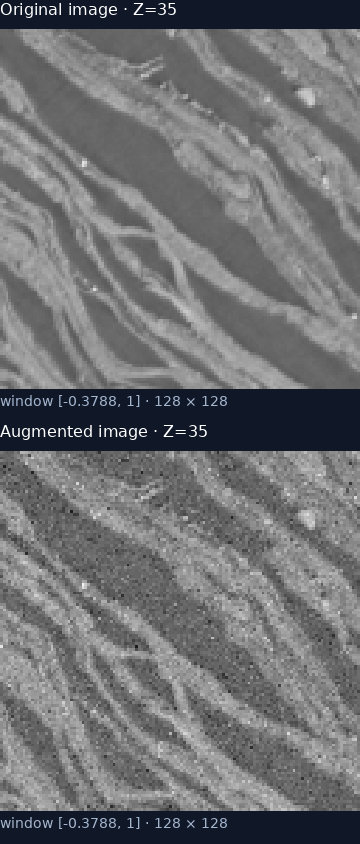](docs/augmentations/previews/AdditiveNoise-z.webp) | [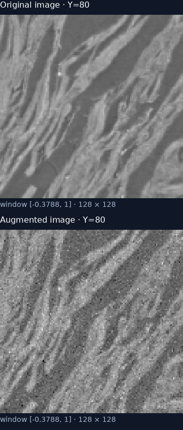](docs/augmentations/previews/AdditiveNoise-y.webp) | [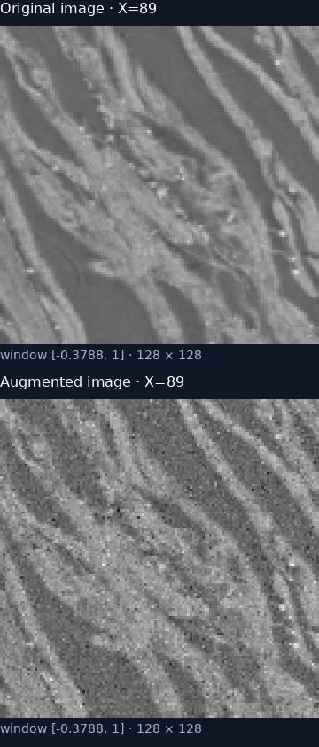](docs/augmentations/previews/AdditiveNoise-x.webp) |

</details>

<details>
<summary><strong>Affine</strong></summary>

Rotate, translate and scale the volume, applying the same geometry to images and labels.

```python
A.Affine(degrees=5, translate=2, scale=0.95)
```

| CPU | CUDA uploaded | CUDA resident | Uploaded speedup | Resident speedup |
| ---: | ---: | ---: | ---: | ---: |
| 68.183 ms | 6.039 ms | 0.608 ms | 11.3× | 112.1× |

| Z slice · YX plane | Y slice · ZX plane | X slice · ZY plane |
| :---: | :---: | :---: |
| [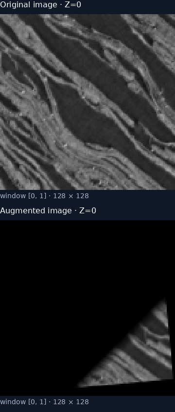](docs/augmentations/previews/Affine-z.webp) | [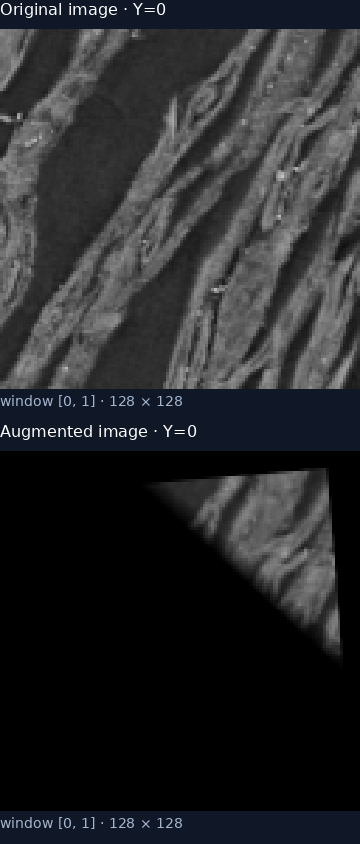](docs/augmentations/previews/Affine-y.webp) | [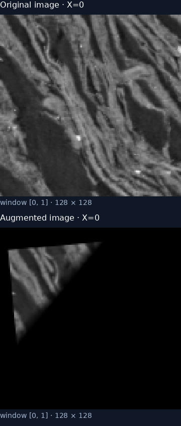](docs/augmentations/previews/Affine-x.webp) |

</details>

<details>
<summary><strong>BiasField</strong></summary>

Multiply intensities by a smooth 3D gain field generated from a coarse Gaussian random lattice.

```python
A.BiasField(std=0.3, scale=0.025)
```

| CPU | CUDA uploaded | CUDA resident | Uploaded speedup | Resident speedup |
| ---: | ---: | ---: | ---: | ---: |
| 11.655 ms | 1.442 ms | 0.323 ms | 8.1× | 36.1× |

| Z slice · YX plane | Y slice · ZX plane | X slice · ZY plane |
| :---: | :---: | :---: |
| [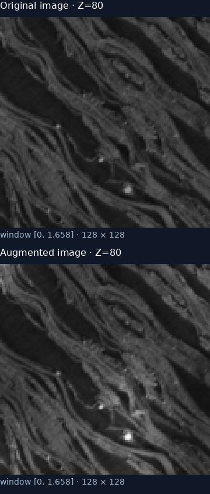](docs/augmentations/previews/BiasField-z.webp) | [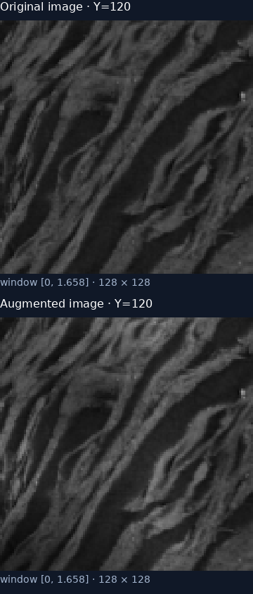](docs/augmentations/previews/BiasField-y.webp) | [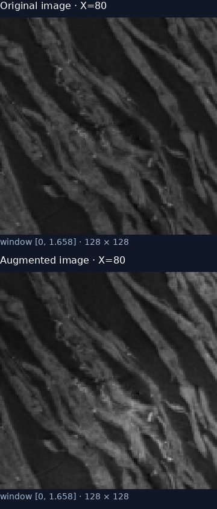](docs/augmentations/previews/BiasField-x.webp) |

</details>

<details>
<summary><strong>BlankRectangle</strong></summary>

Fill randomly placed cuboids with a chosen value, simulating missing regions.

```python
A.BlankRectangle(size=16, value=0, count=3)
```

| CPU | CUDA uploaded | CUDA resident | Uploaded speedup | Resident speedup |
| ---: | ---: | ---: | ---: | ---: |
| 0.797 ms | 1.205 ms | 0.111 ms | 0.7× | 7.2× |

| Z slice · YX plane | Y slice · ZX plane | X slice · ZY plane |
| :---: | :---: | :---: |
| [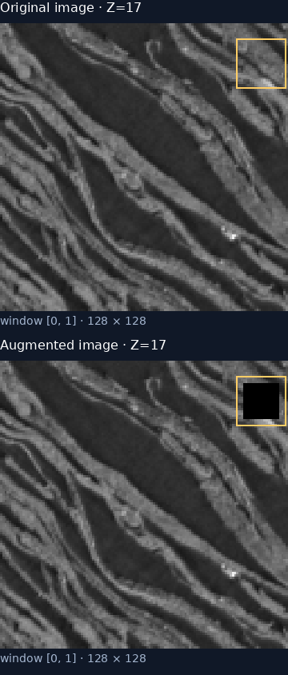](docs/augmentations/previews/BlankRectangle-z.webp) | [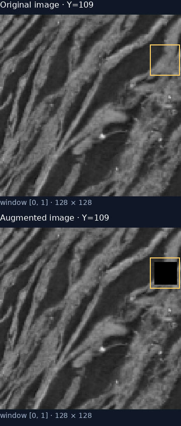](docs/augmentations/previews/BlankRectangle-y.webp) | [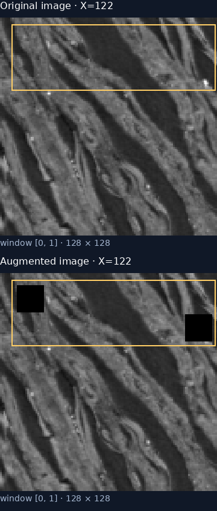](docs/augmentations/previews/BlankRectangle-x.webp) |

</details>

<details>
<summary><strong>BrightnessAdd</strong></summary>

Add a constant offset to every voxel in the selected image channels.

```python
A.BrightnessAdd(shift=0.1)
```

| CPU | CUDA uploaded | CUDA resident | Uploaded speedup | Resident speedup |
| ---: | ---: | ---: | ---: | ---: |
| 1.650 ms | 1.329 ms | 0.158 ms | 1.2× | 10.4× |

| Z slice · YX plane | Y slice · ZX plane | X slice · ZY plane |
| :---: | :---: | :---: |
| [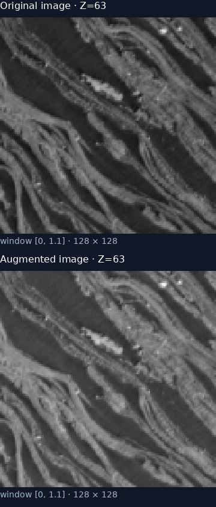](docs/augmentations/previews/BrightnessAdd-z.webp) | [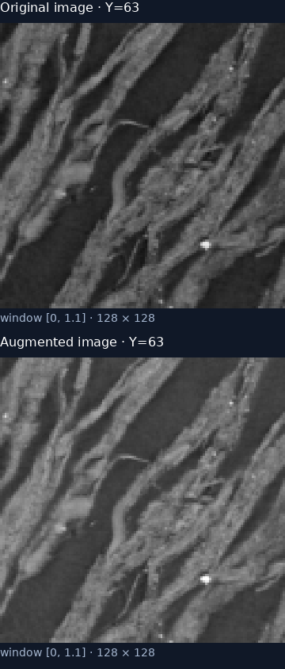](docs/augmentations/previews/BrightnessAdd-y.webp) | [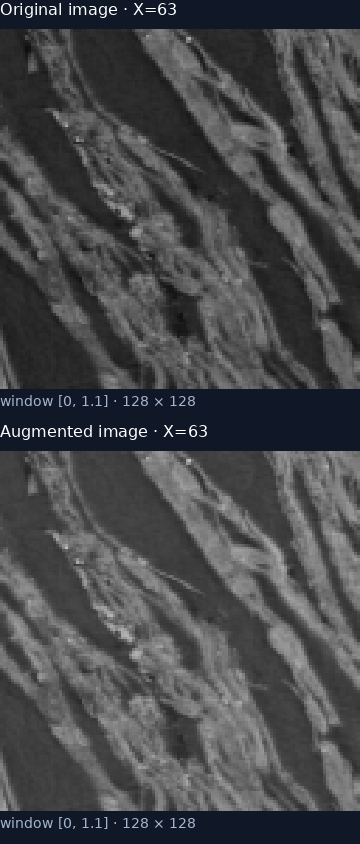](docs/augmentations/previews/BrightnessAdd-x.webp) |

</details>

<details>
<summary><strong>BrightnessGradient</strong></summary>

Add a localized Gaussian brightness field. This example fixes its center at the middle of the volume; `loc=(0, 1)` samples a random position. The field is mean-centered by default.

```python
A.BrightnessGradient(scale=12, loc=0.5, strength=0.3)
```

| CPU | CUDA uploaded | CUDA resident | Uploaded speedup | Resident speedup |
| ---: | ---: | ---: | ---: | ---: |
| 2.587 ms | 1.380 ms | 0.184 ms | 1.9× | 14.1× |

| Z slice · YX plane | Y slice · ZX plane | X slice · ZY plane |
| :---: | :---: | :---: |
| [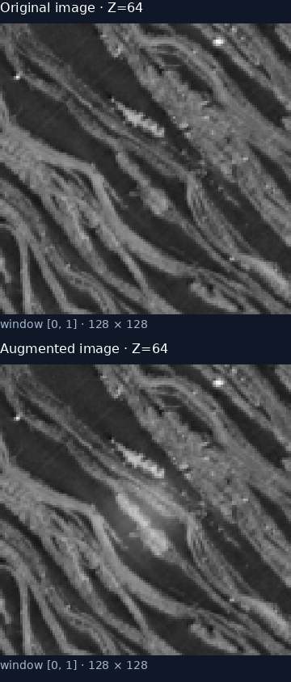](docs/augmentations/previews/BrightnessGradient-z.webp) | [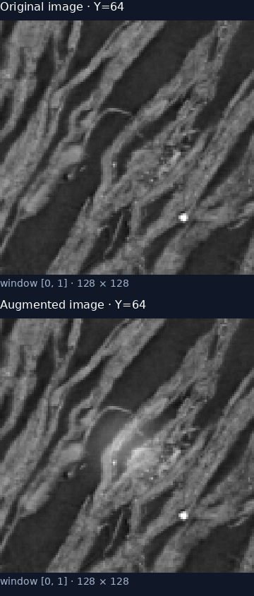](docs/augmentations/previews/BrightnessGradient-y.webp) | [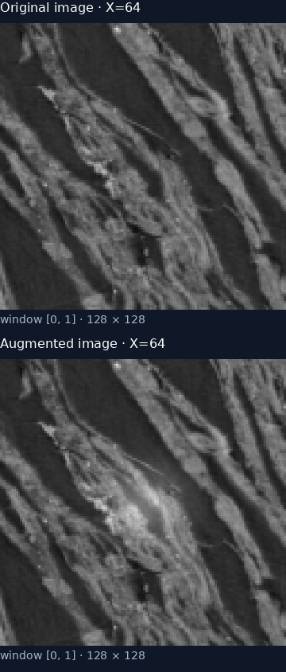](docs/augmentations/previews/BrightnessGradient-x.webp) |

</details>

<details>
<summary><strong>BrightnessMultiply</strong></summary>

Multiply every voxel in the selected image channels by a brightness factor.

```python
A.BrightnessMultiply(factor=1.1)
```

| CPU | CUDA uploaded | CUDA resident | Uploaded speedup | Resident speedup |
| ---: | ---: | ---: | ---: | ---: |
| 1.632 ms | 1.359 ms | 0.119 ms | 1.2× | 13.7× |

| Z slice · YX plane | Y slice · ZX plane | X slice · ZY plane |
| :---: | :---: | :---: |
| [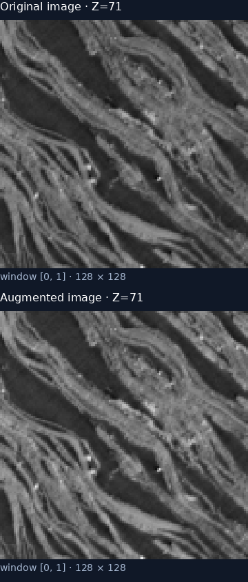](docs/augmentations/previews/BrightnessMultiply-z.webp) | [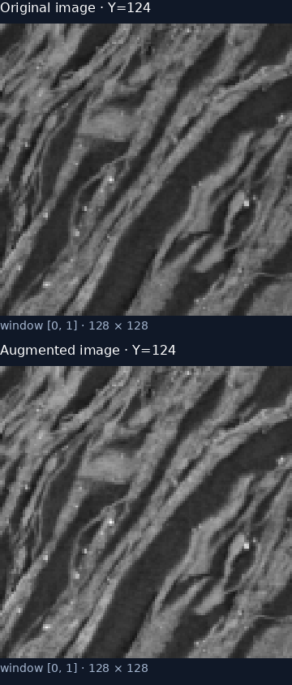](docs/augmentations/previews/BrightnessMultiply-y.webp) | [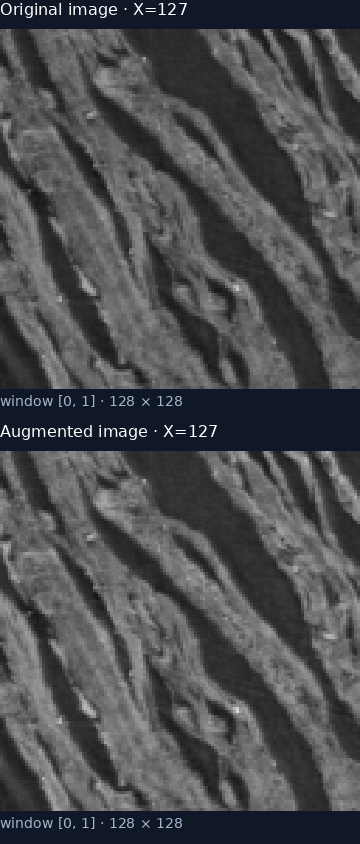](docs/augmentations/previews/BrightnessMultiply-x.webp) |

</details>

<details>
<summary><strong>ChannelMisalignment</strong></summary>

Independently shift, rotate and scale selected image channels to simulate registration errors. This example moves the second of two identical CT channels.

```python
A.ChannelMisalignment(degrees=5, translate=2, scale=1, channels=(1,))
```

| CPU | CUDA uploaded | CUDA resident | Uploaded speedup | Resident speedup |
| ---: | ---: | ---: | ---: | ---: |
| 46.855 ms | 2.591 ms | 0.252 ms | 18.1× | 186.2× |

| Z slice · YX plane | Y slice · ZX plane | X slice · ZY plane |
| :---: | :---: | :---: |
| [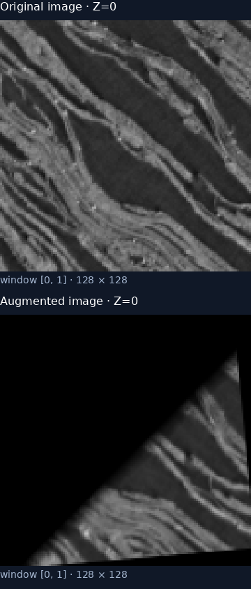](docs/augmentations/previews/ChannelMisalignment-z.webp) | [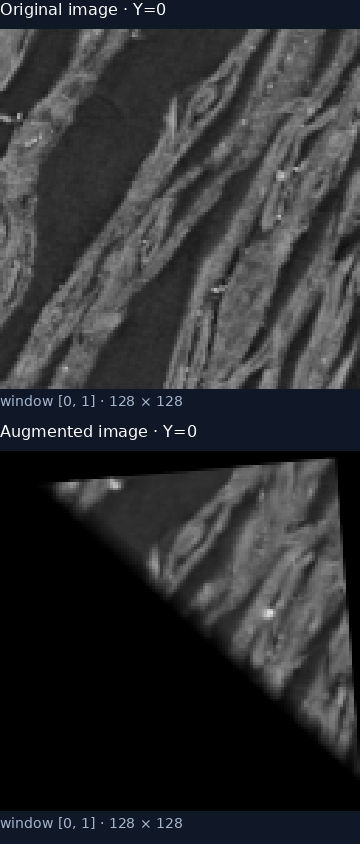](docs/augmentations/previews/ChannelMisalignment-y.webp) | [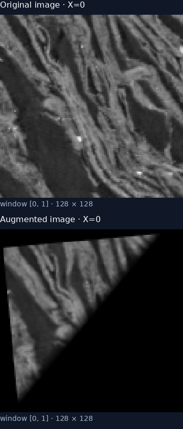](docs/augmentations/previews/ChannelMisalignment-x.webp) |

Two input channels (second is a copy of the CT); only channel 1 moves. Both channels are included in timing.

</details>

<details>
<summary><strong>CLAHE</strong></summary>

Equalize local histograms in 3D tiles, limit their contrast, and interpolate between neighboring tiles to avoid seams.

```python
A.CLAHE(clip_limit=2, tile_shape=(16, 16, 16), bins=256)
```

| CPU | CUDA uploaded | CUDA resident | Uploaded speedup | Resident speedup |
| ---: | ---: | ---: | ---: | ---: |
| 52.663 ms | 1.712 ms | 0.549 ms | 30.8× | 96.0× |

| Z slice · YX plane | Y slice · ZX plane | X slice · ZY plane |
| :---: | :---: | :---: |
| [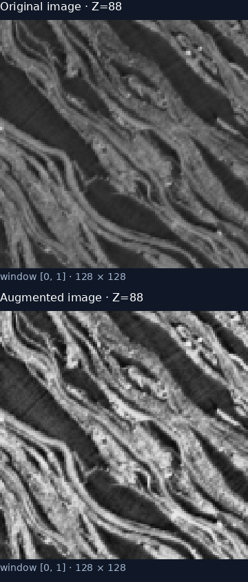](docs/augmentations/previews/CLAHE-z.webp) | [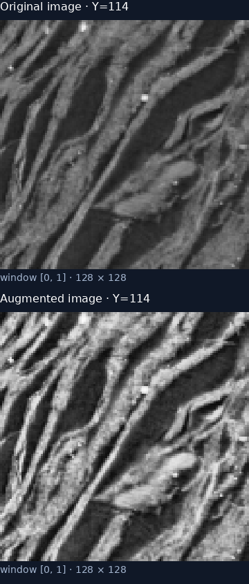](docs/augmentations/previews/CLAHE-y.webp) | [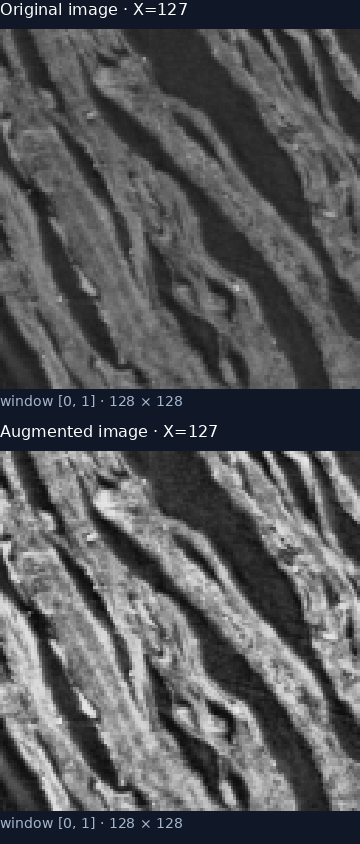](docs/augmentations/previews/CLAHE-x.webp) |

</details>

<details>
<summary><strong>ClipOutliers</strong></summary>

Clip intensities at selected percentiles. This example then restores the original standard deviation.

```python
A.ClipOutliers(lower=1, upper=99, p_retain_std=1)
```

| CPU | CUDA uploaded | CUDA resident | Uploaded speedup | Resident speedup |
| ---: | ---: | ---: | ---: | ---: |
| 21.853 ms | 1.757 ms | 0.532 ms | 12.4× | 41.1× |

| Z slice · YX plane | Y slice · ZX plane | X slice · ZY plane |
| :---: | :---: | :---: |
| [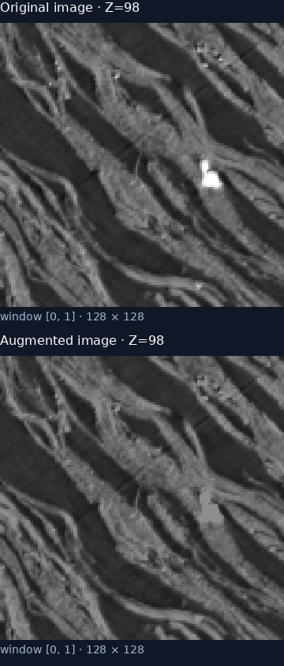](docs/augmentations/previews/ClipOutliers-z.webp) | [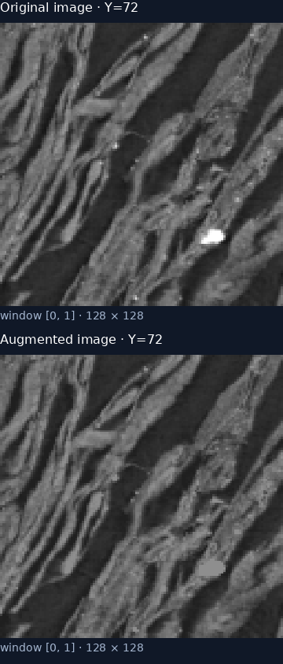](docs/augmentations/previews/ClipOutliers-y.webp) | [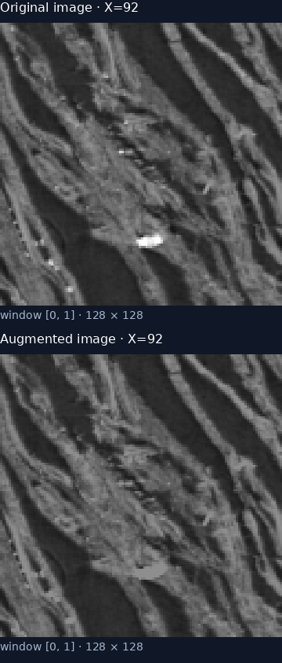](docs/augmentations/previews/ClipOutliers-x.webp) |

</details>

<details>
<summary><strong>Contrast</strong></summary>

Scale intensity differences from the channel mean. The default range-preservation option clips results to the original range.

```python
A.Contrast(factor=1.2)
```

| CPU | CUDA uploaded | CUDA resident | Uploaded speedup | Resident speedup |
| ---: | ---: | ---: | ---: | ---: |
| 5.635 ms | 1.297 ms | 0.133 ms | 4.3× | 42.3× |

| Z slice · YX plane | Y slice · ZX plane | X slice · ZY plane |
| :---: | :---: | :---: |
| [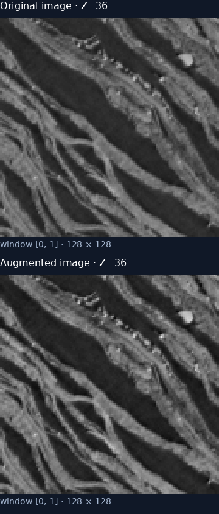](docs/augmentations/previews/Contrast-z.webp) | [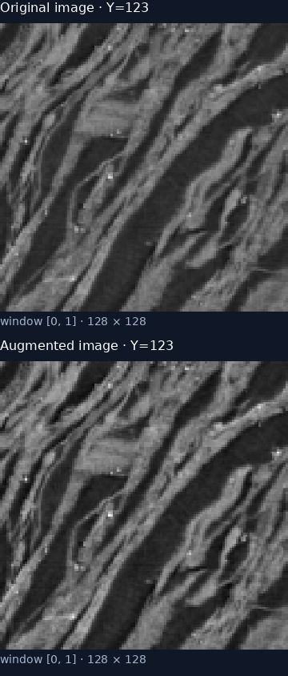](docs/augmentations/previews/Contrast-y.webp) | [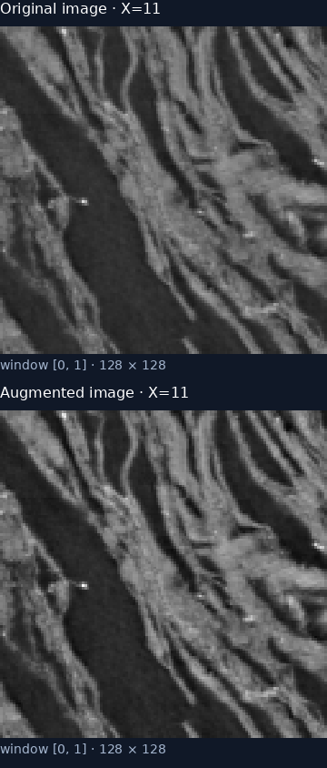](docs/augmentations/previews/Contrast-x.webp) |

</details>

<details>
<summary><strong>CropPad</strong></summary>

Crop or pad all aligned targets to a requested ZYX shape. This example takes a centered 112³ crop from the 128³ input.

```python
A.CropPad(shape=(112, 112, 112))
```

| CPU | CUDA uploaded | CUDA resident | Uploaded speedup | Resident speedup |
| ---: | ---: | ---: | ---: | ---: |
| 0.911 ms | 1.932 ms | 0.369 ms | 0.5× | 2.5× |

| Z slice · YX plane | Y slice · ZX plane | X slice · ZY plane |
| :---: | :---: | :---: |
| [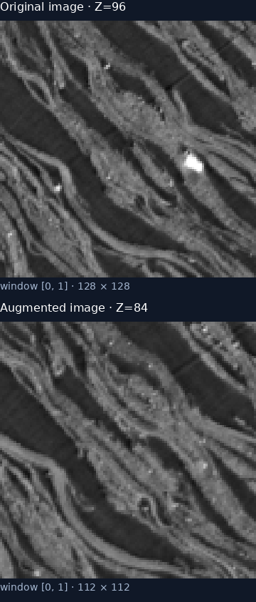](docs/augmentations/previews/CropPad-z.webp) | [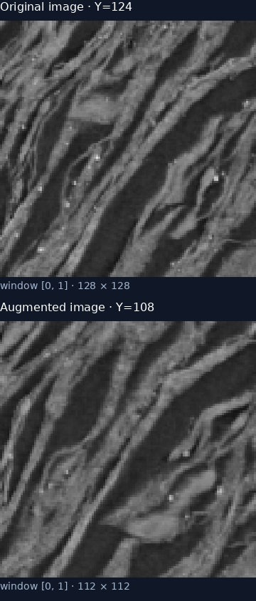](docs/augmentations/previews/CropPad-y.webp) | [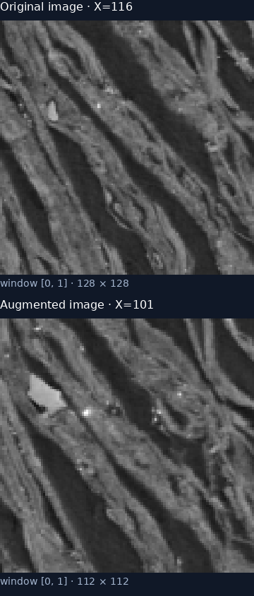](docs/augmentations/previews/CropPad-x.webp) |

</details>

<details>
<summary><strong>Defocus</strong></summary>

Average intensities within a spherical 3D neighborhood to simulate out-of-focus acquisition.

```python
A.Defocus(radius=2)
```

| CPU | CUDA uploaded | CUDA resident | Uploaded speedup | Resident speedup |
| ---: | ---: | ---: | ---: | ---: |
| 9.619 ms | 1.944 ms | 0.776 ms | 4.9× | 12.4× |

| Z slice · YX plane | Y slice · ZX plane | X slice · ZY plane |
| :---: | :---: | :---: |
| [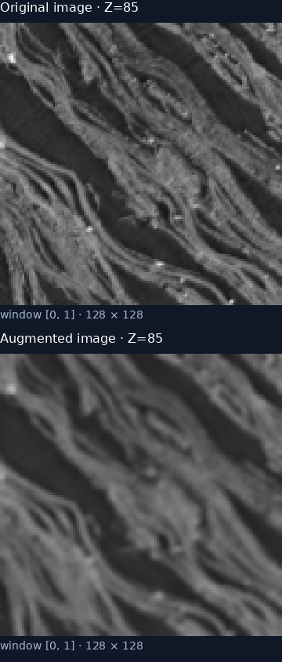](docs/augmentations/previews/Defocus-z.webp) | [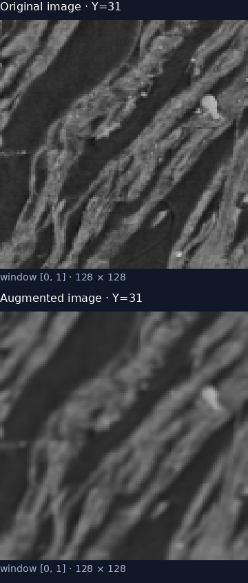](docs/augmentations/previews/Defocus-y.webp) | [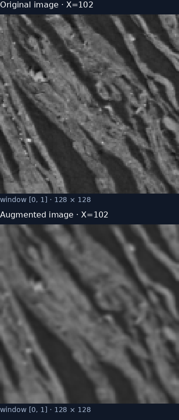](docs/augmentations/previews/Defocus-x.webp) |

</details>

<details>
<summary><strong>Elastic</strong></summary>

Warp the volume with a smooth random 3D B-spline displacement field, keeping images and labels aligned. The previews use interior slices so boundary padding does not dominate the view.

```python
A.Elastic(sigma=32, magnitude=8, border=True)
```

CPU and CUDA construct and store elastic fields in float32. Ordinary crop
geometry also uses float32, with wider arithmetic where coordinate range or
numerical conditioning requires it. Output dtypes are preserved. Small
coordinate differences can select a neighboring label at a nearest-neighbor
boundary. New replay plans use float32 fields; old plans must be regenerated.
See the [precision policy](docs/precision.md) and
[geometry optimization measurements](benchmarks/README.md#cuda-geometry-optimizations).

| CPU | CUDA uploaded | CUDA resident | Uploaded speedup | Resident speedup |
| ---: | ---: | ---: | ---: | ---: |
| 85.995 ms | 2.536 ms | 0.696 ms | 33.9× | 123.6× |

[▶ Watch Elastic animation (WebM)](docs/augmentations/animations/Elastic.webm)

Strong cubic B-spline deformation: original → deformed → original. Fixed Z/Y/X slices, seed 125, achieved RMS 5.36 voxels.

[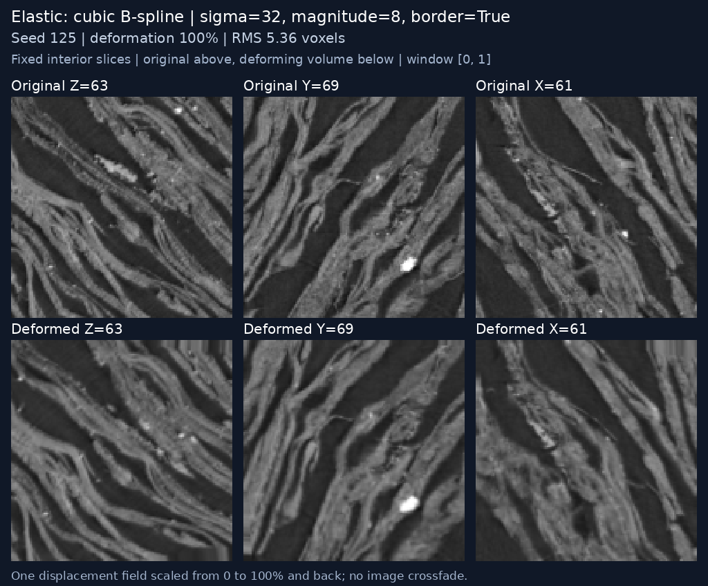](docs/augmentations/animations/Elastic.webm)

| Z slice · YX plane | Y slice · ZX plane | X slice · ZY plane |
| :---: | :---: | :---: |
| [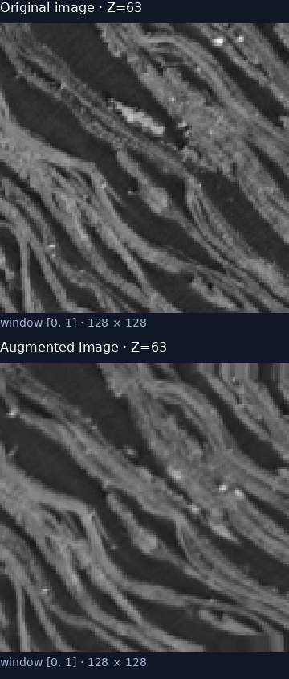](docs/augmentations/previews/Elastic-z.webp) | [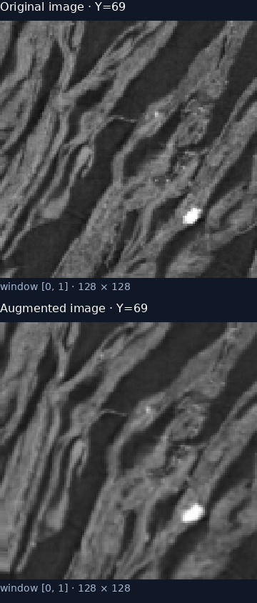](docs/augmentations/previews/Elastic-y.webp) | [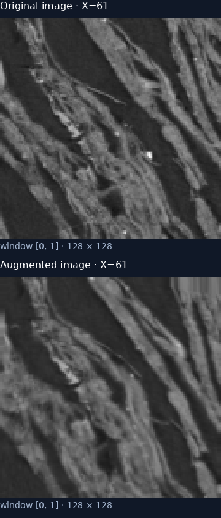](docs/augmentations/previews/Elastic-x.webp) |

Strong cubic B-spline example: 64-voxel knot spacing, requested RMS displacement 8 voxels, with border clamping.

</details>

<details>
<summary><strong>Equalize</strong></summary>

Equalize the histogram across the entire volume while retaining the channel intensity range.

```python
A.Equalize(bins=256)
```

| CPU | CUDA uploaded | CUDA resident | Uploaded speedup | Resident speedup |
| ---: | ---: | ---: | ---: | ---: |
| 19.669 ms | 1.588 ms | 0.369 ms | 12.4× | 53.4× |

| Z slice · YX plane | Y slice · ZX plane | X slice · ZY plane |
| :---: | :---: | :---: |
| [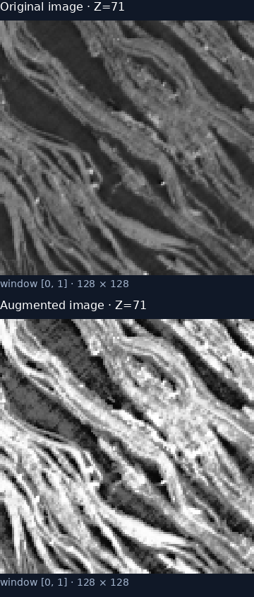](docs/augmentations/previews/Equalize-z.webp) | [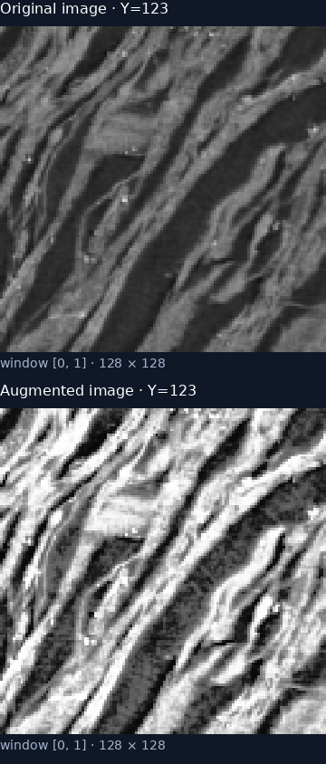](docs/augmentations/previews/Equalize-y.webp) | [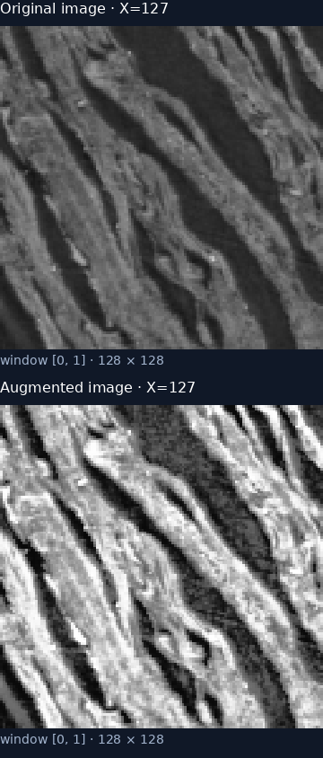](docs/augmentations/previews/Equalize-x.webp) |

</details>

<details>
<summary><strong>FDA</strong></summary>

Blend low-frequency amplitudes from a reference volume into the 3D Fourier spectrum while preserving the source phase.

```python
A.FDA(reference=reference, blend=1, fraction=0.1)
```

| CPU | CUDA uploaded | CUDA resident | Uploaded speedup | Resident speedup |
| ---: | ---: | ---: | ---: | ---: |
| 613.754 ms | 3.463 ms | 2.119 ms | 177.2× | 289.6× |

| Z slice · YX plane | Y slice · ZX plane | X slice · ZY plane |
| :---: | :---: | :---: |
| [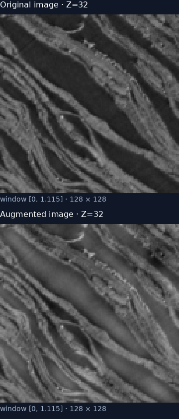](docs/augmentations/previews/FDA-z.webp) | [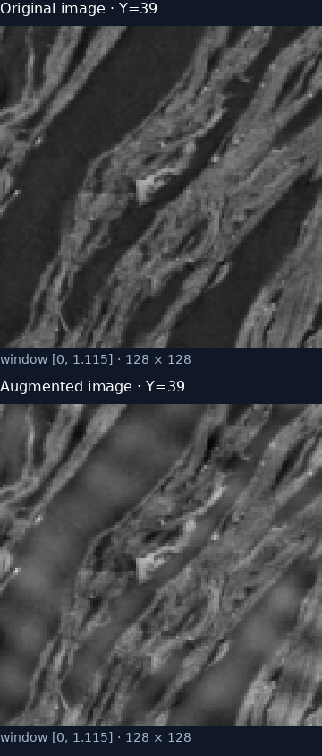](docs/augmentations/previews/FDA-y.webp) | [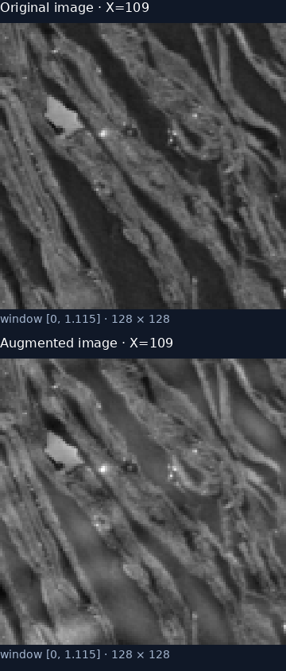](docs/augmentations/previews/FDA-x.webp) |

</details>

<details>
<summary><strong>Flip</strong></summary>

Mirror the volume along selected axes. This example always flips X.

```python
A.Flip(axes='x', p_axis=1)
```

| CPU | CUDA uploaded | CUDA resident | Uploaded speedup | Resident speedup |
| ---: | ---: | ---: | ---: | ---: |
| 1.425 ms | 1.869 ms | 0.323 ms | 0.8× | 4.4× |

| Z slice · YX plane | Y slice · ZX plane | X slice · ZY plane |
| :---: | :---: | :---: |
| [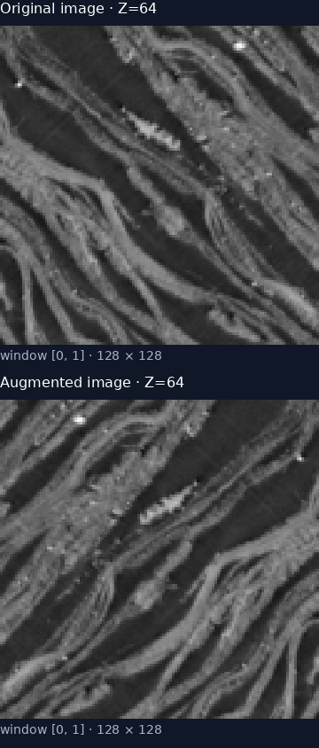](docs/augmentations/previews/Flip-z.webp) | [](docs/augmentations/previews/Flip-y.webp) | [](docs/augmentations/previews/Flip-x.webp) |

</details>

<details>
<summary><strong>ForegroundCrop</strong></summary>

Choose a random crop containing a sampled foreground voxel. All aligned targets follow the crop; empty masks fall back to random cropping.

```python
A.ForegroundCrop(shape=(112, 112, 112))
```

| CPU | CUDA uploaded | CUDA resident | Uploaded speedup | Resident speedup |
| ---: | ---: | ---: | ---: | ---: |
| 2.387 ms | 2.059 ms | 0.531 ms | 1.2× | 4.5× |

| Z slice · YX plane | Y slice · ZX plane | X slice · ZY plane |
| :---: | :---: | :---: |
| [](docs/augmentations/previews/ForegroundCrop-z.webp) | [](docs/augmentations/previews/ForegroundCrop-y.webp) | [](docs/augmentations/previews/ForegroundCrop-x.webp) |

</details>

<details>
<summary><strong>ForegroundDropout</strong></summary>

Place cuboids around sampled foreground voxels and erase only foreground inside those cuboids.

```python
A.ForegroundDropout(size=(16, 16, 16), count=3)
```

| CPU | CUDA uploaded | CUDA resident | Uploaded speedup | Resident speedup |
| ---: | ---: | ---: | ---: | ---: |
| 6.501 ms | 1.885 ms | 0.452 ms | 3.4× | 14.4× |

| Z slice · YX plane | Y slice · ZX plane | X slice · ZY plane |
| :---: | :---: | :---: |
| [](docs/augmentations/previews/ForegroundDropout-z.webp) | [](docs/augmentations/previews/ForegroundDropout-y.webp) | [](docs/augmentations/previews/ForegroundDropout-x.webp) |

</details>

<details>
<summary><strong>Gamma</strong></summary>

Apply a power-law intensity curve over the channel range, changing the relative brightness of dark and light structures.

```python
A.Gamma(gamma=0.8)
```

| CPU | CUDA uploaded | CUDA resident | Uploaded speedup | Resident speedup |
| ---: | ---: | ---: | ---: | ---: |
| 8.660 ms | 1.420 ms | 0.133 ms | 6.1× | 65.1× |

| Z slice · YX plane | Y slice · ZX plane | X slice · ZY plane |
| :---: | :---: | :---: |
| [](docs/augmentations/previews/Gamma-z.webp) | [](docs/augmentations/previews/Gamma-y.webp) | [](docs/augmentations/previews/Gamma-x.webp) |

</details>

<details>
<summary><strong>GaussianBlur</strong></summary>

Smooth the volume with a separable 3D Gaussian filter.

```python
A.GaussianBlur(sigma=1)
```

| CPU | CUDA uploaded | CUDA resident | Uploaded speedup | Resident speedup |
| ---: | ---: | ---: | ---: | ---: |
| 6.254 ms | 1.412 ms | 0.229 ms | 4.4× | 27.4× |

| Z slice · YX plane | Y slice · ZX plane | X slice · ZY plane |
| :---: | :---: | :---: |
| [](docs/augmentations/previews/GaussianBlur-z.webp) | [](docs/augmentations/previews/GaussianBlur-y.webp) | [](docs/augmentations/previews/GaussianBlur-x.webp) |

</details>

<details>
<summary><strong>GaussianNoise</strong></summary>

Add independent zero-mean Gaussian noise with the specified standard deviation.

```python
A.GaussianNoise(std=0.05)
```

| CPU | CUDA uploaded | CUDA resident | Uploaded speedup | Resident speedup |
| ---: | ---: | ---: | ---: | ---: |
| 9.104 ms | 1.255 ms | 0.125 ms | 7.3× | 73.0× |

| Z slice · YX plane | Y slice · ZX plane | X slice · ZY plane |
| :---: | :---: | :---: |
| [](docs/augmentations/previews/GaussianNoise-z.webp) | [](docs/augmentations/previews/GaussianNoise-y.webp) | [](docs/augmentations/previews/GaussianNoise-x.webp) |

</details>

<details>
<summary><strong>GibbsRinging</strong></summary>

Truncate high frequencies in the 3D Fourier spectrum, creating ringing around sharp boundaries.

```python
A.GibbsRinging(cutoff=0.7)
```

| CPU | CUDA uploaded | CUDA resident | Uploaded speedup | Resident speedup |
| ---: | ---: | ---: | ---: | ---: |
| 425.044 ms | 1.617 ms | 0.485 ms | 262.9× | 875.9× |

| Z slice · YX plane | Y slice · ZX plane | X slice · ZY plane |
| :---: | :---: | :---: |
| [](docs/augmentations/previews/GibbsRinging-z.webp) | [](docs/augmentations/previews/GibbsRinging-y.webp) | [](docs/augmentations/previews/GibbsRinging-x.webp) |

</details>

<details>
<summary><strong>GridDropout</strong></summary>

Erase a periodic grid of cuboid holes with a randomly sampled offset.

```python
A.GridDropout(unit_size=(16, 16, 16), ratio=0.4)
```

| CPU | CUDA uploaded | CUDA resident | Uploaded speedup | Resident speedup |
| ---: | ---: | ---: | ---: | ---: |
| 39.059 ms | 1.297 ms | 0.146 ms | 30.1× | 267.9× |

| Z slice · YX plane | Y slice · ZX plane | X slice · ZY plane |
| :---: | :---: | :---: |
| [](docs/augmentations/previews/GridDropout-z.webp) | [](docs/augmentations/previews/GridDropout-y.webp) | [](docs/augmentations/previews/GridDropout-x.webp) |

</details>

<details>
<summary><strong>HistogramMatching</strong></summary>

Match the volume intensity histogram to a reference volume, with optional blending.

```python
A.HistogramMatching(reference=reference, blend=1, bins=256)
```

| CPU | CUDA uploaded | CUDA resident | Uploaded speedup | Resident speedup |
| ---: | ---: | ---: | ---: | ---: |
| 86.937 ms | 3.000 ms | 1.899 ms | 29.0× | 45.8× |

| Z slice · YX plane | Y slice · ZX plane | X slice · ZY plane |
| :---: | :---: | :---: |
| [](docs/augmentations/previews/HistogramMatching-z.webp) | [](docs/augmentations/previews/HistogramMatching-y.webp) | [](docs/augmentations/previews/HistogramMatching-x.webp) |

</details>

<details>
<summary><strong>Illumination</strong></summary>

Apply a smooth multiplicative illumination field. Supports directional ramps, corner falloff and Gaussian illumination; this example uses a diagonal ramp.

```python
A.Illumination(strength=0.3, mode='linear', direction=(1, 1, 1))
```

| CPU | CUDA uploaded | CUDA resident | Uploaded speedup | Resident speedup |
| ---: | ---: | ---: | ---: | ---: |
| 28.240 ms | 1.355 ms | 0.201 ms | 20.8× | 140.3× |

| Z slice · YX plane | Y slice · ZX plane | X slice · ZY plane |
| :---: | :---: | :---: |
| [](docs/augmentations/previews/Illumination-z.webp) | [](docs/augmentations/previews/Illumination-y.webp) | [](docs/augmentations/previews/Illumination-x.webp) |

</details>

<details>
<summary><strong>Invert</strong></summary>

Reflect intensities around the channel mean, reversing bright and dark structures.

```python
A.Invert()
```

| CPU | CUDA uploaded | CUDA resident | Uploaded speedup | Resident speedup |
| ---: | ---: | ---: | ---: | ---: |
| 2.582 ms | 1.389 ms | 0.178 ms | 1.9× | 14.5× |

| Z slice · YX plane | Y slice · ZX plane | X slice · ZY plane |
| :---: | :---: | :---: |
| [](docs/augmentations/previews/Invert-z.webp) | [](docs/augmentations/previews/Invert-y.webp) | [](docs/augmentations/previews/Invert-x.webp) |

</details>

<details>
<summary><strong>LocalContrast</strong></summary>

Change contrast around a Gaussian-weighted local mean inside a smooth region.

```python
A.LocalContrast(scale=12, loc=0.5, factor=1.2)
```

| CPU | CUDA uploaded | CUDA resident | Uploaded speedup | Resident speedup |
| ---: | ---: | ---: | ---: | ---: |
| 4.167 ms | 1.297 ms | 0.171 ms | 3.2× | 24.4× |

| Z slice · YX plane | Y slice · ZX plane | X slice · ZY plane |
| :---: | :---: | :---: |
| [](docs/augmentations/previews/LocalContrast-z.webp) | [](docs/augmentations/previews/LocalContrast-y.webp) | [](docs/augmentations/previews/LocalContrast-x.webp) |

</details>

<details>
<summary><strong>LocalGamma</strong></summary>

Blend a gamma-adjusted image into a localized Gaussian region.

```python
A.LocalGamma(scale=12, loc=0.5, gamma=0.8)
```

| CPU | CUDA uploaded | CUDA resident | Uploaded speedup | Resident speedup |
| ---: | ---: | ---: | ---: | ---: |
| 12.362 ms | 1.308 ms | 0.161 ms | 9.5× | 76.6× |

| Z slice · YX plane | Y slice · ZX plane | X slice · ZY plane |
| :---: | :---: | :---: |
| [](docs/augmentations/previews/LocalGamma-z.webp) | [](docs/augmentations/previews/LocalGamma-y.webp) | [](docs/augmentations/previews/LocalGamma-x.webp) |

</details>

<details>
<summary><strong>LocalSmoothing</strong></summary>

Blend Gaussian smoothing into a localized region, leaving distant voxels largely unchanged.

```python
A.LocalSmoothing(scale=12, loc=0.5, strength=0.7, sigma=1)
```

| CPU | CUDA uploaded | CUDA resident | Uploaded speedup | Resident speedup |
| ---: | ---: | ---: | ---: | ---: |
| 7.336 ms | 1.695 ms | 0.414 ms | 4.3× | 17.7× |

| Z slice · YX plane | Y slice · ZX plane | X slice · ZY plane |
| :---: | :---: | :---: |
| [](docs/augmentations/previews/LocalSmoothing-z.webp) | [](docs/augmentations/previews/LocalSmoothing-y.webp) | [](docs/augmentations/previews/LocalSmoothing-x.webp) |

</details>

<details>
<summary><strong>LowResolution</strong></summary>

Downsample and upsample the image to simulate reduced spatial resolution.

```python
A.LowResolution(scale=0.5)
```

| CPU | CUDA uploaded | CUDA resident | Uploaded speedup | Resident speedup |
| ---: | ---: | ---: | ---: | ---: |
| 6.298 ms | 1.284 ms | 0.127 ms | 4.9× | 49.6× |

| Z slice · YX plane | Y slice · ZX plane | X slice · ZY plane |
| :---: | :---: | :---: |
| [](docs/augmentations/previews/LowResolution-z.webp) | [](docs/augmentations/previews/LowResolution-y.webp) | [](docs/augmentations/previews/LowResolution-x.webp) |

</details>

<details>
<summary><strong>MedianFilter</strong></summary>

Replace each voxel with the median of its 3D neighborhood, suppressing isolated noise while retaining edges.

```python
A.MedianFilter(size=3)
```

| CPU | CUDA uploaded | CUDA resident | Uploaded speedup | Resident speedup |
| ---: | ---: | ---: | ---: | ---: |
| 15.783 ms | 1.310 ms | 0.149 ms | 12.1× | 105.9× |

| Z slice · YX plane | Y slice · ZX plane | X slice · ZY plane |
| :---: | :---: | :---: |
| [](docs/augmentations/previews/MedianFilter-z.webp) | [](docs/augmentations/previews/MedianFilter-y.webp) | [](docs/augmentations/previews/MedianFilter-x.webp) |

</details>

<details>
<summary><strong>Morphology</strong></summary>

Apply a morphological operation to labels. This example closes small gaps using dilation followed by erosion.

```python
A.Morphology(operation='close', radius=1)
```

| CPU | CUDA uploaded | CUDA resident | Uploaded speedup | Resident speedup |
| ---: | ---: | ---: | ---: | ---: |
| 12.452 ms | 0.732 ms | 0.312 ms | 17.0× | 39.9× |

| Z slice · YX plane | Y slice · ZX plane | X slice · ZY plane |
| :---: | :---: | :---: |
| [](docs/augmentations/previews/Morphology-z.webp) | [](docs/augmentations/previews/Morphology-y.webp) | [](docs/augmentations/previews/Morphology-x.webp) |

</details>

<details>
<summary><strong>MotionBlur</strong></summary>

Average samples along a 3D line to simulate motion during acquisition.

```python
A.MotionBlur(length=5, direction=(1, 1, 1), samples=9)
```

| CPU | CUDA uploaded | CUDA resident | Uploaded speedup | Resident speedup |
| ---: | ---: | ---: | ---: | ---: |
| 240.809 ms | 2.594 ms | 1.356 ms | 92.8× | 177.6× |

| Z slice · YX plane | Y slice · ZX plane | X slice · ZY plane |
| :---: | :---: | :---: |
| [](docs/augmentations/previews/MotionBlur-z.webp) | [](docs/augmentations/previews/MotionBlur-y.webp) | [](docs/augmentations/previews/MotionBlur-x.webp) |

</details>

<details>
<summary><strong>MultiplicativeNoise</strong></summary>

Multiply each voxel by an independently sampled uniform random gain.

```python
A.MultiplicativeNoise(low=0.8, high=1.2)
```

| CPU | CUDA uploaded | CUDA resident | Uploaded speedup | Resident speedup |
| ---: | ---: | ---: | ---: | ---: |
| 8.368 ms | 1.310 ms | 0.149 ms | 6.4× | 56.3× |

| Z slice · YX plane | Y slice · ZX plane | X slice · ZY plane |
| :---: | :---: | :---: |
| [](docs/augmentations/previews/MultiplicativeNoise-z.webp) | [](docs/augmentations/previews/MultiplicativeNoise-y.webp) | [](docs/augmentations/previews/MultiplicativeNoise-x.webp) |

</details>

<details>
<summary><strong>Normalize</strong></summary>

Normalize intensities per channel. This example uses z-score normalization of nonzero voxels, keeping zeros unchanged; its display window includes negative values.

```python
A.Normalize(mode='zscore')
```

| CPU | CUDA uploaded | CUDA resident | Uploaded speedup | Resident speedup |
| ---: | ---: | ---: | ---: | ---: |
| 6.726 ms | 1.347 ms | 0.245 ms | 5.0× | 27.5× |

| Z slice · YX plane | Y slice · ZX plane | X slice · ZY plane |
| :---: | :---: | :---: |
| [](docs/augmentations/previews/Normalize-z.webp) | [](docs/augmentations/previews/Normalize-y.webp) | [](docs/augmentations/previews/Normalize-x.webp) |

</details>

<details>
<summary><strong>ObjectDropout</strong></summary>

Randomly remove whole connected foreground objects, clearing their image voxels and labels by default.

```python
A.ObjectDropout(drop_probability=0.5)
```

| CPU | CUDA uploaded | CUDA resident | Uploaded speedup | Resident speedup |
| ---: | ---: | ---: | ---: | ---: |
| 13.619 ms | 2.345 ms | 0.509 ms | 5.8× | 26.8× |

| Z slice · YX plane | Y slice · ZX plane | X slice · ZY plane |
| :---: | :---: | :---: |
| [](docs/augmentations/previews/ObjectDropout-z.webp) | [](docs/augmentations/previews/ObjectDropout-y.webp) | [](docs/augmentations/previews/ObjectDropout-x.webp) |

</details>

<details>
<summary><strong>OrientedBlur</strong></summary>

Smooth along a specified 3D direction and two perpendicular directions with separate blur widths. This example is aligned with Z.

```python
A.OrientedBlur(sigma_along=2, sigma_across=0.5, axis=(1, 0, 0))
```

| CPU | CUDA uploaded | CUDA resident | Uploaded speedup | Resident speedup |
| ---: | ---: | ---: | ---: | ---: |
| 7.649 ms | 1.874 ms | 0.719 ms | 4.1× | 10.6× |

| Z slice · YX plane | Y slice · ZX plane | X slice · ZY plane |
| :---: | :---: | :---: |
| [](docs/augmentations/previews/OrientedBlur-z.webp) | [](docs/augmentations/previews/OrientedBlur-y.webp) | [](docs/augmentations/previews/OrientedBlur-x.webp) |

</details>

<details>
<summary><strong>PixelDistributionAdaptation</strong></summary>

Transfer reference intensity statistics. The standard mode shown here blends the reference mean and standard deviation; minmax mode transfers the range.

```python
A.PixelDistributionAdaptation(reference=reference, blend=1, mode='standard')
```

| CPU | CUDA uploaded | CUDA resident | Uploaded speedup | Resident speedup |
| ---: | ---: | ---: | ---: | ---: |
| 18.454 ms | 2.614 ms | 1.448 ms | 7.1× | 12.7× |

| Z slice · YX plane | Y slice · ZX plane | X slice · ZY plane |
| :---: | :---: | :---: |
| [](docs/augmentations/previews/PixelDistributionAdaptation-z.webp) | [](docs/augmentations/previews/PixelDistributionAdaptation-y.webp) | [](docs/augmentations/previews/PixelDistributionAdaptation-x.webp) |

</details>

<details>
<summary><strong>PlasmaBrightnessContrast</strong></summary>

Use a smooth multiscale 3D random field to vary brightness and contrast throughout the volume.

```python
A.PlasmaBrightnessContrast(brightness=0.2, contrast=0.3, scale=0.025, persistence=0.5, octaves=5)
```

| CPU | CUDA uploaded | CUDA resident | Uploaded speedup | Resident speedup |
| ---: | ---: | ---: | ---: | ---: |
| 31.285 ms | 1.831 ms | 0.677 ms | 17.1× | 46.2× |

| Z slice · YX plane | Y slice · ZX plane | X slice · ZY plane |
| :---: | :---: | :---: |
| [](docs/augmentations/previews/PlasmaBrightnessContrast-z.webp) | [](docs/augmentations/previews/PlasmaBrightnessContrast-y.webp) | [](docs/augmentations/previews/PlasmaBrightnessContrast-x.webp) |

</details>

<details>
<summary><strong>PlasmaShadow</strong></summary>

Darken the volume with a smooth multiscale 3D random shadow field.

```python
A.PlasmaShadow(strength=0.5, scale=0.025, persistence=0.5, octaves=5)
```

| CPU | CUDA uploaded | CUDA resident | Uploaded speedup | Resident speedup |
| ---: | ---: | ---: | ---: | ---: |
| 25.357 ms | 1.690 ms | 0.591 ms | 15.0× | 42.9× |

| Z slice · YX plane | Y slice · ZX plane | X slice · ZY plane |
| :---: | :---: | :---: |
| [](docs/augmentations/previews/PlasmaShadow-z.webp) | [](docs/augmentations/previews/PlasmaShadow-y.webp) | [](docs/augmentations/previews/PlasmaShadow-x.webp) |

</details>

<details>
<summary><strong>RandomBinaryOperator</strong></summary>

Apply a selected binary morphological operation to image channels. This example dilates a thresholded foreground volume.

```python
A.RandomBinaryOperator(channels=(0,), radius=1, operations=('dilate',))
```

| CPU | CUDA uploaded | CUDA resident | Uploaded speedup | Resident speedup |
| ---: | ---: | ---: | ---: | ---: |
| 10.243 ms | 1.404 ms | 0.241 ms | 7.3× | 42.6× |

| Z slice · YX plane | Y slice · ZX plane | X slice · ZY plane |
| :---: | :---: | :---: |
| [](docs/augmentations/previews/RandomBinaryOperator-z.webp) | [](docs/augmentations/previews/RandomBinaryOperator-y.webp) | [](docs/augmentations/previews/RandomBinaryOperator-x.webp) |

</details>

<details>
<summary><strong>RandomToneCurve</strong></summary>

Apply a random monotone nonlinear intensity curve while preserving the channel range endpoints.

```python
A.RandomToneCurve(scale=0.1)
```

| CPU | CUDA uploaded | CUDA resident | Uploaded speedup | Resident speedup |
| ---: | ---: | ---: | ---: | ---: |
| 13.061 ms | 1.232 ms | 0.194 ms | 10.6× | 67.4× |

| Z slice · YX plane | Y slice · ZX plane | X slice · ZY plane |
| :---: | :---: | :---: |
| [](docs/augmentations/previews/RandomToneCurve-z.webp) | [](docs/augmentations/previews/RandomToneCurve-y.webp) | [](docs/augmentations/previews/RandomToneCurve-x.webp) |

</details>

<details>
<summary><strong>RemoveComponents</strong></summary>

Randomly remove connected foreground components below a size threshold. This example modifies the label mask.

```python
A.RemoveComponents(on='mask', max_fraction=0.25, p_fill=0)
```

| CPU | CUDA uploaded | CUDA resident | Uploaded speedup | Resident speedup |
| ---: | ---: | ---: | ---: | ---: |
| 20.792 ms | 1.335 ms | 0.970 ms | 15.6× | 21.4× |

| Z slice · YX plane | Y slice · ZX plane | X slice · ZY plane |
| :---: | :---: | :---: |
| [](docs/augmentations/previews/RemoveComponents-z.webp) | [](docs/augmentations/previews/RemoveComponents-y.webp) | [](docs/augmentations/previews/RemoveComponents-x.webp) |

</details>

<details>
<summary><strong>RicianNoise</strong></summary>

Combine the image with two independent Gaussian noise fields to simulate magnitude-image Rician noise.

```python
A.RicianNoise(std=0.05)
```

| CPU | CUDA uploaded | CUDA resident | Uploaded speedup | Resident speedup |
| ---: | ---: | ---: | ---: | ---: |
| 21.196 ms | 1.422 ms | 0.185 ms | 14.9× | 114.8× |

| Z slice · YX plane | Y slice · ZX plane | X slice · ZY plane |
| :---: | :---: | :---: |
| [](docs/augmentations/previews/RicianNoise-z.webp) | [](docs/augmentations/previews/RicianNoise-y.webp) | [](docs/augmentations/previews/RicianNoise-x.webp) |

</details>

<details>
<summary><strong>RingingOvershoot</strong></summary>

Apply a separable windowed-sinc filter in 3D, retaining edge overshoot and ringing.

```python
A.RingingOvershoot(cutoff=0.7, radius=4)
```

| CPU | CUDA uploaded | CUDA resident | Uploaded speedup | Resident speedup |
| ---: | ---: | ---: | ---: | ---: |
| 7.994 ms | 5.418 ms | 4.292 ms | 1.5× | 1.9× |

| Z slice · YX plane | Y slice · ZX plane | X slice · ZY plane |
| :---: | :---: | :---: |
| [](docs/augmentations/previews/RingingOvershoot-z.webp) | [](docs/augmentations/previews/RingingOvershoot-y.webp) | [](docs/augmentations/previews/RingingOvershoot-x.webp) |

</details>

<details>
<summary><strong>Rotate90</strong></summary>

Rotate aligned targets by multiples of 90 degrees. This example rotates the YX plane by one quarter turn.

```python
A.Rotate90(planes=('yx',), turns=(1,))
```

| CPU | CUDA uploaded | CUDA resident | Uploaded speedup | Resident speedup |
| ---: | ---: | ---: | ---: | ---: |
| 2.052 ms | 2.296 ms | 0.587 ms | 0.9× | 3.5× |

| Z slice · YX plane | Y slice · ZX plane | X slice · ZY plane |
| :---: | :---: | :---: |
| [](docs/augmentations/previews/Rotate90-z.webp) | [](docs/augmentations/previews/Rotate90-y.webp) | [](docs/augmentations/previews/Rotate90-x.webp) |

</details>

<details>
<summary><strong>SaltAndPepper</strong></summary>

Replace selected voxels with the channel minimum or maximum, producing dark and bright impulse noise.

```python
A.SaltAndPepper(amount=0.02, salt_fraction=0.5)
```

| CPU | CUDA uploaded | CUDA resident | Uploaded speedup | Resident speedup |
| ---: | ---: | ---: | ---: | ---: |
| 9.965 ms | 1.250 ms | 0.206 ms | 8.0× | 48.3× |

| Z slice · YX plane | Y slice · ZX plane | X slice · ZY plane |
| :---: | :---: | :---: |
| [](docs/augmentations/previews/SaltAndPepper-z.webp) | [](docs/augmentations/previews/SaltAndPepper-y.webp) | [](docs/augmentations/previews/SaltAndPepper-x.webp) |

</details>

<details>
<summary><strong>Sharpen</strong></summary>

Enhance local edges with a discrete Laplacian sharpening filter. This example keeps overshoots instead of clipping them.

```python
A.Sharpen(strength=0.25, p_clamp=0)
```

| CPU | CUDA uploaded | CUDA resident | Uploaded speedup | Resident speedup |
| ---: | ---: | ---: | ---: | ---: |
| 4.557 ms | 1.449 ms | 0.174 ms | 3.1× | 26.3× |

| Z slice · YX plane | Y slice · ZX plane | X slice · ZY plane |
| :---: | :---: | :---: |
| [](docs/augmentations/previews/Sharpen-z.webp) | [](docs/augmentations/previews/Sharpen-y.webp) | [](docs/augmentations/previews/Sharpen-x.webp) |

</details>

<details>
<summary><strong>SheetCompression</strong></summary>

Use the CT intensity profile to compress sheet-like structures along a selected axis while transforming aligned targets together.

```python
A.SheetCompression(strength=0.2, intensity_sigma=1, smoothing=2, axes='z')
```

| CPU | CUDA uploaded | CUDA resident | Uploaded speedup | Resident speedup |
| ---: | ---: | ---: | ---: | ---: |
| 41.401 ms | 2.545 ms | 0.887 ms | 16.3× | 46.7× |

| Z slice · YX plane | Y slice · ZX plane | X slice · ZY plane |
| :---: | :---: | :---: |
| [](docs/augmentations/previews/SheetCompression-z.webp) | [](docs/augmentations/previews/SheetCompression-y.webp) | [](docs/augmentations/previews/SheetCompression-x.webp) |

</details>

<details>
<summary><strong>ShotNoise</strong></summary>

Sample Poisson photon counts from nonnegative intensities and rescale them, producing signal-dependent shot noise.

```python
A.ShotNoise(photons=100)
```

| CPU | CUDA uploaded | CUDA resident | Uploaded speedup | Resident speedup |
| ---: | ---: | ---: | ---: | ---: |
| 61.419 ms | 2.374 ms | 1.268 ms | 25.9× | 48.4× |

| Z slice · YX plane | Y slice · ZX plane | X slice · ZY plane |
| :---: | :---: | :---: |
| [](docs/augmentations/previews/ShotNoise-z.webp) | [](docs/augmentations/previews/ShotNoise-y.webp) | [](docs/augmentations/previews/ShotNoise-x.webp) |

</details>

<details>
<summary><strong>SliceIllumination</strong></summary>

Reduce brightness across selected slices and wider bands to simulate slice-dependent acquisition defects.

```python
A.SliceIllumination(defects=3, width=4, reduction=0.5, base_p=0.1, base_reduction=0.5)
```

| CPU | CUDA uploaded | CUDA resident | Uploaded speedup | Resident speedup |
| ---: | ---: | ---: | ---: | ---: |
| 1.115 ms | 1.277 ms | 0.156 ms | 0.9× | 7.2× |

| Z slice · YX plane | Y slice · ZX plane | X slice · ZY plane |
| :---: | :---: | :---: |
| [](docs/augmentations/previews/SliceIllumination-z.webp) | [](docs/augmentations/previews/SliceIllumination-y.webp) | [](docs/augmentations/previews/SliceIllumination-x.webp) |

</details>

<details>
<summary><strong>Smear</strong></summary>

Blend shifted copies of preceding slices into each slice to simulate directional smearing.

```python
A.Smear(shift=(3, 0), alpha=0.25)
```

| CPU | CUDA uploaded | CUDA resident | Uploaded speedup | Resident speedup |
| ---: | ---: | ---: | ---: | ---: |
| 5.003 ms | 1.556 ms | 0.461 ms | 3.2× | 10.8× |

| Z slice · YX plane | Y slice · ZX plane | X slice · ZY plane |
| :---: | :---: | :---: |
| [](docs/augmentations/previews/Smear-z.webp) | [](docs/augmentations/previews/Smear-y.webp) | [](docs/augmentations/previews/Smear-x.webp) |

</details>

<details>
<summary><strong>StripeMasking</strong></summary>

Erase periodic slabs along selected axes with random offsets; overlapping slabs form a stripe pattern through the volume.

```python
A.StripeMasking(unit_size=(16, 16, 16), ratio=0.25, axes='zyx')
```

| CPU | CUDA uploaded | CUDA resident | Uploaded speedup | Resident speedup |
| ---: | ---: | ---: | ---: | ---: |
| 39.640 ms | 1.319 ms | 0.140 ms | 30.1× | 283.3× |

| Z slice · YX plane | Y slice · ZX plane | X slice · ZY plane |
| :---: | :---: | :---: |
| [](docs/augmentations/previews/StripeMasking-z.webp) | [](docs/augmentations/previews/StripeMasking-y.webp) | [](docs/augmentations/previews/StripeMasking-x.webp) |

</details>

<details>
<summary><strong>ThickSlice</strong></summary>

Downsample and upsample along selected axes to simulate thicker acquisition slices. Labels follow the same slice mapping.

```python
A.ThickSlice(scale=0.5, axes='z')
```

| CPU | CUDA uploaded | CUDA resident | Uploaded speedup | Resident speedup |
| ---: | ---: | ---: | ---: | ---: |
| 2.337 ms | 5.592 ms | 0.443 ms | 0.4× | 5.3× |

| Z slice · YX plane | Y slice · ZX plane | X slice · ZY plane |
| :---: | :---: | :---: |
| [](docs/augmentations/previews/ThickSlice-z.webp) | [](docs/augmentations/previews/ThickSlice-y.webp) | [](docs/augmentations/previews/ThickSlice-x.webp) |

</details>

<details>
<summary><strong>Transpose</strong></summary>

Permute spatial axes for all aligned targets. This example exchanges Y and X.

```python
A.Transpose(order='zxy')
```

| CPU | CUDA uploaded | CUDA resident | Uploaded speedup | Resident speedup |
| ---: | ---: | ---: | ---: | ---: |
| 2.025 ms | 2.199 ms | 0.611 ms | 0.9× | 3.3× |

| Z slice · YX plane | Y slice · ZX plane | X slice · ZY plane |
| :---: | :---: | :---: |
| [](docs/augmentations/previews/Transpose-z.webp) | [](docs/augmentations/previews/Transpose-y.webp) | [](docs/augmentations/previews/Transpose-x.webp) |

</details>

<details>
<summary><strong>UnsharpMask</strong></summary>

Add a scaled difference between the image and a Gaussian-smoothed copy to enhance fine structure.

```python
A.UnsharpMask(strength=0.5, sigma=1)
```

| CPU | CUDA uploaded | CUDA resident | Uploaded speedup | Resident speedup |
| ---: | ---: | ---: | ---: | ---: |
| 10.299 ms | 1.632 ms | 0.394 ms | 6.3× | 26.2× |

| Z slice · YX plane | Y slice · ZX plane | X slice · ZY plane |
| :---: | :---: | :---: |
| [](docs/augmentations/previews/UnsharpMask-z.webp) | [](docs/augmentations/previews/UnsharpMask-y.webp) | [](docs/augmentations/previews/UnsharpMask-x.webp) |

</details>

<details>
<summary><strong>Vignetting</strong></summary>

Attenuate intensities with a radial falloff in all three dimensions, darkening voxels farther from the center.

```python
A.Vignetting(strength=0.5, radius=0.8)
```

| CPU | CUDA uploaded | CUDA resident | Uploaded speedup | Resident speedup |
| ---: | ---: | ---: | ---: | ---: |
| 28.360 ms | 1.411 ms | 0.173 ms | 20.1× | 164.3× |

| Z slice · YX plane | Y slice · ZX plane | X slice · ZY plane |
| :---: | :---: | :---: |
| [](docs/augmentations/previews/Vignetting-z.webp) | [](docs/augmentations/previews/Vignetting-y.webp) | [](docs/augmentations/previews/Vignetting-x.webp) |

</details>

<details>
<summary><strong>ZoomBlur</strong></summary>

Average multiple 3D zoom states around a center point to create radial blur.

```python
A.ZoomBlur(strength=0.15, samples=9)
```

| CPU | CUDA uploaded | CUDA resident | Uploaded speedup | Resident speedup |
| ---: | ---: | ---: | ---: | ---: |
| 257.941 ms | 3.091 ms | 1.939 ms | 83.5× | 133.1× |

| Z slice · YX plane | Y slice · ZX plane | X slice · ZY plane |
| :---: | :---: | :---: |
| [](docs/augmentations/previews/ZoomBlur-z.webp) | [](docs/augmentations/previews/ZoomBlur-y.webp) | [](docs/augmentations/previews/ZoomBlur-x.webp) |

</details>

### 2D tracing companions

These operate on 128 × 128 inputs derived from the 128³ crop. Their timings are for 2D work and they have no Z/Y/X volume slice triplet.

<details>
<summary><strong>StripGeometry</strong></summary>

Warp a 2D strip with rotation and a smooth lateral offset. This companion example uses the central Z slice of the CT crop.

```python
A.StripGeometry(degrees=5, smooth_offset=2, stride=16)
```

| CPU | CUDA uploaded | CUDA resident | Uploaded speedup | Resident speedup |
| ---: | ---: | ---: | ---: | ---: |
| 1.092 ms | 0.038 ms | 0.042 ms | 28.9× | 25.8× |

[](docs/augmentations/previews/StripGeometry.webp)

2D-only companion: central Z slice, not a cubic-volume timing.

</details>

<details>
<summary><strong>SurfacePerturb</strong></summary>

Add localized smooth displacements to a 2D coordinate surface. This companion uses a synthetic surface with CT-derived height; the last panel shows displacement magnitude.

```python
A.SurfacePerturb(blobs=3, amplitude=1, points_affected=100, p=1)
```

| CPU | CUDA uploaded | CUDA resident | Uploaded speedup | Resident speedup |
| ---: | ---: | ---: | ---: | ---: |
| 0.527 ms | 0.287 ms | 0.269 ms | 1.8× | 2.0× |

[](docs/augmentations/previews/SurfacePerturb.webp)

2D-only companion: synthetic coordinate surface with CT-derived height. Preview is displacement magnitude, not an anatomical surface.

</details>

## Aligned source sampling

Use `vc_reader.sampling.open_sample(reference, targets, backend="cpu")` to read
registered labels and representations into a selected volume grid. Results
contain channel-first data, per-target geometric validity, and separate source
masks. CPU and CUDA sampling support integer labels, multichannel arrays,
embedded slices, vectors, normals, and coordinate fields.

```python
from vc_reader.sampling import open_sample

with open_sample(reference, {"label": label, "field": field}) as reader:
    sample = reader[100:132, 200:328, 300:428]  # shared ZYX selection
    component = reader["field"][1, 100:132, 200:328, 300:428]  # CZYX
```

Slices preserve axes; integer indices remove them. A named target returns its
array; a shared spatial selection returns data, validity, and companion masks.

See [aligned sampling](docs/aligned-sampling.md) for registration, value-frame,
cache, worker, and build contracts, and [measurements](docs/aligned-sampling-benchmarks.md)
for reproducible real-input benchmarks.
