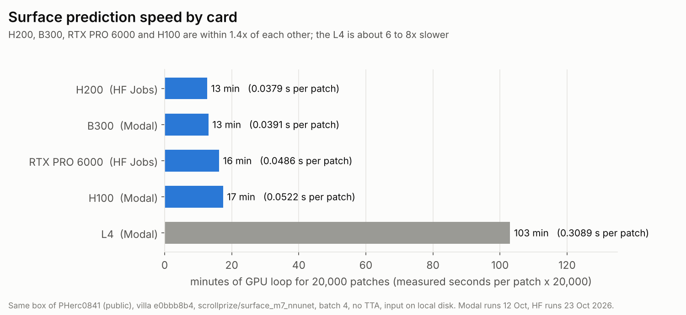
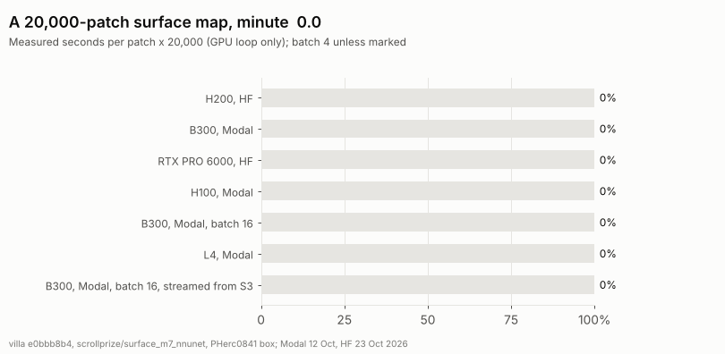
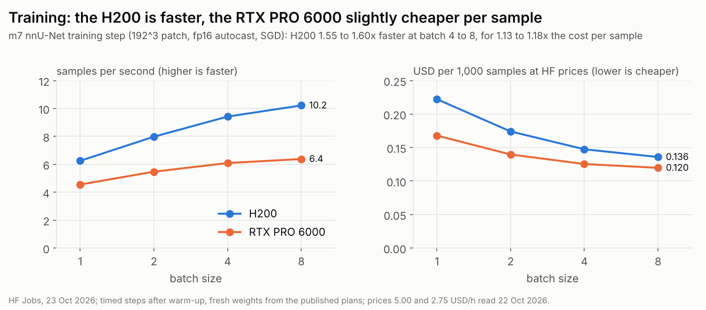
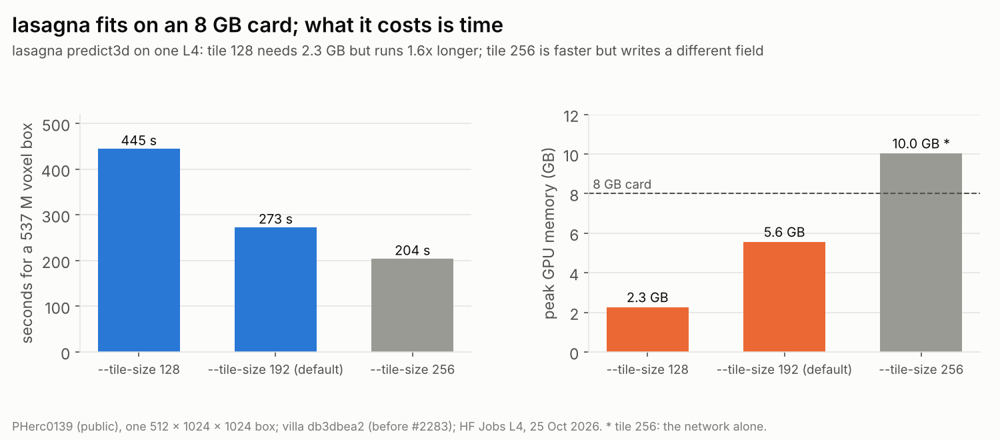
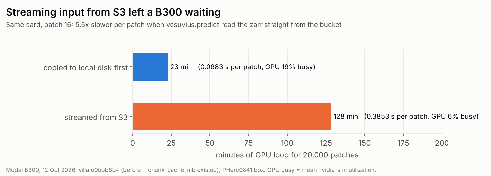
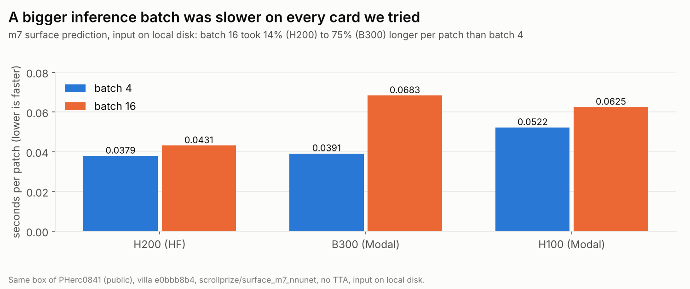
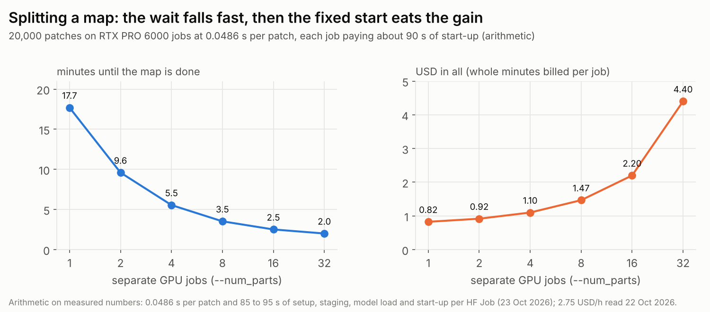

# Running villa on rented GPUs

Which card to rent for surface prediction, training and lasagna, what it cost us, the mistakes that wasted the most GPU time, and how to split a run across machines. Every number here was measured on real scroll data in October 2026 on Hugging Face Jobs and Modal, or is simple arithmetic on those measurements (marked as such). Prices were read on 22 Oct 2026 and will change; the speeds per card should carry over to any provider.

## Quick picks

| Workload | Rent | Why |
| --- | --- | --- |
| Surface prediction (`vesuvius.predict`, m7) | RTX PRO 6000 for the lowest cost; H200 for the shortest single run | Both measured on the same box: RTX PRO 6000 26,936 patches per USD, H200 18,997, H200 1.28x faster per patch |
| nnU-Net training | H200 | 1.55 to 1.60x faster than an RTX PRO 6000 at batch 4 to 8, for 1.13 to 1.18x the cost per sample |
| lasagna `predict3d` | RTX PRO 6000 | 33 to 69 M read voxels per second across ten jobs, about 2.5 to 5 min per 10 G voxels |
| lasagna on a card you already have | Any 8 GB GPU | 5.6 GB peak at the default tile, 2.3 GB at `--tile-size 128`; slow (about 2 M voxels per second on an L4), see [lasagna on a small card](#lasagna-on-a-small-card) |
| B300 | Only for compute-bound training | On m7 surface prediction a B300 was 38% busy and no faster than an H200 (0.0391 vs 0.0379 s per patch) at a higher price |
| One model trained across several GPUs | H200 or B300 | They have NVLink; the RTX PRO 6000 is PCIe only (NVIDIA spec pages) |
| Small checks, embeddings | L4 | 6 to 8x slower than the cards above on m7, but the cheapest per hour |

Peak GPU memory in everything below was about 60 GiB or less for inference (B300 at batch 16) and 88 GiB for the largest training batch, so an RTX PRO 6000 (96 GB) or an H200 (141 GB) holds all of it, though training at batch 8 is close to the RTX PRO 6000's limit.

## Surface prediction

Same box of PHerc0841 (`--bbox 9408:9984,3648:4224,3648:4224`, 512 patches), same villa commit (`e0bbb8b4`), same model (`scrollprize/surface_m7_nnunet` at `cd83ccf7`), input copied to local disk, the settings the published m7 map records (batch 4, `--disable_tta`, overlap 0.5), `--num_workers 16`. Every card's output matched the published m7 map for that box (Dice 0.9998 on all five; shifted controls 0.04 to 0.93).

| Card | Where | s per patch, batch 4 | Price per hour (22 Oct 2026) | 20,000-patch map |
| --- | --- | ---: | --- | --- |
| H200 | HF Jobs | 0.0379 | 5.00 USD, CPU and memory included | about 14 min, 1.25 USD |
| RTX PRO 6000 | HF Jobs | 0.0486 | 2.75 USD, CPU and memory included | about 18 min, 0.83 USD |
| B300 | Modal | 0.0391 | 7.10 USD for the GPU, plus CPU and memory | about 13 min of GPU loop |
| H100 | Modal | 0.0522 | 3.95 USD for the GPU, plus CPU and memory | about 17 min of GPU loop |
| L4 | Modal | 0.3089 | 0.80 USD for the GPU, plus CPU and memory | about 103 min of GPU loop |

The HF map times add the measured fixed start of each job (setup, copying the box, loading the model, about 85 to 95 s) and round up to whole billed minutes. Surface prediction does not keep a big card busy: nvidia-smi showed the B300 38% busy at batch 4 and the H100 45%, against 80% on the L4. So for inference the cheapest card that fits usually wins, and you get speed by splitting the volume (below), not by renting a bigger card.

## Training

The m7 nnU-Net (published plans, `3d_fullres`, 192^3 patch, fresh weights), fp16 autocast with GradScaler and SGD, timed steps after warm-up, HF Jobs, 23 Oct 2026.

| Batch | H200 s per step | RTX PRO 6000 s per step | H200 faster by | Peak GiB H200 / RTX PRO 6000 |
| --- | ---: | ---: | ---: | --- |
| 1 | 0.160 | 0.220 | 1.37x | 9.6 / 26.1 |
| 2 | 0.251 | 0.366 | 1.46x | 18.3 / 31.4 |
| 4 | 0.425 | 0.657 | 1.55x | 35.5 / 62.2 |
| 8 | 0.783 | 1.253 | 1.60x | 70.1 / 87.6 |

At batch 8 the RTX PRO 6000 logged an allocator out-of-memory warning and still finished; it is close to the card's limit there. Training is where a faster card pays: the H200's lead grows with batch size, while on inference it was only 1.28x.

## lasagna on a small card

lasagna `predict3d` does not need a big card. On an L4 its peak GPU memory was 5.6 GB at the default tile size (192) and 2.3 GB at `--tile-size 128`, so any 8 GB card runs it. What it costs on a small card is time: about 2 M requested voxels per second at the default, so roughly 10 minutes per cm³ of a 9.4 µm scan (arithmetic, before the margin effect below).

| `predict3d` on one L4, 537 M voxel box | Wall time | M voxels per second | Peak GPU memory | Peak host memory |
| --- | ---: | ---: | ---: | ---: |
| `--tile-size 128` | 445 s | 1.21 | 2.3 GB | 4.0 GB |
| default (tile 192) | 273 s | 1.97 | 5.6 GB | 5.0 GB |
| `--tile-size 256` | 204 s | 2.63 | about 10 GB (network alone) | not recorded |

Tile 256 is 1.35x faster but does not write the same field: against the default run only half of the cos voxels were within 1 of 255 (mean difference 3.3). Tile 128 we did not compare. If you need the published field, keep the default tile and accept the time.

Where the time goes: the GPU was 92 to 100% busy for 93% of the run, so a faster CPU or disk will not help. Most of the GPU work is repeated. With the default `--overlap 64` the tile stride is 128, so every voxel goes through the network about 3.4 times, and on a small box the tiles around its edge add about 2.3x more. Run whole scans or large boxes in one go rather than many small ones.

On a Mac (M1 Pro, 16 GB, MPS, fp16) the lasagna network alone took 0.83 s per 128³ tile and 3.03 s per 192³ tile. On that Mac's CPU a 192³ tile was killed by macOS for memory, so use MPS or `--tile-size 128`.

## Mistakes that cost us the most GPU time

**1. Streaming the volume from S3 into the GPU.** With the input read straight from the open-data bucket, a B300 took 5.6x longer per patch and sat at 6% busy. Copy the region you need to local disk first, then point `--input_dir` at the copy. On HF Jobs the 885 MB m7 box (with a one-patch margin) copied to local disk in 6.7 to 7.1 s, and lasagna's CT copies ran at 0.35 to 1.25 GB/s; a parallel copier such as `s5cmd` does this well.

This was measured on villa `e0bbb8b4`, before `vesuvius.predict` had `--chunk_cache_mb`. The cache may close part of the gap; we have not measured it.

**2. A bigger inference batch.** Batch 16 was slower per patch than batch 4 on every card we tried, by 14% on the H200 and 75% on the B300. Keep batch 4 for m7 unless you measure otherwise on your card.

**3. Too many loader workers in a container.** On an HF RTX PRO 6000 job, batch 16 with `--num_workers 16` failed after 18.7 s with `RuntimeError: can't start new thread` in the data loader, not a GPU out-of-memory error. If you see that, lower `--num_workers`.

**4. Compiling villa at the start of every job.** Building villa's fiber tracer modules took 530 s on 3 cores; unpacking a saved build took 3 s. Building volume-cartographer with its Python bindings took 7 min 54 s on 2 CPUs. Build once into a container image (or save the build folder) and reuse it; a GPU minute spent compiling is billed like any other.

**5. Plumbing faults.** About 8 to 10% of one month of our GPU spend bought no result because of engineering faults, not bad science: a missing Python package, a missing script, a preempted run that could not resume, an attached run killed when the laptop lost its network, and host memory running out at 64 GiB. Later, one benchmark lost its map runs because the command was joined with spaces under `bash -lc`, so `python -c CODE` split and every predict call exited in 0.2 s. What fixed them for us:

- Run the exact image and entry point on a CPU machine with a tiny input before renting a GPU.
- Launch detached, so a dropped connection cannot kill the run.
- Write checkpoints and resume from them after preemption.
- Do a short pilot that records peak GPU and host memory, then size the machine and timeout from it.
- Build commands as argument lists (`shlex.join` if a shell is unavoidable).

**6. Paying for options you do not need.** On Modal, pinning a region costs 1.15 to 1.75x and non-preemptible containers 3x the CPU and memory price (modal.com/pricing, read 22 Oct 2026).

## Splitting a run across machines

`vesuvius.predict` already splits a volume with `--num_parts` and `--part_id` ([inference docs](inference.md)). Each part is a separate job that pays its own start-up, so splitting cuts the wait quickly and then starts to cost more than it saves:

That chart is arithmetic: 0.0486 s per patch, about 90 s of start-up per job, billing in whole minutes at 2.75 USD per hour. For this map, 4 parts finish in about 5.5 min for 1.10 USD against about 18 min and 0.83 USD on one card; past 8 parts the start-up dominates. A larger volume moves that point further out. A rule of thumb: split until each part runs a few times longer than the fixed start.

For tiled tools that read a halo around each tile (lasagna `predict3d`, for example), small tiles also repeat work: an xy tile of edge t with a halo h on each side reads ((t + 2h) / t)^2 of its own area. Keep tiles large compared with the halo.

Several independent runs (seeds, configs, scrolls) cost the same at once as one after another when the price is per GPU-hour, and finish in a fraction of the wait. Check your account's limit first: Modal's Starter plan allows 10 GPUs and 100 containers at once (read 13 Oct 2026); we found no published concurrency limit for HF Jobs (22 Oct 2026).

## Prices we used (read 22 Oct 2026)

| Card | HF Jobs, per hour, CPU and memory included | Modal, per hour, GPU only |
| --- | ---: | ---: |
| B300 | not offered | 7.10 |
| B200 | not offered as a Job | 6.25 |
| H200 | 5.00 (23 vCPU, 256 GB) | 4.54 |
| H100 | not offered as a Job | 3.95 |
| RTX PRO 6000 | 2.75 (23 vCPU, 256 GB) | 3.03 |
| A100 80 GB | 2.50 (12 vCPU, 142 GB) | 2.50 |
| L4 | 0.80 (8 vCPU, 30 GB) | 0.80 |

HF Jobs bill by the minute while a job is starting or running ([Jobs pricing](https://huggingface.co/docs/hub/jobs-pricing)). Modal bills per second and adds 0.047 USD per physical core-hour and 0.008 USD per GiB-hour of memory ([modal.com/pricing](https://modal.com/pricing)). So the same card can cost very different amounts depending on how much CPU and memory you attach: on Modal, an L4 (0.80 USD per hour) with 16 cores and 64 GiB pays about 1.27 USD per hour more for the CPU and memory.

| | RTX PRO 6000 | H200 SXM |
| --- | --- | --- |
| Memory | 96 GB GDDR7 | 141 GB HBM3e |
| Memory bandwidth | 1,597 GB/s | 4.8 TB/s |
| GPU to GPU | PCIe Gen 5 | NVLink 900 GB/s |

From NVIDIA's [RTX PRO 6000 Blackwell Server Edition](https://www.nvidia.com/en-us/data-center/rtx-pro-6000-blackwell-server-edition/) and [H200](https://www.nvidia.com/en-us/data-center/h200/) pages, read 22 Oct 2026.

## How we measured

- Surface prediction: one run per card and batch size on the box above. Seconds per patch is the full 512-patch run minus a 16-patch start-up run, over the 496 patches between them. Modal runs on 12 Oct 2026 (16 cores, 64 GiB); HF runs on 23 Oct 2026. Torch 2.14.1 with CUDA 13.2 on all cards. Different days and machines, so treat small gaps (under about 5%) as ties.
- Training: steps timed after warm-up on HF Jobs, 23 Oct 2026, the same torch build.
- lasagna: villa `lasagna/` at `db3dbea2`, `scrollprize/lasagna` `model_current.pt`, tile 192, ten HF RTX PRO 6000 jobs on ten different scans, 23 Oct 2026, read-box voxels over `predict3d` seconds; set-up was 140 to 165 s per job.
- lasagna on a small card: villa `lasagna/` at `db3dbea2` (before #2283 changed `predict3d`'s GPU handling; not re-measured on current main), `scrollprize/lasagna`, HF Jobs L4 (8 vCPU), 25 Oct 2026, one box of PHerc0139 (z 9600, y 2816, x 2816, 512 x 1024 x 1024) with the CT copied to local disk first. Tile 128 and 192 in one job, tile 256 in a second job on the same box; peak GPU memory as nvidia-smi reports it. Utilization from nvidia-smi sampled during a separate profiled run. The Mac numbers are the network alone on random input, not a full `predict3d` run.
- Not measured: the B300 against the H200 on the same training step; a whole training run on HF; packed multi-GPU machines (the split chart uses separate jobs); `--chunk_cache_mb` against a local copy.
