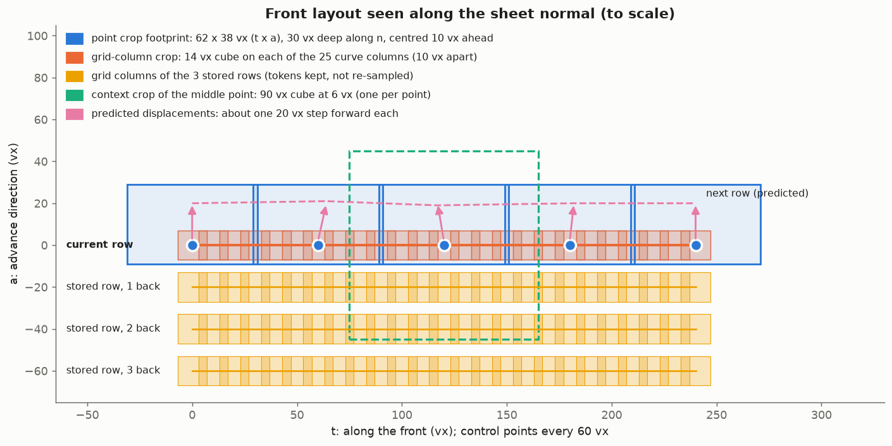
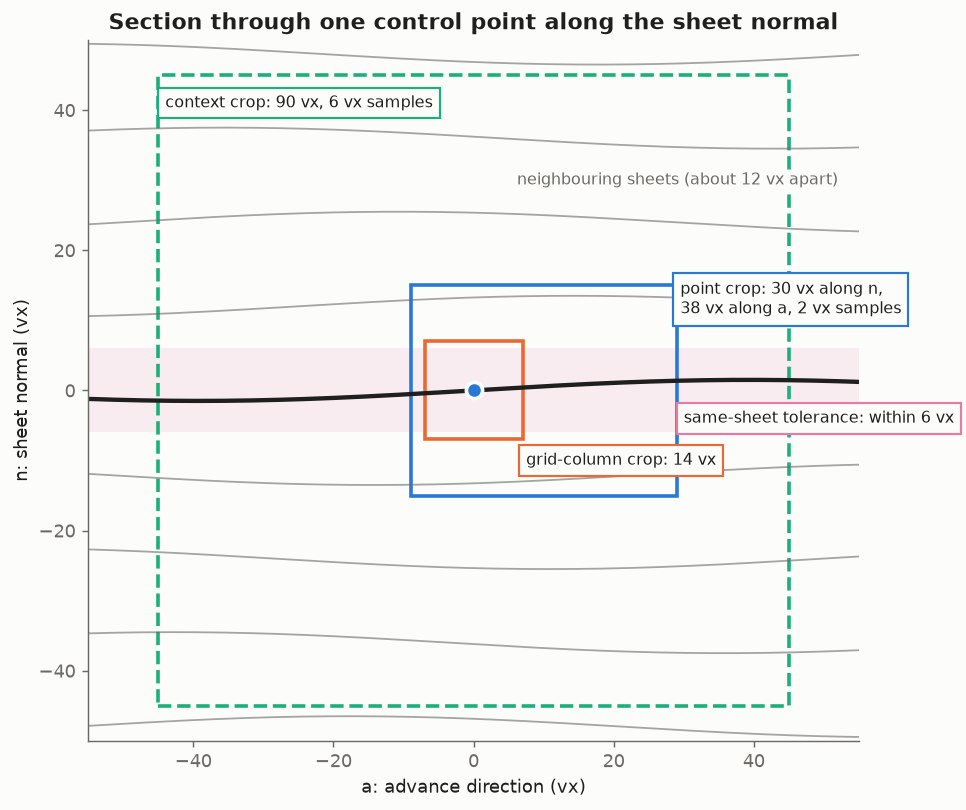
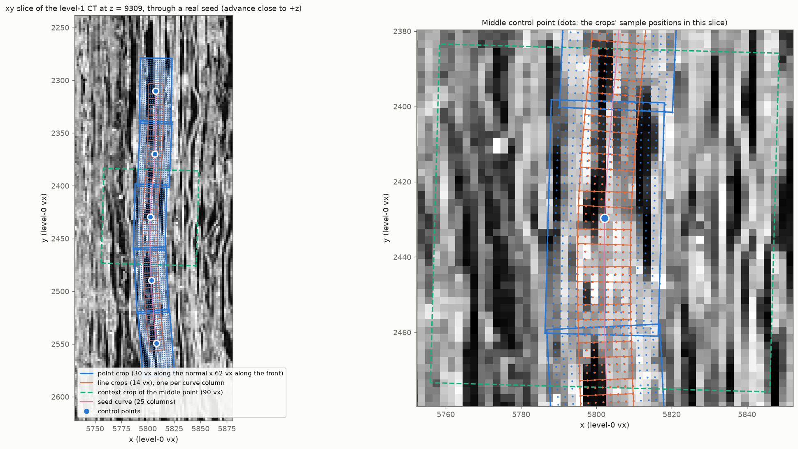
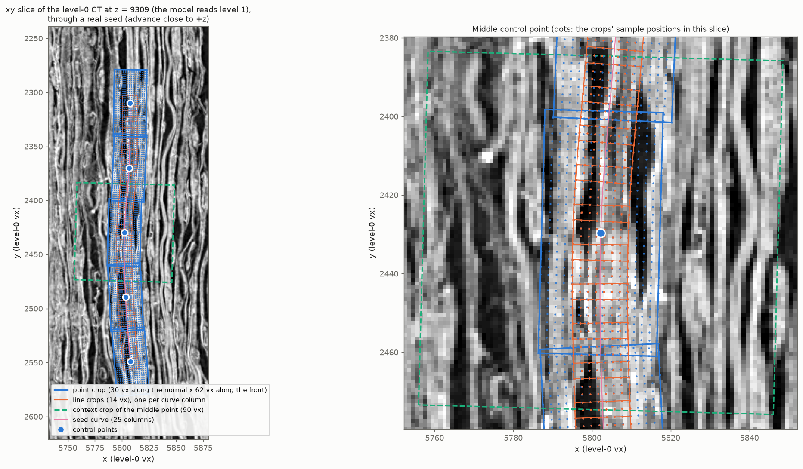
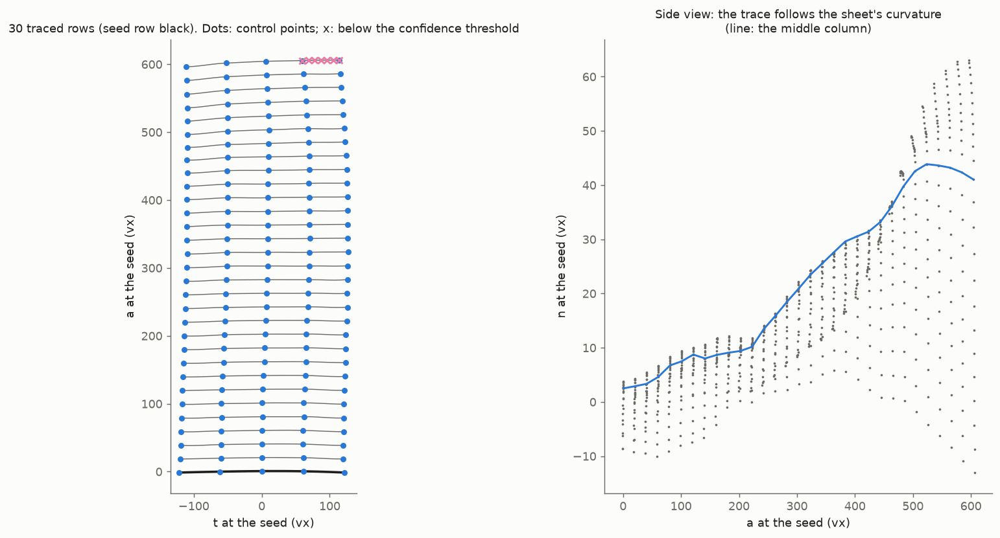

# Sheet tracer architecture (the m7 model)

This describes `ctx2_m7_len` / `ctx2_m7_len2`, the current best model, precisely enough to rebuild it. Code
references point at this package. Figures are generated by `docs/make_architecture_figures.py`.

## Summary

The tracer grows a surface (a papyrus sheet in a CT volume) row by row from a seed polyline. A **front** of 5
control points, 60 vx apart, steps 20 vx forward per row. At each step one network (7.52 M parameters) reads
small crops of the CT and of a surface-prediction volume (m7) around the front and along the curve between the
points, plus stored tokens from the last 3 rows. It predicts, for each control point, a displacement, a tangent
tilt and a confidence ("is this point on the seed's sheet?"). The new row is the cubic Hermite curve through the
moved points, sampled at 25 columns. Low-confidence points are carried along on the curve through their confident
neighbours and can rejoin later; tracing stops when a whole row has no confident point connected to the surface.

* **Inputs per step:** a volume block around the front (CT and m7 at pyramid level 1, i.e. 2 vx voxels), the
  front state (5 points, the previous row, confidences, the current curve) and the grid memory (3 stored rows).
* **Network:** three small 3D CNNs (point crops, context crops, curve-column crops), a 2D axial transformer over a
  4 x 25 grid of curve tokens (current row plus 3 past rows), and a 5-token transformer whose points attend to each
  other and to the grid.
* **Outputs per step:** per point a displacement (3), a confidence logit (1) and a tangent tilt (2); geometric
  post-processing (no parameters) turns them into the next row of 25 surface points.


## Step by step

One tracing step for a batch of `B` fronts. `N = 5` control points, `Q = 25` curve columns, `D = 192`, and
`R` = grid rows (the current row plus up to 3 stored ones, so 1 to 4). Sections 1 to 4 give the details of each
item.

**Read and lay out the inputs**

1. Read the CT and m7 blocks around the front at pyramid level 1 (2 vx voxels): two volumes of shape
   (B, 1, d, h, w).
2. Point frames `R_k = [t a n]` from `pos` and `prev`: (B, 5, 3, 3). Front frame (centre and one `[t a n]`) for
   the geometry features: (B, 3) and (B, 3, 3).
3. Sample the point crops, 16 x 32 x 20 at 2 vx in each point's frame, centred 10 vx ahead:
   (B, 5, 2, 16, 32, 20).
4. Sample the context crops, 16^3 at 6 vx in each point's frame: (B, 5, 2, 16, 16, 16).
5. Column frames along the current curve (25 columns, 10 vx apart), and the column crops, 8^3 at 2 vx:
   (B, 25, 2, 8, 8, 8).
6. Geometry features: per point, 16 (B, 5, 16); per grid row and column, 17 (B, R, 25, 17).

**Encode**

7. Point CNN: (B, 5, 2, 16, 32, 20) -> `e_point` (B, 5, 192).
8. Context CNN, then a zero-initialised Linear: -> `e_ctx` (B, 5, 192).
9. Token CNN: -> `e_col` (B, 25, 192).

**Build the tokens**

10. Point tokens: `x = e_point + MLP(point features) + e_ctx`: (B, 5, 192).
11. Current grid row: `row = e_col`, plus `Linear(e_point_k)` added at column `6k` for each point: (B, 25, 192).
    This row is what gets stored as memory at the end of the step.
12. Stack the stored rows (oldest first) and the current row: (B, R, 25, 192). Add `MLP(grid features)`.

**Attend**

13. 4 axial blocks on the grid: attention along each row (over 25), along each column (over R), then an MLP.
    Flatten to the memory: (B, 25 R, 192), i.e. 100 tokens when full.
14. 4 point blocks on `x`: self-attention over the 5 points, cross-attention from the points to the memory, then an
    MLP: (B, 5, 192).

**Predict**

15. Head: LayerNorm, then Linear 192 -> 6: (B, 5, 6) = displacement `(d_t, d_a, d_n)`, confidence logit, tilt
    `(tilt_a, tilt_n)`.

**Turn the outputs into the next row** (no learned parameters)

16. Predicted points: `pred_k = pos_k + R_k (20 d_t, 20 (1 + d_a), 20 d_n)`: (B, 5, 3).
17. `confident_k = sigmoid(logit_k) > threshold` (0.5 in training, 0.4 when tracing).
18. Stopped points: take their confident neighbours' interpolated displacement; between two confident points,
    place them on the Hermite curve through those points.
19. Tangents: Catmull-Rom from the moved points; each confident point tilts its own:
    `T_k = normalise(T_k + tilt_a a_k + tilt_n n_k)`.
20. Hermite curve through the 5 points, 6 samples per gap: the new row of 25 surface points (B, 25, 3). A column's
    confidence is the lower of its gap's two point confidences.

**Output and state update**

21. Output (tracing): write the 25 columns as the next tifxyz row, keeping columns above the threshold that connect
    to the surface traced so far. Stop at the first row where none do. In training, the losses are computed on
    this step's predictions, confidences and curve instead.
22. Next front: `pos` = 5 points spaced evenly by arc length on the new curve; `prev` = the old `pos`;
    `conf = sigmoid(logit)`; `curve` = the new curve re-spaced to 25 columns.
23. Memory: append (the current row from item 11, its curve, column frames and column confidences); keep the last
    3 rows. Repeat from item 1.

## 1. Conventions

* **Coordinates.** Level-0 voxel units, `xyz`, throughout. The model reads pyramid level `L = 1`; level-L voxel
  `i` (per axis) is centred on level-0 coordinate `(i + 0.5) * 2^L - 0.5` (mean-pooled pyramid). Sampling is
  trilinear (`F.grid_sample(..., mode='bilinear', padding_mode='zeros', align_corners=True)` on the 5D block),
  so samples outside the loaded block read 0.
* **Volumes.** Channel 0 is CT (`s1_ds2.zarr`, level 1, uint8). Channel 1 is m7 (`m7_ds2.zarr`, a surface
  prediction on the same grid, level 1, uint8). Every crop's CT channel is z-scored over that crop:
  `(x - mean) / max(std, 1e-6)` (population std); m7 is divided by 255.
* **Frames** are right-handed orthonormal triads `(t, a, n)`: `t` along the front, `a` the advance direction, `n`
  the sheet normal (`n = t x a`).
* **Front state** (`rollout.Front`): `pos` (B, 5, 3), `prev` (B, 5, 3) (the previous row, giving the advance
  direction), `conf` (B, 5) (sigmoid confidence of the step that produced `pos`, 1 for the seed), `curve`
  (B, 25, 3) (the previous step's Hermite curve re-spaced by arc length; at the seed, the Catmull-Rom Hermite
  curve through `pos`, re-spaced), and the grid memory: a list of up to 3 rows, each
  `(tokens (B, 25, 192), curve (B, 25, 3), column frames (B, 25, 3, 3), column confidences (B, 25))`.

**Point frames** (`geometry.point_frames`): `t_k` = normalised central difference of `pos` along the front
(one-sided at the ends); `a_k` = `pos_k - prev_k` with its `t_k` component removed, normalised; `n_k = t_k x a_k`.

**Front frame** (`geometry.front_frame`, for rotation-invariant features): centre `c` = mean of `pos`;
`t` = normalise(`pos_4 - pos_0`); `a` = mean of (`pos - prev`) minus its `t` component, normalised; `n = t x a`.
`to_local(p) = (p - c) @ [t a n]`.

## 2. Inputs of one step





The same crops on real data. Below is an xy slice of the level-1 CT through a benchmark seed whose advance is +z (out
of the page), so the seed row lies in the slice; the sheets run roughly along y. The dots in the zoom are the crops'
actual sample positions that fall in this slice, about 2 vx apart and rotated to the front's frame. The crops also
extend along z: the point crops from 9 vx behind the row to 29 vx ahead, the line crops 7 vx either side.



The same slice and crops over the level-0 CT. This is for reference only: the model reads level 1, where each 2 vx
sample lands on one averaged voxel.



All crops are regular sample lattices in a local frame. A crop of `(Sn, St, Sa)` samples with spacing `d` and
forward shift `f` has offsets `(t, a, n) = ((j - (St-1)/2) d, (i - (Sa-1)/2) d + f, (m - (Sn-1)/2) d)` and
sample positions `p + R @ (t, a, n)`, where `R = [t a n]` is the crop's frame (`sampling.crop_offsets`,
`sampling.sample_crops`). Tensors are laid out (channels, normal, tangent, advance).

| crop | per | samples (n x t x a) | spacing | extent (vx) | centre | frame |
| --- | --- | --- | --- | --- | --- | --- |
| point crop | control point (5) | 16 x 32 x 20 | 2 vx | 30 x 62 x 38 | 10 vx ahead of the point along `a` | point frame |
| context crop | control point (5) | 16 x 16 x 16 | 6 vx | 90 x 90 x 90 | the point | point frame |
| grid-column crop | curve column (25) | 8 x 8 x 8 | 2 vx | 14 x 14 x 14 | the column | column frame |

Each has 2 channels (CT z-scored, m7 / 255).

**Curve columns.** The current curve has 25 columns, `(5 - 1) * 6 + 1` (6 per gap); control point `k` sits at
column `6k`. Column frames: `t` = Catmull-Rom tangent of the curve at the column (`chord_tangents` on the 25
columns); `a` = the control points' advance axes linearly interpolated to the column (by column index within the
gap), minus its `t` component, normalised; `n = t x a`. Column confidences are the point confidences interpolated
the same way.

**Point geometry features** (16 per point, `Tracer._features`):

| features | count |
| --- | --- |
| `to_local(pos_k) / 20` | 3 |
| the point frame expressed in the front frame, `[t a n]^T @ R_k`, flattened | 9 |
| index features of `s = k / 4`: `(2s - 1, sin(pi s), cos(pi s))` | 3 |
| previous confidence `conf_k` | 1 |

**Grid geometry features** (17 per row and column, `Tracer._grid`), for the current row and each stored row:

| features | count |
| --- | --- |
| `to_local(column position) / 20` (in the current front frame) | 3 |
| column index features of `s = j / 24`: `(2s - 1, sin(pi s), cos(pi s))` | 3 |
| age: rows back / 3 (0 for the current row) | 1 |
| column confidence | 1 |
| column frame in the front frame, flattened | 9 |

The volume block is read around the front: at inference, the bounding box of `pos` padded by
`view_radius + step + 4` (`view_radius` = the farthest crop sample from a point, about 78 vx, set by the context
crop); in training, the episode's reachable GT region padded by `view_radius + reset_distance + 4`.

## 3. Network (`model.SheetTracer`)

Width `D = 192`, 6 attention heads, MLP ratio 2, no dropout, bf16 autocast. All attention is
`nn.MultiheadAttention(D, 6, batch_first=True)`. There are no positional embeddings other than the geometry
features above.

**Crop encoders** (`CropEncoder`): a stack of `Conv3d(c_in, c, 3, stride, padding=1)` -> `GroupNorm(4, c)` ->
`GELU`, then flatten and `Linear` to 192.

| encoder | input | convs (out channels, stride) | output map | final Linear |
| --- | --- | --- | --- | --- |
| point | 2 x 16 x 32 x 20 | (32, 1), (64, 2), (96, 2) | 96 x 4 x 8 x 5 | 15360 -> 192 |
| context | 2 x 16 x 16 x 16 | (8, 2), (16, 2), (32, 1) | 32 x 4 x 4 x 4 | 2048 -> 192 |
| grid column | 2 x 8 x 8 x 8 | (24, 1), (48, 2), (64, 2) | 64 x 2 x 2 x 2 | 512 -> 192 |

(Stride-2 convs map size `s` to `(s + 1) // 2`.)

**Point tokens** (B, 5, 192):
`x = point_enc(point crop) + point_geometry(16 features) + context_proj(context_enc(context crop))`, where
`point_geometry` is `Linear(16, 192) -> GELU -> Linear(192, 192)` and `context_proj` is a `Linear(192, 192)`
initialised to zero (the context crop was added in a fine-tune; zero init makes the new model start out equal to
the old one).

**Surface-token grid** (B, 4, 25, 192):
1. Current row: `row = token_enc(column crops)` (B, 25, 192). Then each control point's own crop embedding
   (`point_enc` output, before geometry and context are added), passed through `point_to_grid = Linear(192, 192)`,
   is added at its column: `row[:, 6k] += point_to_grid(point_enc(point crop k))`.
2. Stack with the stored rows' tokens, oldest first and current last: `rows` (B, R, 25, 192), R = 1 to 4. Stored
   tokens are exactly the `row` tensors of earlier steps (before geometry and attention), detached.
3. `g = rows + token_geometry(17 features)`, with `token_geometry` = `Linear(17, 192) -> GELU -> Linear(192, 192)`.
4. 4 axial blocks (`AxialBlock`), each pre-norm and residual:
   `g += RowAttn(LN(g))` (attention over the 25 columns, within each row);
   `g += ColAttn(LN(g))` (attention over the R rows, within each column);
   `g += MLP(LN(g))` (`Linear(192, 384) -> GELU -> Linear(384, 192)`).
5. Memory = `g` flattened to (B, 25 R, 192): 100 tokens with a full memory.

**Point transformer:** 4 blocks (`Block`), each pre-norm and residual:
`x += SelfAttn(LN(x))` over the 5 point tokens;
`x += CrossAttn(query = LN_q(x), key = value = LN_m(memory))` (separate LayerNorms for queries and memory);
`x += MLP(LN(x))` (192 -> 384 -> 192, GELU).

**Head:** `out = Linear(192, 6)(LayerNorm(x))`, weight and bias initialised to zero:
`out[0:3]` = displacement `(d_t, d_a, d_n)` in units of the step (20 vx);
`out[3]` = confidence logit;
`out[4:6]` = tangent tilt `(tilt_a, tilt_n)`.
Zero init means an untrained model advances straight, uses Catmull-Rom tangents and has confidence 0.5.

**Parameters** (7,521,414):

| module | parameters |
| --- | --- |
| point encoder | 3,172,800 (2.95 M of it in the 15360 -> 192 Linear) |
| point transformer (4 blocks) | 1,784,064 |
| grid axial blocks (4) | 1,782,528 |
| context encoder + projection | 411,288 + 37,056 |
| token encoder | 214,248 |
| geometry MLPs (point, token) | 40,320 + 40,512 |
| point_to_grid | 37,056 |
| head + its LayerNorm | 1,158 + 384 |

## 4. From outputs to the next row (`rollout.Tracer.step`, `advance`)

No learned parameters. `B` batch, 5 points, step `s = 20` vx, threshold `tau` (0.5 in training, 0.4 for traces).

1. **Predictions:** `pred_k = pos_k + R_k @ (s d_t, s (1 + d_a), s d_n)`: a straight 20 vx advance along `a_k`
   plus the predicted correction, in the point frame.
2. **Confidence:** `confident_k = sigmoid(logit_k) > tau` (with gradients cut).
3. **Stopped points** (`carry_stopped`, then `onto_confident_curve`): a non-confident point's displacement is
   replaced by the linear interpolation, by point index, of its nearest confident neighbours' displacements (or
   the nearest one's, beyond the last confident point). If it has confident points on both sides, it is then
   placed on the cubic Hermite curve through those two neighbours at its index fraction between them. The tangents
   at the neighbours are Bessel tangents from the confident points only (or the other end's tangent mirrored across
   the chord). This lets a point that drifted onto a neighbouring sheet land back on its neighbours' sheet and
   rejoin.
4. **Tangents:** Catmull-Rom unit tangents of the moved points (`chord_tangents`: central chords inside; at the
   ends the neighbour's tangent mirrored across the end chord, which is exact for lines and circles). Confident
   points tilt theirs: `T_k = normalise(T_k + tilt_a a_k + tilt_n n_k)`.
   The tilt lets the model shape the curve *between* control points, which are 60 vx apart. `tilt_n` bows the
   curve toward or away from the sheet normal (a sheet that bulges or dips between two points); `tilt_a` skews it
   forward or back within the sheet. It has no direct label: it learns through the curve loss, which pulls the
   dense samples between two on-sheet points onto the sheet. A tilt of 0.1 is about a 6 degree rotation. It
   starts at zero, i.e. plain Catmull-Rom curves, and is not applied by stopped points. (Not ablated separately.)
   A point's tangent is shared by the two gaps that meet at it, so a tilt bends both: to follow a bump confined to
   one gap, the curve dips the other way in the neighbouring gaps (below, about 1.8 vx for a 3 vx bump). Features
   narrower than the 60 vx point spacing can be followed only approximately.

   
5. **Curve:** cubic Hermite through the points (`hermite_dense`), with each gap's tangents scaled by the gap's chord
   length, sampled at `u = 0, 1/6, ..., 5/6` per gap plus the last point: the 25 output columns. A column's
   confidence is the lower of its gap's two point confidences.
6. **Advance:** the new `pos` is 5 points spaced evenly by arc length along the dense curve (`respace`); `prev`
   is the old `pos`; `conf` is the new sigmoid confidences; `curve` is the dense curve re-spaced to 25 columns. The
   current grid row's `(row tokens, curve, column frames, column confidences)` is appended to the memory, which
   keeps the last 3 rows. In training, all of this is detached between steps (truncated backpropagation through
   time: each step's loss trains that step only).

## 5. Training


A single CT slice at 2 vx is noisy. The m7 channel shows the sheets as clear bands, which is much of why the m7
model traces further.

**Data.** About 27,500 verified tifxyz patches (two directories), with level-0 `x, y, z` per grid node. The index
measures each patch's node spacing and uses it instead of `meta.json`'s scale where they differ by more than 20%
(some patch families state twice their real cell size). An **episode** resamples one patch onto a canonical
`(u, v)` grid at 5 vx: `u` is the advance, `v` runs along the front, and both are in voxels. It covers
`u` in `[-1 x 20 - 40, 12 x 20 + 40]` and `v` in `[-40, 240 + 40]`, in one of 8 orientations (advance along patch
rows or columns, either sign, front either sign). The anchor is random. Episodes are kept only if:
* the seed rows are valid at the 5 point columns,
* at least 90% of the supervised region is valid,
* the reachable region plus the crop margin fits a 640 vx cube, and
* all its corners lie in training-split cells.

Split cells are 1024 vx cubes hashed with a seed, 10% validation. Patches are sampled with weight
`valid_nodes^0.5`. The volume block is the reachable GT region plus the view margin ("tight blocks").

**Rollout** (`train.train_rollout`), 12 steps per episode, batch 64:
* **Seed:** GT rows at `u = -20` and `u = 0` (the previous row and the seed), sampled at the 5 point columns
  `v = 60k`, with Gaussian noise of 1.5 vx along the GT normal and 3 vx in-plane.
* **Each step:** the model step, then the losses, then `advance`, then a perturbation of the new positions.
  The perturbation adds noise of 0.75 vx along the normal and 1.5 vx in-plane. In "snapped" episodes (50%),
  points farther than 8 vx from the GT sheet are also reset onto their GT foot point. "Free" episodes (the
  other 50%) let points drift onto other sheets, which is where confidence negatives come from.
* **Sheet jumps (30% of episodes):** before one random step, a random contiguous run of 1 to 2 points is pushed
  along the GT normal (random sign) onto the brightest CT sample 7 to 24 vx away, i.e. onto the neighbouring
  sheet.

**Labels.** Positions are projected onto the GT window: the nearest valid node, then 3 Gauss-Newton iterations on
the bilinear patch, with no moves onto invalid cells and the result invalid if pinned to the border. A point is
**on the seed's sheet** if its point-to-plane distance to the foot point is under 6 vx (about half the sheet
spacing).

**Losses per step** (`losses.step_losses`), averaged over the 12 steps:

* **Point loss.** Target for point `k`: the GT surface point at `u = u_foot(pos_k) + 20` (one step past the
  current position's foot point) and `v = 60k` (the point's seed column: drifting along the front is penalised).
  The error `pred_k - target` is split along the target's GT frame
  (`t = normalise(dS/dv)`, `a = normalise(dS/du)`, `n = t x a`):
  `0.1 huber(e_t) + 0.3 huber(e_a) + 1.0 huber(e_n)`, Huber delta 2 vx. It applies only to points currently on
  the seed's sheet with a valid target. An off-sheet point cannot be told where "its" sheet continues, so it
  learns only confidence 0.
* **Curve loss (weight 0.5).** For every dense curve sample whose gap has both end points on the sheet:
  `huber(point-to-plane distance to the GT sheet)`.
* **Confidence loss (weight 0.5).** BCE of the confidence logit against "the prediction `pred_k` is on the seed's
  sheet", class-balanced as the mean of the on-sheet and off-sheet losses (off-sheet points are rare, and an
  unbalanced BCE learns to keep everything).
* **Front-length loss (weight 0.2).** `huber((arc length of the dense curve - 4 x 60) / 4)`: the fixed set of 5
  points should neither stretch nor shrink along the sheet.

`loss = point + 0.5 curve + 0.5 confidence + 0.2 front_length`.

**Optimisation.** AdamW (lr 7e-4, weight decay 1e-4), 200-iteration linear warm-up, then cosine decay to zero at
the 300-minute budget (about 17,000 iterations on one H100), gradient clipping at 1.0, bf16 autocast. Validation:
64 fixed held-out episodes every 2,000 iterations.

**Lineage** (the m7 model is the end of a chain of fine-tunes; a from-scratch run of this config was not tried):

1. `big_run1` (from scratch, 300 min);
2. `big_curve_ft1` (stopped points placed on the curve);
3. `big_curve_ctx` (adds the context crop, zero-initialised projection);
4. `big_curve_ctx2` (continued, lr 5e-4);
5. `ctx2_m7_len` (adds the m7 input channel: the first convs of all three encoders gain a channel initialised to
   zero; adds the front-length loss; lr 7e-4, 300 min);
6. `ctx2_m7_len2` (continued 300 more minutes, fresh schedule).

From-scratch variants of steps 2 to 4 were slightly worse than the fine-tuned chain.

## 6. Inference (`infer.trace`, `trace_benchmark.py`)

The seed is a polyline (e.g. a row of an existing tifxyz) plus an advance direction. It is resampled by arc
length to `max(4, round(length / 60) + 1)` evenly spaced points (the network accepts any count, but was trained on
5 points 60 vx apart), and `prev = seed - 20 * direction`. Each step reads the level-1 CT and m7 blocks around the front, runs one
`Tracer.step` with threshold 0.4, and `advance`s. The written row is the step's 25 dense columns; a column is kept
if its confidence exceeds 0.4.

**Stop rule:** a row's kept columns that form a contiguous run touching a reached column of the row above are
"reached". Tracing stops at the first row with none (it would only produce separate pieces), and the written
surface is the seed row plus the 4-connected kept points connected to it (`connected_keep`). Output: a tifxyz with
one row per step and the 25 columns per row (`meta.json` scale `[0.1, 0.05]`: 10 vx between columns, 20 vx between
rows), unkept points written as -1.



## 7. Full configuration

The resolved config of `ctx2_m7_len` (`output/remote/ctx2_m7_len/config.json`; paths are the H100's):

```json
{"data": {"volume_level": 1, "front_points": 5, "point_spacing": 60.0, "step": 20.0, "steps": 12, "history": 1,
          "gt_resolution": 5.0, "gt_margin": 40.0, "roi": 640, "min_valid_fraction": 0.9, "patch_weight_power": 0.5,
          "split_block": 1024, "val_fraction": 0.1, "split_seed": 0, "seed_noise_normal": 1.5,
          "seed_noise_tangent": 3.0, "extra_volumes": [".../m7_ds2.zarr"], "tight_blocks": true},
 "model": {"crop": [16, 32, 20], "crop_spacing": 2.0, "crop_forward": 10.0, "channels": [32, 64, 96],
           "strides": [1, 2, 2], "dim": 192, "layers": 4, "heads": 6, "mlp_ratio": 2.0, "memory_rows": 3,
           "attention": true, "dropout": 0.0, "surface_tokens": true, "token_crop": [8, 8, 8], "token_spacing": 2.0,
           "token_channels": [24, 48, 64], "token_strides": [1, 2, 2], "grid_layers": 4, "context_crop": [16, 16, 16],
           "context_spacing": 6.0, "context_channels": [8, 16, 32], "context_strides": [2, 2, 1]},
 "trace": {"curve": "hermite", "spline_samples": 6, "respace": true, "confidence_threshold": 0.5, "stopped": "curve"},
 "loss": {"normal": 1.0, "advance": 0.3, "tangent": 0.1, "spline": 0.5, "confidence": 0.5, "confidence_balance": true,
          "column_target": true, "front_length": 0.2, "huber": 2.0, "sheet_tolerance": 6.0},
 "train": {"batch": 64, "lr": 0.0007, "weight_decay": 0.0001, "warmup": 200, "grad_clip": 1.0, "amp": "bf16",
           "state_noise_normal": 0.75, "state_noise_tangent": 1.5, "reset_distance": 8.0, "free_fraction": 0.5,
           "jump_probability": 0.3, "jump_min": 7.0, "jump_max": 24.0, "detach_steps": true, "max_minutes": 300}}
```
