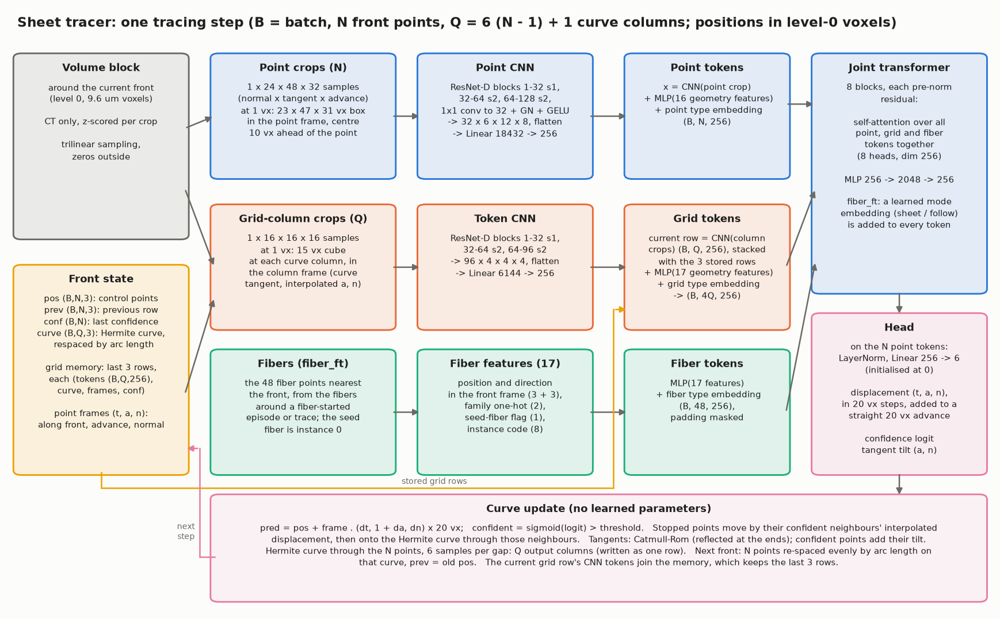
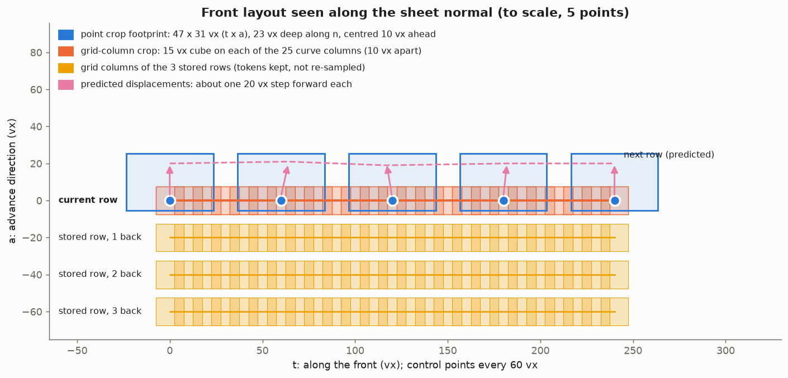
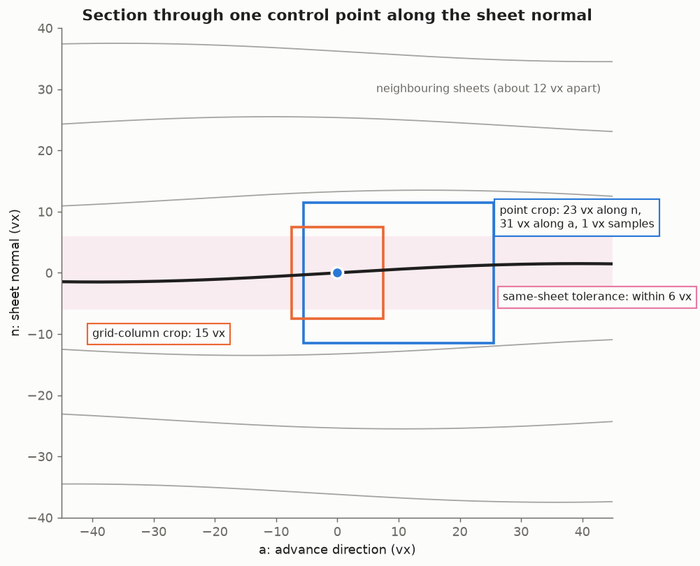
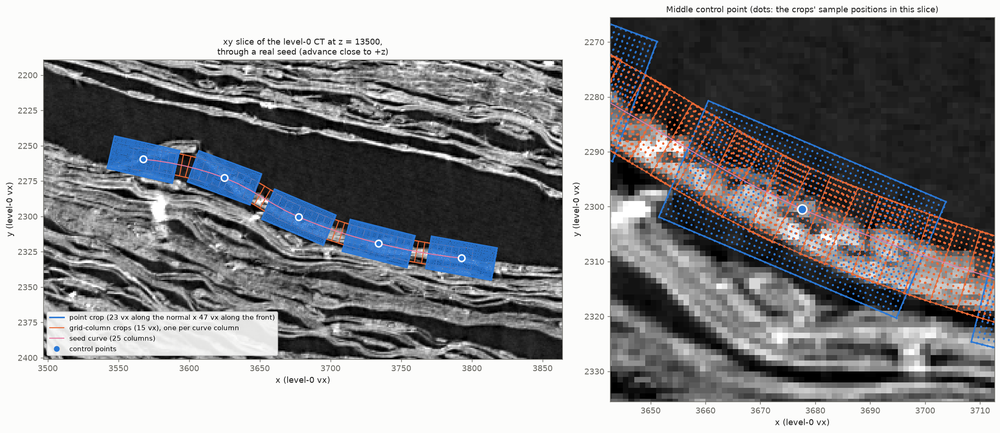
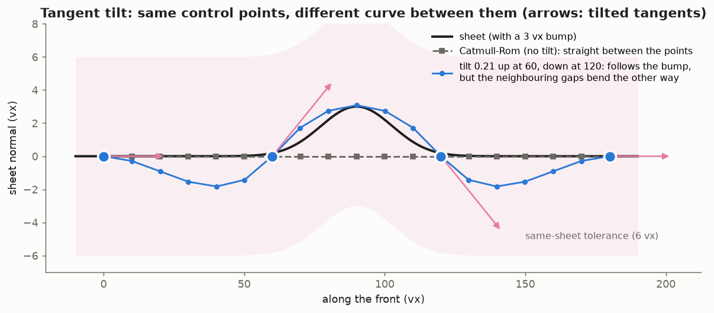
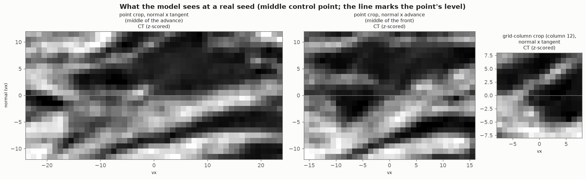
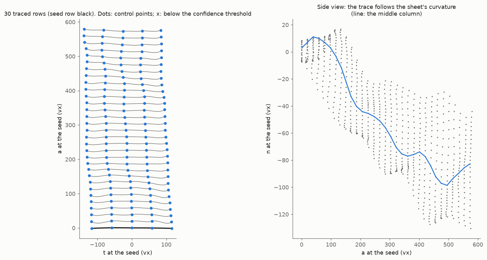

# Sheet tracer architecture

This describes the two supported models precisely enough to rebuild them:

* `remote_l0_points_ft` (`configs/remote_l0_points_ft.json`): the sheet tracer, 18.45 M parameters;
* `remote_l0_fiber_ft` (`configs/remote_l0_fiber_ft.json`): the same network initialised from `remote_l0_points_ft`,
  plus fiber tokens and a fiber-following mode, 18.52 M parameters.

Code references point at this package. Figures are generated by `docs/make_architecture_figures.py`.

## Summary

The tracer grows a surface (a papyrus sheet in a CT volume) row by row from a seed polyline. A **front** of `N`
control points, 60 vx apart, steps 20 vx forward per row. `N` is free: training draws it per batch (5 to 16 for
`points_ft`, 3 to 9 for `fiber_ft`). At each step one network reads level-0 CT around the front: one crop per control
point, and small crops along the curve between the points for the current row and the last 3 rows. With `fiber_ft`
it can also read the fibers near the front. For each control point it predicts a displacement, a tangent tilt and a
confidence ("is this point on the seed's sheet?"). The new row is the cubic Hermite curve through the moved points,
sampled at `Q = 6 (N - 1) + 1` columns. Low-confidence points are carried along on the curve through their confident
neighbours and can rejoin later. Tracing stops when a row has no confident point connected to the surface.

* **Inputs per step:**
  * a CT block around the front (pyramid level 0 of `s1_ds2`, 9.6 um voxels, one channel);
  * the front state (N points, the previous row, confidences, the current curve);
  * the grid memory (3 stored rows);
  * with `fiber_ft`, optionally the fibers around the trace.
* **Network:**
  * two residual 3D CNNs, one for the point crops and one for the curve-column crops;
  * one transformer with full self-attention over the point tokens, the grid tokens (current row plus 3 past rows)
    and the fiber tokens together.
* **Outputs per step:**
  * per point, a displacement (3), a confidence logit (1) and a tangent tilt (2);
  * geometric post-processing (no parameters) turns them into the next row of `Q` surface points.

## Step by step

One tracing step for a batch of `B` fronts with `N` control points, `Q = 6 (N - 1) + 1` curve columns, `D = 256`
and `R` grid rows (the current row plus up to 3 stored ones, so 1 to 4). With the nominal `N = 5`, `Q = 25`.

**Read and lay out the inputs**

1. Read the CT block around the front at level 0: (B, 1, d, h, w). In training each episode keeps its own unpadded
   block (`data.unpadded_blocks`), and crops sample from their episode's block.
2. Compute the point frames `R_k = [t a n]` from `pos` and `prev`: (B, N, 3, 3). The front frame (a centre and one
   `[t a n]`) is used for the geometry features: (B, 3) and (B, 3, 3).
3. Sample the point crops, 24 x 48 x 32 at 1 vx, in each point's frame, centred 10 vx ahead: (B, N, 1, 24, 48, 32).
4. Compute the column frames along the current curve (Q columns, 10 vx apart) and sample the column crops, 16^3 at
   1 vx: (B, Q, 1, 16, 16, 16).
5. Compute the geometry features: 16 per point, (B, N, 16); and 17 per grid row and column, (B, R, Q, 17).
6. `fiber_ft` with fibers given: take the 48 fiber points nearest the front and compute 17 features each:
   (B, 48, 17).

**Encode and build the tokens**

7. Point tokens: `x = point_enc(point crop) + point_geometry(features)`: (B, N, 256).
8. Current grid row: `row = token_enc(column crops)`: (B, Q, 256). This row is stored as memory at the end of the
   step.
9. Stack the stored rows (oldest first) and the current row, then add `token_geometry(grid features)`:
   (B, R, Q, 256).
10. `fiber_ft`: fiber tokens `fiber_geometry(fiber features) + fiber_type`: (B, 48, 256), with padding masked out.
    `mode_embed[mode]` is added to every point, grid and fiber token: 0 for sheet tracing, 1 for fiber following.

**Attend and predict**

11. Build the sequence: the point tokens plus `token_type[0]`, then the grid tokens plus `token_type[1]` flattened
    to R Q tokens, then the fiber tokens. That is N + 4Q (+ 48) tokens with a full memory: 105 at N = 5.
12. Run 8 pre-norm transformer blocks, each full self-attention over the whole sequence followed by an MLP. Padded
    fiber tokens are masked as keys.
13. Head on the N point tokens: LayerNorm, then Linear 256 -> 6: (B, N, 6). The outputs are the displacement
    `(d_t, d_a, d_n)`, the confidence logit, and the tilt `(tilt_a, tilt_n)`.

**Turn the outputs into the next row** (no learned parameters)

14. Predicted points: `pred_k = pos_k + R_k (20 d_t, 20 (1 + d_a), 20 d_n)`: (B, N, 3).
15. A point is confident when `sigmoid(logit_k) > threshold` (`trace.confidence_threshold`, 0.5; inference tools
    can override it).
16. Stopped points take their confident neighbours' interpolated displacement. If they lie between two confident
    points, they are placed on the Hermite curve through those points.
17. Tangents are Catmull-Rom from the moved points. Each confident point tilts its own:
    `T_k = normalise(T_k + tilt_a a_k + tilt_n n_k)`.
18. The Hermite curve through the N points, sampled 6 times per gap, gives the new row of Q surface points
    (B, Q, 3). A column's confidence is the lower of its gap's two point confidences.

**Output and state update**

19. When tracing, write the Q columns as the next tifxyz row. Keep the columns above the threshold that connect to
    the surface traced so far, and stop at the first row where none do. In training, the losses are computed on
    this step's predictions, confidences and curve instead.
20. Next front:
    * `pos`: N points spaced evenly by arc length on the new curve;
    * `prev`: the old `pos`;
    * `conf`: `sigmoid(logit)`;
    * `curve`: the new curve re-spaced to Q columns.
21. Memory: append the current row from step 8 together with its curve, column frames and column confidences, and
    keep the last 3 rows. Repeat from step 1.

## 1. Conventions

* **Coordinates.** Positions are in level-0 voxel units, `xyz`, throughout, and the model reads level 0. Sampling
  is trilinear: `F.grid_sample(..., mode='bilinear', padding_mode='zeros', align_corners=True)` on the 5D block, so
  samples outside the loaded block read 0. A level-L voxel `i` (per axis) is centred on level-0 coordinate
  `(i + 0.5) * 2^L - 0.5`; this is used for patches on other scrolls (`data.patch_volumes`), whose volumes share
  `data.volume_level`.
* **Volume.** One channel, CT (uint8). Every crop is z-scored over itself: `(x - mean) / max(std, 1e-6)`, using the
  population std.
* **Frames** are right-handed orthonormal triads `(t, a, n)`: `t` along the front, `a` the advance direction and
  `n` the sheet normal (`n = t x a`).
* **Front state** (`tracing.rollout.Front`):
  * `pos` (B, N, 3): the control points;
  * `prev` (B, N, 3): the previous row, which gives the advance direction;
  * `conf` (B, N): the sigmoid confidence of the step that produced `pos`, 1 for the seed;
  * `curve` (B, Q, 3): the previous step's Hermite curve re-spaced by arc length. At the seed it is the Catmull-Rom
    Hermite curve through `pos`, re-spaced.
  * `grid`: the grid memory, a list of up to 3 rows, each
    `(tokens (B, Q, 256), curve (B, Q, 3), column frames (B, Q, 3, 3), column confidences (B, Q))`.

**Point frames** (`geometry.point_frames`):

* `t_k` is the normalised central difference of `pos` along the front (one-sided at the ends);
* `a_k` is `pos_k - prev_k` with its `t_k` component removed, normalised;
* `n_k = t_k x a_k`.

**Front frame** (`geometry.front_frame`, for the rotation-invariant features):

* the centre `c` is the mean of `pos`;
* `t = normalise(pos_last - pos_0)`;
* `a` is the mean of `pos - prev` minus its `t` component, normalised;
* `n = t x a`.

Points are expressed in it as `to_local(p) = (p - c) @ [t a n]`.

## 2. Inputs of one step

The figure below shows the same crops on real data. It is an xy slice of the level-0 CT through a benchmark seed
whose advance is +z (out of the page), so the seed row lies in the slice and the sheets run roughly along y. In the
zoom, the dots are the actual sample positions of the crops that fall in this slice: 1 vx apart and rotated to the
front's frame. The crops also extend along z: the point crops from 5.5 vx behind the row to 25.5 vx ahead, and the
column crops 7.5 vx either side.

All crops are regular sample lattices in a local frame (`sampling.crop_offsets`, `sampling.sample_crops`). Take a
crop of `(Sn, St, Sa)` samples with spacing `d` and forward shift `f`:

* its offsets are `(t, a, n) = ((j - (St-1)/2) d, (i - (Sa-1)/2) d + f, (m - (Sn-1)/2) d)`;
* its sample positions are `p + R @ (t, a, n)`, where `R = [t a n]` is the crop's frame.

Tensors are laid out (channel, normal, tangent, advance).

| crop | per | samples (n x t x a) | spacing | extent (vx) | centre | frame |
| --- | --- | --- | --- | --- | --- | --- |
| point crop | control point (N) | 24 x 48 x 32 | 1 vx | 23 x 47 x 31 | 10 vx ahead of the point along `a` | point frame |
| grid-column crop | curve column (Q) | 16 x 16 x 16 | 1 vx | 15 x 15 x 15 | the column | column frame |

**Curve columns.** The current curve has `Q = (N - 1) * 6 + 1` columns, 6 per gap, and control point `k` sits at
column `6k`. Column frames:

* `t` is the Catmull-Rom tangent of the curve at the column (`chord_tangents` on the Q columns);
* `a` is the control points' advance axes, linearly interpolated to the column (by column index within the gap),
  minus its `t` component, normalised;
* `n = t x a`.

Column confidences are the point confidences, interpolated the same way.

**Point geometry features** (16 per point, `Tracer._features`):

| features | count |
| --- | --- |
| `to_local(pos_k) / 20` | 3 |
| the point frame expressed in the front frame, `[t a n]^T @ R_k`, flattened | 9 |
| index features of `s = k / (N - 1)`: `(2s - 1, sin(pi s), cos(pi s))` | 3 |
| previous confidence `conf_k` | 1 |

**Grid geometry features** (17 per row and column, `Tracer._grid`), for the current row and each stored row:

| features | count |
| --- | --- |
| `to_local(column position) / 20`, in the current front frame | 3 |
| column index features of `s = j / (Q - 1)`: `(2s - 1, sin(pi s), cos(pi s))` | 3 |
| age: rows back / 3 (0 for the current row) | 1 |
| column confidence | 1 |
| column frame in the front frame, flattened | 9 |

**Fiber features** (`fiber_ft`, 17 per fiber point, `Tracer._fiber_tokens`). Fibers come from a pool
(`scripts/build_fiber_pool.py`) of AFV fibers and VC3D fiber JSONs, sampled along each fiber. Each step takes the 48
pool points nearest any front point:

| features | count |
| --- | --- |
| `to_local(point) / 20` | 3 |
| fiber direction in the front frame, sign-flipped so its `t` component is >= 0 (a fiber has no direction) | 3 |
| family one-hot (horizontal, vertical) | 2 |
| seed-fiber flag: the fiber the episode or trace started from (instance 0) | 1 |
| instance code: a random unit 8-vector per fiber, drawn per episode, shared by all points of that fiber | 8 |

The instance code tells the model which points belong to the same fiber, and that different fibers are different
instances, without giving fibers a fixed identity. Fiber tokens are present only when fibers are given: in
fiber-started training episodes, and when tracing with `scripts/trace_from_fibers.py --fiber-pool`.

The volume block is read around the front. At inference it is the bounding box of `pos`, padded by
`view_radius + step + 4`, where `view_radius` (36.5 vx) is the farthest point-crop sample from its point. In
training it is the episode's reachable GT region, padded by `view_radius + reset_distance + 4`.

## 3. Network (`model.SheetTracer`)

* Width `D = 256`, 8 attention heads, MLP ratio 8, no dropout, bf16 autocast.
* Attention is `nn.MultiheadAttention(256, 8, batch_first=True)`.
* There are no positional embeddings other than the geometry features above. The model is independent of `N`.

**Crop encoders** (`CropEncoder`) are a stack of ResNet-D basic blocks
(`vesuvius.models.build.resblocks.BasicBlockD`). Each block has two 3x3x3 convs, each followed by `GroupNorm(4)` and
GELU, plus a skip path that is pooled and projected when the shape changes. The point encoder then has a 1x1 conv to
32 channels, followed by GroupNorm and GELU. Both encoders end by flattening and a `Linear` to 256.

| encoder | input | blocks (out channels, stride) | output map | final Linear |
| --- | --- | --- | --- | --- |
| point | 1 x 24 x 48 x 32 | (32, 1), (64, 2), (128, 2), then 1x1 to 32 | 32 x 6 x 12 x 8 | 18432 -> 256 |
| grid column | 1 x 16 x 16 x 16 | (32, 1), (64, 2), (96, 2) | 96 x 4 x 4 x 4 | 6144 -> 256 |

**Geometry MLPs.** `point_geometry` is `Linear(16, 256) -> GELU -> Linear(256, 256)`. `token_geometry` is the same
with 17 inputs. `fiber_geometry` (`fiber_ft`) is the same with 17 inputs.

**Type and mode embeddings.**

* `token_type` (2, 256) is added to the point tokens (row 0) and the grid tokens (row 1).
* `fiber_type` (256) is added to the fiber tokens (`fiber_ft`).
* `mode_embed` (2, 256) is added to every token (`fiber_ft`): row 0 for sheet tracing, row 1 for fiber following.
  It is initialised to zero, so the model starts as the checkpoint it was initialised from.

**Grid.** The stored rows' tokens are exactly the `row` tensors of earlier steps (CNN outputs, before geometry and
attention), detached. Their geometry features are recomputed each step in the current front frame.

**Transformer:** 8 blocks (`Block`), each pre-norm and residual:

* `s += SelfAttn(LN(s))` over the whole sequence (points, grid, fibers), with padded fiber tokens masked as keys;
* `s += MLP(LN(s))`, where the MLP is `Linear(256, 2048) -> GELU -> Linear(2048, 256)`.

**Head:** `out = Linear(256, 6)(LayerNorm(x))` on the N point tokens. The weight and bias are initialised to zero.

* `out[0:3]` is the displacement `(d_t, d_a, d_n)`, in units of the step (20 vx).
* `out[3]` is the confidence logit.
* `out[4:6]` is the tangent tilt `(tilt_a, tilt_n)`.

Because of the zero init, an untrained model advances straight, uses Catmull-Rom tangents and has confidence 0.5.

**Parameters** (`points_ft` 18,448,742; `fiber_ft` 18,519,910):

| module | parameters |
| --- | --- |
| transformer (8 blocks, 1,315,072 each) | 10,520,576 |
| point encoder | 5,593,056 (4,718,848 of it in the 18432 -> 256 Linear) |
| token encoder | 2,192,000 (1,573,120 of it in the 6144 -> 256 Linear) |
| geometry MLPs (point, token) | 70,144 + 70,400 |
| head + its LayerNorm, token_type | 1,542 + 512, 512 |
| `fiber_ft` only: fiber_geometry, fiber_type, mode_embed | 70,400 + 256 + 512 |

## 4. From outputs to the next row (`tracing.rollout.Tracer.step`, `advance`)

No learned parameters are involved. `B` is the batch, `N` the number of points, `s = 20` vx the step and `tau` the
threshold.

1. **Predictions:** `pred_k = pos_k + R_k @ (s d_t, s (1 + d_a), s d_n)`. This is a straight 20 vx advance along
   `a_k` plus the predicted correction, in the point frame.
2. **Confidence:** `confident_k = sigmoid(logit_k) > tau`, with gradients cut.
3. **Stopped points** (`carry_stopped`, then `onto_confident_curve`):
   * A non-confident point's displacement is replaced by a linear interpolation, by point index, of the
     displacements of its nearest confident neighbours (beyond the last confident point, the nearest one's).
   * If it has confident points on both sides, it is then placed on the cubic Hermite curve through those two
     neighbours, at its index fraction between them. The tangents at the neighbours are Bessel tangents from the
     confident points only (at an end, the other end's tangent mirrored across the chord).

   This lets a point that drifted onto a neighbouring sheet land back on its neighbours' sheet and rejoin.
4. **Tangents:** Catmull-Rom unit tangents of the moved points (`chord_tangents`): central chords inside, and at the
   ends the neighbour's tangent mirrored across the end chord (exact for lines and circles). Confident points tilt
   theirs: `T_k = normalise(T_k + tilt_a a_k + tilt_n n_k)`.

   The tilt lets the model shape the curve between control points, which are 60 vx apart:
   * `tilt_n` bows the curve toward or away from the sheet normal (a sheet that bulges or dips between two points);
   * `tilt_a` skews the curve forward or back within the sheet.

   The tilt has no direct label. It learns through the curve loss, which pulls the dense samples between two
   on-sheet points onto the sheet. A tilt of 0.1 is about a 6 degree rotation.

   A point's tangent is shared by the two gaps that meet at it, so a tilt bends both. To follow a bump confined to
   one gap, the curve dips the other way in the neighbouring gaps (in the figure below, about 1.8 vx for a 3 vx
   bump).

   
5. **Curve:** a cubic Hermite curve through the points (`hermite_dense`), with each gap's tangents scaled by the
   gap's chord length. It is sampled at `u = 0, 1/6, ..., 5/6` per gap plus the last point, giving the Q output
   columns. A column's confidence is the lower of its gap's two point confidences.
6. **Advance:**
   * the new `pos` is N points spaced evenly by arc length along the dense curve (`respace`);
   * `prev` is the old `pos`;
   * `conf` is the new sigmoid confidences;
   * `curve` is the dense curve re-spaced to Q columns.

   The current grid row is appended to the memory, which keeps the last 3 rows. In training, all of this is detached
   between steps (truncated backpropagation through time: each step's loss trains that step only).

## 5. Training

### Data

**Patches.** Verified tifxyz patches with level-0 `x, y, z` per grid node:

* Scroll 1 (PHercParis4): two directories, on `s1_ds2`;
* `fiber_ft` also uses `cut_windings`, resampled to square grids (`scripts/resample_isotropic.py`);
* the registered segments of PHerc0139 and PHerc1667, on their own volumes at 9.6 um (`scripts/prepare_scroll.py`,
  `data.patch_volumes`), masked where they leave the scan. The middle 20% of each scroll's z extent is held out.

`data.dir_weights` sets each directory's share of the sampling weight. Within a directory, patches are sampled with
weight `valid_nodes^0.5`. The patch index measures each patch's node spacing and uses it instead of `meta.json`'s
scale where the two differ by more than 20%.

**Episodes.** An episode resamples one patch onto a canonical `(u, v)` grid at 5 vx:

* `u` is the advance and `v` runs along the front, both in voxels;
* the grid covers `u` in `[-1 x 20 - 40, 12 x 20 + 40]` and `v` in `[-40, (N - 1) x 60 + 40]`;
* it uses one of 8 orientations (advance along patch rows or columns, either sign; front either sign);
* the anchor is random.

An episode is kept only if all of these hold:

* the seed rows are valid at the N point columns;
* at least 90% of the supervised region is valid;
* the reachable region plus the crop margin fits a 640 vx cube;
* all its corners lie in training-split cells.

Split cells are 1024 vx cubes hashed with a seed; 10% are held out for validation.

**Front sizes.** Each training batch draws N uniformly from `data.front_points_range`, with about
`train.points_per_batch = 160` points per batch (32 episodes at 5 points, 10 at 16). Validation uses
`data.front_points = 5`.

### Fiber episodes (`fiber_ft`)

Horizontal fibers of PHercParis4 are matched to the patches they lie on (`scripts/match_fibers_to_patches.py`,
`data.fiber_runs`). The fibers are the AFV fiber volume plus VC3D fiber JSONs, matched within +-2 vx along the patch
normal.

* **Fiber-seeded episodes (25%, `data.fiber_fraction`).** The seed row is a random stretch of a matched fiber,
  sampled at the 60 vx point spacing. The GT window is rotated so its front axis follows the fiber's course on the
  patch grid, and the episode advances perpendicular to it, either way (`EpisodeSampler._fiber_attempt`, at least
  50% valid).
* **Fiber-following batches (20% of batches, `data.follow_fraction`).** A 3-point front stands across a matched
  fiber, with the middle point on it, and advances along the fiber. The GT window is laid along the fiber, so the
  middle column is the fiber itself and the usual losses keep the middle point on it and the others on the sheet
  beside it (`EpisodeSampler._follow_attempt`). These batches set the mode input to 1. The sheet beside the fiber is
  traced as usual, so a follow trace is a strip of sheet whose middle column is the fiber.
* **Fiber inputs.** Both kinds of episode see every pool fiber around them as fiber tokens (`data.fiber_pool`, at
  most 32 instances), with the seed fiber as instance 0. In following episodes the seed fiber is cut ahead of the
  start: exactly at the start with probability 0.5 (`data.fiber_cut_at_start`), otherwise anywhere up to the
  rollout's end. This way the model learns to extend a fiber past its known end. Regular episodes have no fiber
  tokens.

### Rollout (`train.train_rollout`)

Each episode runs 12 steps.

* **Seed:** the GT rows at `u = -20` and `u = 0` (the previous row and the seed), sampled at the N point columns
  `v = 60k`. Gaussian noise is added: 1.5 vx along the GT normal and 3 vx in-plane.
* **Each step:** the model step, then the losses, then `advance`, then a perturbation of the new positions. The
  perturbation adds noise of 0.75 vx along the normal and 1.5 vx in-plane.
  * In "snapped" episodes (50%), points farther than 8 vx from the GT sheet are reset onto their GT foot point.
  * "Free" episodes (the other 50%) let points drift onto other sheets, which is where confidence negatives come
    from.
* **Sheet jumps (30% of episodes):** before one random step, a random contiguous run of 1 to 2 points is pushed
  along the GT normal (random sign) onto the brightest CT sample 7 to 24 vx away, which is the neighbouring sheet.

### Labels

Positions are projected onto the GT window: first the nearest valid node, then 3 Gauss-Newton iterations on the
bilinear patch. Projections never move onto invalid cells, and a result pinned to the border is invalid. A point is
**on the seed's sheet** if its point-to-plane distance to its foot point is under 6 vx (about half the sheet
spacing).

### Losses per step (`losses.step_losses`), averaged over the 12 steps

* **Point loss.** The target for point `k` is the GT surface point at `u = u_foot(pos_k) + 20` (one step past the
  current position's foot point) and `v = 60k` (the point's seed column, so drifting along the front is penalised).
  * The error `pred_k - target` is split along the target's GT frame: `t = normalise(dS/dv)`,
    `a = normalise(dS/du)`, `n = t x a`.
  * The loss is `0.1 huber(e_t) + 0.3 huber(e_a) + 1.0 huber(e_n)`, with Huber delta 2 vx.
  * It applies only to points currently on the seed's sheet with a valid target. An off-sheet point cannot be told
    where "its" sheet continues, so it learns only confidence 0.
* **Curve loss (weight 0.5).** For every dense curve sample whose gap has both end points on the sheet:
  `huber(point-to-plane distance to the GT sheet)`.
* **Confidence loss (weight 0.5).** BCE of the confidence logit against "the prediction `pred_k` is on the seed's
  sheet". It is class-balanced, as the mean of the on-sheet and off-sheet losses: off-sheet points are rare, and an
  unbalanced BCE learns to keep everything.
* **Front-length loss (weight 0.2).** `huber((arc length of the dense curve - (N - 1) x 60) / (N - 1))`: the fixed
  set of points should neither stretch nor shrink along the sheet.

`loss = point + 0.5 curve + 0.5 confidence + 0.2 front_length`.

### Optimisation

* AdamW with weight decay 1e-4, a linear warm-up, then cosine decay to zero at `train.max_minutes`.
* Gradient clipping at 1.0 and bf16 autocast.
* Each step's loss is backpropagated right after the step (steps are detached from each other).
* An EMA of the weights (0.999) is used for validation, `best.pt` and `--init`.
* Validation: 64 fixed held-out episodes every 1,000 iterations.

### Lineage

All four runs below use this architecture.

1. `l0_joint`: from scratch on Scroll 1 patches, 5 points, lr 7e-4, batch 32; stopped at 19,000 iterations.
2. `remote_l0_joint_scrolls`: continued from `l0_joint` for 40,000 iterations with PHerc0139 and PHerc1667 added
   (lr 3.5e-4, `train.compile_model`).
3. `remote_l0_points_ft`: from the 40k EMA weights, 2 h (4,849 iterations), 5 to 16 points per front, lr 1e-4.
4. `remote_l0_fiber_ft`: from `remote_l0_points_ft` (EMA), 240 min, 3 to 9 points, `cut_windings` added, fiber
   episodes and fiber following, lr 1e-4. The fiber and mode modules start fresh (`model.init_model_state`; the
   mode embedding at zero).

## 6. Inference

* **`tracing/inference.py`.** The seed is a polyline (for example, a row of an existing tifxyz) plus an advance direction. It
  is resampled by arc length to `max(4, round(length / 60) + 1)` evenly spaced points, with
  `prev = seed - 20 * direction`. Each step reads the level-0 CT block around the front, runs one `Tracer.step` and
  `advance`s. The written row is the step's Q dense columns, and a column is kept if its confidence exceeds the
  threshold.
* **`evaluation/benchmark.py`** traces from GT seeds of held-out patches and scores the traces against the GT.
* **`scripts/trace_from_fibers.py`** seeds traces from fibers, advancing along the 2/8 structure-tensor sheet
  direction, up and/or down. With `fiber_ft`:
  * `--fiber-pool` gives the model the fibers around each trace;
  * `--follow` runs the fiber-following mode (a 3-point front across the fiber) and also writes the extended fiber
    as VC3D fiber JSON.

**Stop rule.** A row's kept columns that form a contiguous run touching a reached column of the row above are
"reached". Tracing stops at the first row with none, since it would only produce separate pieces. The written
surface is the seed row plus the 4-connected kept points connected to it (`connected_keep`).

**Output.** A tifxyz with one row per step and the Q columns per row, unkept points written as -1. Its `meta.json`
has scale `[0.1, 0.05]` (10 vx between columns, 20 vx between rows) and `area_cm2`.

## 7. Full configuration

Use the two config files themselves (`configs/remote_l0_points_ft.json`, `configs/remote_l0_fiber_ft.json`; the
paths are the H100's). Fields they omit take the defaults in `config.py`, which match this architecture.
