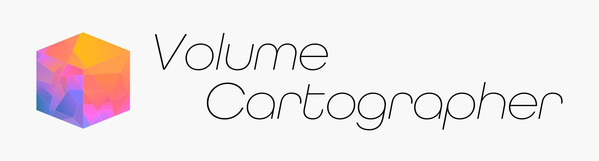
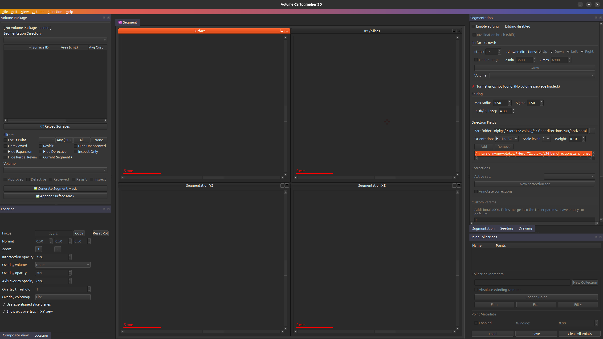
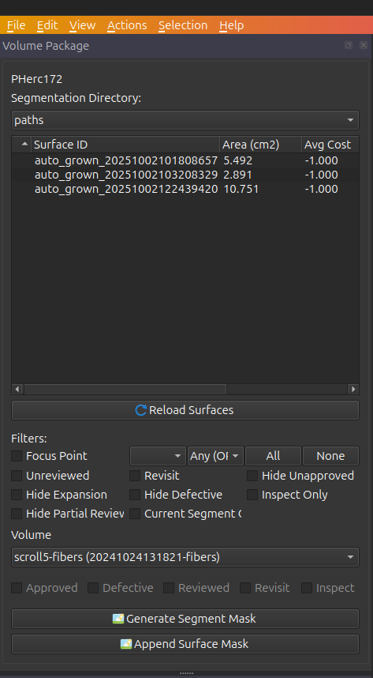
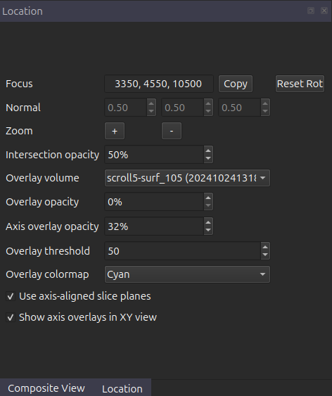
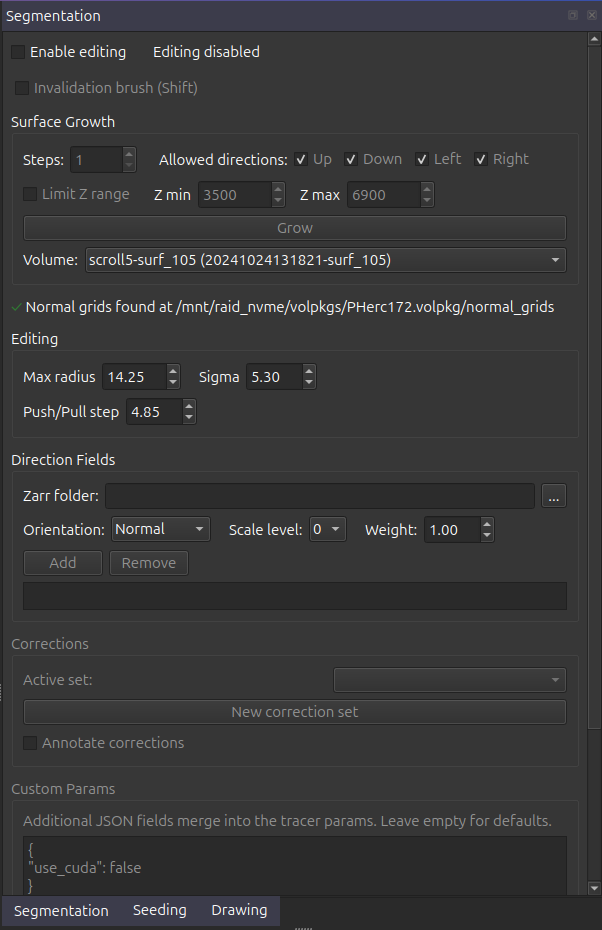
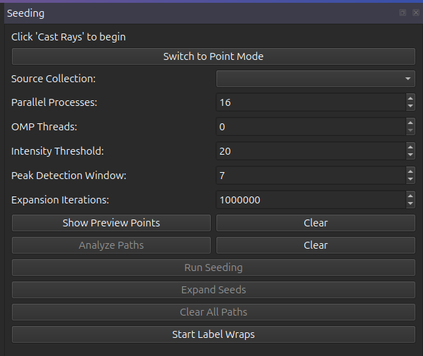

**Volume Cartographer** is a toolkit and set of cross-platform C++ libraries for
virtually unwrapping volumetric datasets. It was designed to recover text from
CT scans of ancient, badly damaged manuscripts, but can be applied in many
volumetric analysis applications.

This repository (a.k.a. **"VC3D"**) is a version of [EduceLab](https://educelab.engr.uky.edu/)'s original.
Via Vesuvius Challenge, it has gone through a few forks:
[EduceLab](https://github.com/educelab/volume-cartographer) (original) ->
[Julian Schilliger](https://github.com/schillij95/volume-cartographer-papyrus) (optical flow segmentation) ->
[Philip Allgaier](https://github.com/spacegaier/volume-cartographer) (performance/usability improvements) ->
[Hendrik Schilling and Sean Johnson](https://github.com/hendrikschilling/volume-cartographer) (various improvements) ->
this repository (developed and maintained by the Vesuvius Challenge team).
The original Volume Cartographer is a general purpose toolkit for virtual unwrapping, while this version is specialized for the frontier challenges of the Herculaneum papyri.

### Installation Instructions
Due to a complex set of dependencies, it is *highly* recommended to use the docker image. We host an up-to-date image on the [github container registry](https://github.com/ScrollPrize/villa/pkgs/container/villa%2Fvolume-cartographer) which can be pulled with a simple command :

```bash
docker pull ghcr.io/scrollprize/villa/volume-cartographer:edge
```

To install VC3D and all command-line tools from source on a recent Debian-family
Linux distribution using APT:

```bash
./build_from_src_debian.sh
```

The script installs build dependencies from system packages, builds VC3D and
flatboi, and installs the runtime under `/usr/local` so commands such as
`VC3D` and `vc_grow_seg_from_seed` are available from the terminal. The
distribution must provide CMake 3.28 or newer; Ubuntu 24.04+ and Debian 13+
meet that requirement. Set `JOBS`, `BUILD_DIR`, or `PREFIX` to override the
corresponding defaults.

#### Python source builds

`uv sync` in this directory builds the Python bindings from C++ source. The
monorepo's `vesuvius` environment also builds this local package when selecting
the `models` or `all` extra (including `uv sync --all-extras`). Install the native
build prerequisites first: `uv` manages Python packages, not system C++ libraries.
The [Python CI workflow](../.github/workflows/test-vesuvius.yml) lists the native
packages used for the Python-only build on Ubuntu.

**Qt6 Core development files are required even with GUI targets disabled.** The
shared SFTP implementation uses Qt Core for subprocess and URL handling. This
does not require a display server, Qt Widgets, or Python Qt bindings. Installing
`pyqt6` is not a substitute for the native development package.

To add Qt to an otherwise prepared build environment:

```bash
# Ubuntu / Debian
sudo apt-get install qt6-base-dev

# macOS (Homebrew)
brew install qt
```

These commands install Qt, not the complete native dependency set. The existing
Linux dependency setup and macOS build helper already include Qt. If CMake cannot
find `Qt6Config.cmake` after installation, add the Qt installation prefix to
`CMAKE_PREFIX_PATH` before running `uv sync`. Keep the Qt Core runtime libraries
installed when using the compiled bindings. See [SFTP access](docs/sftp_remote_access.md)
for the OpenSSH runtime and authentication requirements.

#### Windows

A self-contained Windows 10/11 installer (`VC3D-<version>-win64.exe`, with all dependencies bundled) is attached to each [GitHub release](https://github.com/ScrollPrize/villa/releases) — download, run, and launch VC3D from the Start menu. A portable `.zip` of the same tree is published alongside it.

To build natively from source on Windows, use an [MSYS2](https://www.msys2.org/) UCRT64 shell (see [.github/workflows/vc3d-windows.yml](../.github/workflows/vc3d-windows.yml) for the package list), then:

```bash
cmake --preset ci-windows-mingw
cmake --build --preset ci-windows-mingw
cpack --config build/ci-windows-mingw/CPackConfig.cmake
```

Alternatively, VC3D builds with the **native MSVC / Visual Studio 2022 toolchain**
using [vcpkg](https://github.com/microsoft/vcpkg) for dependencies, via the
`windows-msvc` preset. Bootstrap a vcpkg checkout, then from an *x64 Native Tools
Command Prompt for VS 2022* (so `cl.exe`/Ninja are on `PATH`):

```bat
set VCPKG_ROOT=C:\path\to\vcpkg
cmake --preset windows-msvc
cmake --build build\windows-msvc
```

The first configure builds the dependency closure (Qt, OpenCV, Ceres, CGAL, ...)
from source via vcpkg — this takes a while, but later configures restore it from
vcpkg's binary cache. The result is `build\windows-msvc\bin\VC3D.exe` with the Qt
plugins and dependency DLLs deployed alongside it, runnable in place. To work in
the VS2022 IDE, *Open Folder* on `volume-cartographer/`. Note that the VS
developer environment forces `VCPKG_ROOT` to the port-less bundled vcpkg, so
create a `CMakeUserPresets.json` (gitignored) that pins `CMAKE_TOOLCHAIN_FILE` to
your vcpkg and select the resulting local preset — otherwise VS reconfigures
against the wrong vcpkg and rebuilds every dependency.

Note: the flatboi SLIM flattening tool (PaStiX-based) is not available on Windows; Docker or WSL still covers that workflow.

#### macOS

A self-contained `VC3D.app` for Apple Silicon (`VC3D-<version>-macos-arm64.dmg`, with all dependencies bundled) is attached to each [GitHub release](https://github.com/ScrollPrize/villa/releases) — drag it to Applications. The app is not notarized, so the first launch is right-click → Open (or `xattr -dr com.apple.quarantine /Applications/VC3D.app`). The `vc_*` command-line tools ship inside the bundle at `VC3D.app/Contents/MacOS/`.

To build from source on macOS, use the Homebrew LLVM build helper:

```bash
scripts/build_macos.sh --install-deps
```

After dependencies are installed, rebuilds can use:

```bash
scripts/build_macos.sh
```

[installation instructions for docker](https://docs.docker.com/engine/install/)

[running docker as a non-root user](https://docs.docker.com/engine/install/linux-postinstall/)


### Basic introduction to VC3D 
The document below is a basic introduction to the ui and keybindings available in VC3D, more detailed documentation is available in the [segmentation tutorial](https://scrollprize.org/segmentation) on the scrollprize website.
> [!WARNING]
> if you are using Ubuntu, the default open file limit is 1024, and you may encounter errors when running vc3d. To fix this, run `ulimit -n 750000` in your terminal.

### Launching VC3D

If you're using docker : 

```bash
xhost +local:docker
sudo docker run -it --rm \
  -v "/path/to/data/:/path/to/data/" \
  -v /tmp/.X11-unix:/tmp/.X11-unix \
  -e DISPLAY=$DISPLAY \
  -e QT_QPA_PLATFORM=xcb \
  -e QT_X11_NO_MITSHM=1 \
ghcr.io/scrollprize/villa/volume-cartographer:edge
```

From source : 

```bash
/path/to/build/bin/VC3D
```



### Data 
VC3D requires a few changes to the data you may already have downloaded. All data must be in OME-Zarr format, of dtype uint8, and contain a meta.json file. To check if your zarr is in uint8 already, open a resolution group zarray file (located at /path/to.zarr/0/.zarray) look at the dtype field. "|u1" is uint8, and "|u2" is uint16. 

### Remote virtual-volume locators

VC3D can expose a public remote pyramid group as logical level 0 without
copying or renumbering the source Zarr. Append the portable fragment selector
`#vc-base-scale=N`, where `N` is an integer from 0 through 5:

```text
https://example.org/volume.zarr#vc-base-scale=2
s3://bucket/volume.zarr#vc-base-scale=2
```

Level 0 canonicalizes to the ordinary selector-free locator. For a base-2
view, source groups `/2`, `/3`, ... become logical levels 0, 1, ...; voxel
coordinates and voxel size are therefore those of physical `/2`. The source
must be a contiguous numeric, isotropic dyadic ZYX pyramid with zero coordinate
translations. Query parameters remain part of the network URL and must precede
the fragment, for example `volume.zarr?token=abc#vc-base-scale=2`.

Coordinate-bearing artifacts created by VC3D retain the selected source view
in their JSON metadata (`meta.json`, point collections, fibers, and atlas
`metadata.json`). For example:

```json
{
  "vc_open_data_coordinate_space": "PHerc1451/20260319101107@L2",
  "vc_open_data_source_path": "s3://path/to/the/source/volume",
  "vc_open_data_source_coordinate_level": 2,
  "vc_open_data_source_coordinate_scale_factor": 4,
  "vc_open_data_source_original_resolution": 2.4
}
```

The source path identifies the native volume without the `#vc-base-scale`
selector. The scale factor is `2^level`, and the original resolution is the
native level-0 voxel size in micrometers.

The selector is part of persistent volume identity but is never sent in HTTP
requests. Tools that support remote volumes receive the complete portable
locator. Local-only tools reject it instead of silently discarding the
selector. Catalog surfaces, normal grids, and overlays are automatically paired
only when their explicit coordinate-space tags match the selected view.

The meta.json contains the following information. The only real change from a standard VC meta.json is the inclusion of the `format:"zarr"` key.
```json
{"height":3550,"max":65535.0,"min":0.0,"name":"PHerc0332, 7.91 - zarr - s3_raw","slices":9778,"type":"vol","uuid":"20231117143551-zarr-s3_raw","voxelsize":7.91,"width":3400, "format":"zarr"}
```
Your folder structure should resemble this: 
```
.
└── scroll1.volpkg/
    ├── volumes/
    │   ├── s1_uint8_ome.zarr -- this is your volume data/
    │   │   └── meta.json - REQUIRED!
    │   └── 050_entire_scroll1_ome.zarr -- this is your surface prediction/
    │       └── meta.json - REQUIRED!
    ├── paths 
    └── config.json - REQUIRED!
```

### Working on remote volumes from the command line

`vc_grow_seg_from_seed` and `vc_render_tifxyz` both take the remote locators
described above as `-v` and stream them, so a segment can be grown and
rendered on a public OME-Zarr volume without downloading it or building a
volpkg. The tools fetch only the chunks they touch, over anonymous HTTPS or
S3. The GUI equivalent is `File -> Open Data Catalog…`, covered in the
[VC3D tutorial](https://scrollprize.org/tutorial_VC3D).

#### Finding a volume URL

The catalog of the Vesuvius Challenge open-data bucket lives at
`https://vesuvius-challenge-open-data.s3.amazonaws.com/metadata.json` and
describes the samples with their scans, volumes and segments. It is served
gzip-encoded, hence `--compressed`. This lists the volumes of one sample with
their level-0 shape and voxel size in micrometers:

```bash
curl -s --compressed https://vesuvius-challenge-open-data.s3.amazonaws.com/metadata.json |
  python3 -c 'import json, sys
for v in json.load(sys.stdin)["samples"]["PHercParis4"]["volumes"].values():
    print(v["long_id"], v["properties"]["shape"], v["properties"]["pixel_size_um"])'
```

A volume sits at `<sample>/volumes/<long_id>` in the bucket and can be
addressed either way:

```text
https://vesuvius-challenge-open-data.s3.amazonaws.com/PHercParis4/volumes/20260310173927-45.532um-11.0m-110keV-masked.zarr
s3://vesuvius-challenge-open-data/PHercParis4/volumes/20260310173927-45.532um-11.0m-110keV-masked.zarr
```

The examples below use this 45.532 µm PHercParis4 volume: level 0 is
4066×2264×2264 voxels stored in 128³ chunks, and the pyramid has levels 0 to 5.

#### Growing a segment

```bash
URL=https://vesuvius-challenge-open-data.s3.amazonaws.com/PHercParis4/volumes/20260310173927-45.532um-11.0m-110keV-masked.zarr
echo '{"mode": "seed", "cache_size": 2000000000, "generations": 8, "thread_limit": 4}' > params.json
vc_grow_seg_from_seed -v "$URL" -t out/ -p params.json --seed 1408 1408 1024
```

The seed is given as `x y z` in level-0 voxel coordinates. `cache_size` caps
the decoded chunk cache in bytes (default 1e9) and `thread_limit` the number
of OpenMP threads. The tracer reads the voxel size from the volume's
`metadata.json` (`voxelsize: 45.532` in the log) and writes the segment to
`out/auto_grown_<timestamp>/` as `x.tif`, `y.tif`, `z.tif`, `generations.tif`
and `meta.json`. It also keeps a copy of every chunk it fetches in VC3D's
remote cache directory, `~/.VC3D/remote_cache/<volume>-<id>/` unless
`remote_cache_dir` under `[viewer]` in `~/.VC3D/VC3D.ini` points elsewhere,
and later runs on the same volume read from there. On this volume the eight
generations take ten to twenty seconds on a 14-core workstation and fetch
about 2 MiB the first time.

To grow the segment further, pass `--resume out/auto_grown_<timestamp>` and
raise `generations` in `params.json`: it is the total generation count the
segment stops at, not a number of additional generations, so resuming with
the unchanged `generations: 8` reports `Resuming from generation 7 with 196
points`, adds nothing and writes the same 196 points again
(`--resume-generations 8` on the command line changes nothing either; the
tracer does not read that option). With `generations: 16` the same command
continues from generation 8 to 15 (1.41 cm² to 7.02 cm² here) and writes the
result to a new `auto_grown_<timestamp>/` under the target directory, reading
the remote volume as before.

#### Rendering it

```bash
vc_render_tifxyz -v "$URL" -s out/auto_grown_* \
  --scale 1 -g 0 --voxel-size 45.532 --voxel-unit micrometer --tif-output render/
```

This writes `render/00.tif` (360×360 pixels for the segment above, about
17 MiB fetched). Things to know:

- `-v` takes the URL itself, and nothing is written under a local directory.
  `--remote-url` is a deprecated alias for the same locator: alone it fills
  `-v`, next to an equal `-v` it warns, next to a different one it is an
  error. Since #1657 the renderer opens the remote volume the same way the
  tracer does, so the chunks it fetches persist in the shared remote cache
  (`~/.VC3D/remote_cache/<volume>-<id>/`, or `remote_cache_dir` under
  `[viewer]` in `VC3D.ini`); `--cache-gb` (default 16) sizes the process-wide
  decoded-chunk cache and `--prefetch-remote` warms it before rendering starts.
- The renderer reads the voxel size from the remote volume's metadata, as the
  tracer does: without `--voxel-size` the log says
  `Voxel size (from volume metadata): 45.532` and the TIFF carries the
  matching resolution tag. Metadata values count as micrometers, while
  `--voxel-unit` applies to `--voxel-size` and defaults to `nanometer`, so
  pass both flags when overriding; `--voxel-size 45.532` alone yields a TIFF
  resolution 1000× too large.
- `-g` selects the pyramid level: `-g 3` renders the same segment at 1/8
  scale (45×45 pixels, about 4 MiB fetched). A level the remote pyramid does
  not have fails immediately with
  `Error: group index 6 not available in remote zarr (present levels: 0 1 2 3 4 5)`.
- The `#vc-base-scale=N` selector described above applies to the tracer as
  well: with `#vc-base-scale=2` it reports
  `zarr dataset size for scale group 0 [1017, 566, 566]` and
  `voxelsize: 182.128`, the seed is expected in level-2 coordinates, and the
  segment's `meta.json` keeps the selector in `target_volume`.

### Opening a volume package and navigating the UI
First, click `File -> Open volpkg` and select the volpkg you wish to work with (select the folder ending in .volpkg)

On the left side of the UI, you have a few dock widgets. The first being the Volume Package / Surface List. The most important things to note here are the `Volume` dropdown list, which selects the currently displayed volume, and the `paths` surface list, which selects the currently displayed segment. Selecting a `Surface ID` should populate the `Surface` volume view in the top left, and initialize the rest the volume viewers.

There are a number of widgets, each with their own purpose. From top to bottom, and left to right : 

**Volume Package**

_Main UI widget for interacting with the volume package and surface list_



- `Reload Surfaces` : checks for new segmentations in the currently selected directory (by default, this is {volpkg}/paths
- `Filters` : Apply a single (or multiple) filters to show or hide specific surface ids from the current set
  - the most important one to remember here is `Current Segment Only`, which will hide the intersection overlays of all other segmentations in the volume viewers (this can greatly speed up ui interaction)
- `Approved`, `Defective`, `Reviewed`, `Inspect`  : tags which can be applied to the surface meta.json, and filtered against
- `Generate Surface Mask` and `Append Surface Mask` : Create a binary mask representing the valid surface, and optionally append the current selected volume to it as a multipage tif

**Location**

_Main UI widget for adjusting the ROI and display of the volume viewers_



- `Focus` : Displays the current location of the focus point (in XYZ) -- also can be used to set the focus point by modifying the values in the text box
- `Zoom` : Can be used in place of scroll wheel based zooming, mostly exists to alleviate touchy track pad zooming
- `Overlay Volume` : Selects the volume to overlay onto the base volume 
- `Overlay opacity` : Modifies the opacity of the overlay volume 
- `Axis overlay opacity` : Modifies the opacity of the plane slice axis overlays
- `Overlay threshold` : The value of the overlay array below which will not be rendered on the base volume (useful for removing background)
- `Overlay colormap` : The colormap to use for the overlay volume
- `Overlay interpolation` : Selects nearest-neighbor (default) or trilinear sampling independently of the base volume
- `Use axis aligned slices` : by default, vc3d attempts to align your XZ and YZ planes orthogonal to the normal of the current selected surface, this checkbox will instead use the plane normal as the axis to slice along
- `Show axis overlays in XY view` : if you do not wish to view the axis overlays in the XY view, this checkbox will disable them

_Keybinds:_
> - `Right mouse + drag` : pans the current viewer
> - `Scroll wheel` : zooms the current viewer
> - `Ctrl + left mouse button` : centers the focus point on the cursor position
> - `Scroll wheel click + drag` : rotates the slicing pane in the XZ or XY volume viewers
> - `Spacebar` : toggles the overlay on / off
> - `C` : toggle a composite view of the current surface in the segmentation window (parameters of which can be located in the "composite" dock tab, next to the location tab)

**Segmentation**

_Primary entry point for interacting with the segmentation, more info in the [segmentation docs](docs/segmentation.md)_
 


- `Enable editing` : Must be checked to enable any of the actions in this widget. Creates a copy of the base surface upon which we perform any of the following actions
- `Surface Growth` - grouping of settings mostly pertaining to the `Grow` action
  - `Steps` : The number of "generations" the growth action will undertake
  - `Allowed Directions` : Limits the directions of growth _relative to the flattened 2d quad surface!_ (i.e if you look in the segmentation window in the top left, and you set 'up' it will grow towards the top of the window)
  - `Limit Z range` : Constrains the growth to a selected `Z` range
  - `Volume` : the volume to pass to the `tracer()` call _should be a surface prediction volume!_ 
- `Editing` - grouping of settings which mostly apply to drag/push/pull actions for mesh deformation. All mesh deformation-type actions are performed on a gaussian-like area which has a circular shape centered at the current mouse location and whose strength is reduced as we reach the edges. _Radius is in quad vertices in the 2d flattened surface._
  - `Max Radius` : the maximum radius of the area to be affected by the action
  - `Sigma` : the _strength_ of the push/pull on affected vertices other the original one (aka how quickly the influence tapers as we step away from the original point)
  - `Push Pull Step` : The number of "offset steps" to take along the surface normal (in voxels) for each push/pull action (this parameter only affects the push/pull in the segmentation window that is applied with `F` and `G`)
- `Direction Fields`
  - `Zarr folder` : the path containing the direction field you want to use for optimization (ex: `/path/to/scroll.volpkg/fiber-directions.zarr/horizontal`) _these are optional_ 
    - `Orientation` : the orientation/type of the direction field (from horizontal, vertical, or normal)
    - `Scale level` : the zarr resolution from which these were computed
    - `Weight` : the weight to apply to the field when optimizing.
- `Corrections` : group which controls / manages the "correction points" for the current growth session
  - `New correction set` : creates a new point collection containing a single "correction" 
      
_Keybinds:_
> - `F` or `G` : push/pull the current surface in a positive or negative direction along the surface normal (only works in the surface
> - `1`, `2`, `3`, `4`, `5` : select a direction to grow in -- left, up, down, right, all, respectively
> - `T` : create a new correction set

**Seeding** 

_Widget for creating initial segmentations which can be used for traces or later growth actions_



- `Switch to point mode` : toggles the seeding widget into draw mode (not recommended)
- `Source Collection` : the source point collection to use as seed points (will autofill if you draw/analyze)
- `Parallel processes` : the number of processes to run seeding with
- `OMP Threads` : limits the amount of threads each process can use (recommend to set this to 1)
- `Intensity threshold` : mostly unused, can leave default
- `Peak detection window` : how closely each peak detected along a path/raycast can be
- `Expansion iterations` : how many iterations to run expansion mode on after initial seeding
- `Show Preview Points` : unused, can be ignored
- `Clear` (both) : clears current points, paths, or raycasts
- `Analyze Paths` : after drawing paths, detect peaks along the line segment on which to place seed points
- `Run seeding` : creates segmentations from the current seed points
- `Expand seeds` : expands the current seed points to the given number of iterations
- `Clear all paths` : clears any user drawn paths / points (use this over the clear buttons most of the time)
- `Start label wraps` : this is used for absolute or relative wrap labels, is not used during the seeding step, will detail in another document

### Patch-to-patch graph linking performance

Patch overlap linking queries all eligible target patches together for each
seed sample, instead of scanning the same seed separately for every target.
Searches use up to eight workers automatically; small patches use fewer.
`--overlap-workers 1` forces serial search, and a positive value requests that
many workers. Python accepts `db.link_patch_overlaps(path, workers=4)`; C++ uses
`PatchOverlapParams::workers`. The default is `0` (automatic).

Workers retain bounded correspondence sets and merge in source order. Nearest
triangle selection, distance ties, thinning, correspondence caps, RANSAC seeds,
fitting and acceptance thresholds retain the original behavior. Index queries
borrow immutable raw filter sets, avoid allocations for empty results, and
share one index lock across each batch of 512 samples. Progress callbacks run
on the calling thread, including updates during correspondence searches.

Measurements on Linux arm64 with GCC 13, `RelWithDebInfo` and LTO, three runs
per version with a fresh graph each time (seconds, min / median / max):

| Input | Original total | Optimized total | Median speedup |
| --- | --- | --- | --- |
| 8 real patches | 0.710 / 0.721 / 0.729 | 0.225 / 0.277 / 0.323 | 2.6x |
| 24 real patches | 1.563 / 1.565 / 1.569 | 0.298 / 0.317 / 0.328 | 4.9x |
| 3 dense synthetic patches | 2.768 / 2.791 / 2.860 | 0.704 / 0.723 / 0.840 | 3.9x |

Real inputs were small symlink subsets of
`/home/sean/Desktop/spiral_dataset_graph_uuid/verified_patches`, staged in
`/tmp/vc-overlap-perf/patches` and `patches24`. The 24-patch subset was the first
24 sorted directories with at most 6 MB of TIFF geometry, giving 434,673 seed
samples and 50 bounding-box candidate pairs. The synthetic input contained
three 321x321 grids with curvature, small displacements, reflection and a hole,
using sample spacing 1 to exercise the 4,096-correspondence cap. No full
collection was tested; these timings do not predict full-collection runtime.

Phase profiling identified correspondence collection as the bottleneck:
on 24 patches its median fell from 1.389 s to 0.144 s (9.6x), and spatial
queries fell from 3,902,813 to 408,683. Loading, indexing, fitting and agreement
checks accounted for much less time. All accepted links (1, 9 and 3 respectively)
and their complete fit metadata matched the original exactly across all runs.
Regression tests additionally compare serial/parallel capped fits, cancellation,
callback thread identity and batched/individual nearest queries.

Build with `ninja -C build vc_graph_import vc_graph_bindings test_graph_links
test_surface_patch_index`. The benchmark harness in `/tmp/vc-overlap-perf/bench.py`
times the command below, with a new output basename for each run. The original
executable and core library were saved in that temporary directory for comparison;
benchmark inputs and output graphs are not repository files.

```sh
VC_PATCH_OVERLAP_PROFILE=1 build/bin/vc_graph_import \
  --db /tmp/vc-overlap-perf/example.vcgr --author overlap-perf \
  --link-patch-overlaps /tmp/vc-overlap-perf/patches24 --no-progress \
  --export-json /tmp/vc-overlap-perf/example.json
```

Setting `VC_PATCH_OVERLAP_PROFILE` emits one `PATCH_OVERLAP_PROFILE` JSON line
on stderr with phase timings and query counts. Profiling is off by default.

### Fiber-to-patch graph links

`vc_graph_import` reports progress on stderr by default for every import and
linking operation. It shows the current stage, completed/total counts and a bar
when the total is known, elapsed time, and an estimated remaining time once
progress is available. A heartbeat continues during individual slow loads,
spatial-index builds, and database commits. Redirected output uses periodic
plain-text lines; `--no-progress` disables reporting. Final reports stay on stdout.

C++ callers can provide `vc::util::ProgressCallback` through detector
`params.progress` or the optional last argument of the metadata import functions.
The library itself does not print progress. `vc::util::TerminalProgress` is the
shared CLI renderer, also used by `vc_zarr_download_region`; finish it before
printing an operation's summary. Callback string views must be copied if retained.

`vc_graph_import` proposes pending fiber-to-patch links using CT sheet normals:

```sh
build/bin/vc_graph_import --db graph.vcgr --author "$USER" \
  --link-fiber-patches /path/to/fibers --segments /path/to/patches \
  --ct /path/to/ct.zarr --ct-level 0
```

Inputs are fiber JSON files, tifxyz patch directories with valid UUIDs, and a
uint8 CT volume. The detector registers missing objects, finds anchors through
long fiber contact and strip agreement, then grows through same-sheet patch
overlap. The strip has the centerline plus **one row on each side at 20 working
voxels**. `--fiber-strip-rows` and `--fiber-anchor-contact` control its width and
minimum anchor contact (default 75 working voxels).

Fiber contacts and anchors can use every dense line point between the projected
first and last control points, inclusive; extensions outside that span are
excluded. Without controls, the full line is eligible. The saved anchor is the
median contact's original `line_points` index and source XYZ position, without
snapping to a control point. Edge metadata marks `anchor_index_space` as
`line_points`. Reviewed legacy anchors are preserved; pending anchors with the
old index convention are replaced on rerun.

Both fiber import and fiber-to-patch linking populate `fiber.length` from the
full dense polyline in source voxels, including extensions beyond the control
points. The importer uses the control-point polyline when there are no dense
points. Linking scales do not affect the stored length. Existing lengths are
refreshed on processing, including re-imports of unchanged files, without
resetting approvals or generations.

Normals use the selected CT-only estimator: a 2/24 isotropic seed, followed by
three 1/24/4 anisotropic tensor refinements with gradient magnitude weighting.
Widths are selected CT voxels. The current sampler integrates on a global
three-voxel lattice within radius 48, using full-resolution Gaussian derivatives
and a complete six-voxel derivative halo. It reuses gradient tiles across nearby
queries and evaluates weights at the original query position. Flat or ambiguous
CT has no valid normal. The default CT path needs no Lasagna manifest and does
not use `pred_dt` snapping. Measured patch-normal errors and workflow timings
are recorded below. Historical seven-row link accuracy has not been established
for this variant.

`--fiber-scale` and `--patch-scale` multiply source XYZ into common working
voxels (defaults 1). `--working-to-base-scale` and `--ct-to-base-scale` specify
working and **selected-level CT** voxel sizes in common base units (defaults 1).
CT coordinates are working XYZ times their ratio; the level adds no extra scaling.
For full-resolution fibers, quarter-resolution patches and quarter-resolution CT:
`--fiber-scale 0.25 --patch-scale 1 --working-to-base-scale 4 --ct-to-base-scale 4`.
All link thresholds and strip spacing use working voxels. Scaling is in memory;
files, anchor positions, and registered geometry retain source coordinates.

For a controlled comparison, `--normals-manifest /path/to/normals.lasagna.json`
selects Lasagna normals through the **same** strip marching, contact, anchor and
growth code. `--ct` is then optional. Lasagna uses `--working-to-base-scale`;
CT level/scaling options apply only to CT. Both sources leave `pred_dt` snapping
disabled. Python accepts the equivalent `normals_manifest` keyword. This option
allows measuring normal-source effects without changing strip width or gates.

Edges record measurements, rounds, coordinate scales, the actual normal source,
estimator ID, and detector version 3. Reruns preserve reviewed/manual edges; stale pending links
are removed only for successfully processed inputs. Failed inputs are excluded.

C++ exposes `vc::graph_links::linkFibersToPatches`. Python exposes
`GraphDb.link_fibers_to_patches(fibers_dir, patches_dir, ct_volume, **kwargs)`;
snake_case keywords match `FiberPatchParams`, including `ct_level` and
`ct_to_base_scale`. `vc.graph.CtSheetNormalSampler` exposes the same estimator
for numerical verification and direct normal queries.

### CT normal validation

The default method is **`ct-anisotropic-1-24-4-grid3-r48-v4`**. Its radius-48
support contains 33³ quadrature samples. A 1024-entry indexed LRU caches
48-voxel gradient tiles; missing tiles share a bounding CT read. Independent
strip columns march in reverse order to reuse tiles from the centerline pass.
Retained sampler storage is about **102 MiB**, excluding the shared CT chunk
cache. The selected CT level defaults to 0; changing levels does not rescale
the estimator's widths automatically.

Validation on 535 saved regression probes (508 patch points and 27 fiber
points) produced valid normals for both CT and Lasagna at every point. Angular
errors are unsigned normal-axis errors against patch geometry:

| Probe set / method | Mean error | Median error | p95 error | Maximum error |
| --- | ---: | ---: | ---: | ---: |
| Patch points, CT | 2.70° | 2.26° | 5.95° | 24.70° |
| Patch points, Lasagna | 3.38° | 2.92° | 7.15° | 18.00° |
| Fiber points, CT | 3.20° | 2.71° | 7.29° | 11.21° |
| Fiber points, Lasagna | 4.24° | 4.01° | 9.41° | 10.37° |

CT has better mean/median/p95 error on these probes, but worse maximum error.
These reused regression probes are not a new unseen holdout or a measurement
of link precision.

Small-workflow timing on Linux/aarch64, GCC 13, RelWithDebInfo, using level 0 of
`s1_ds2.zarr`, separate processes and warm OS caches:

| Workflow | CT total | Lasagna total | CT normal sampling |
| --- | ---: | ---: | ---: |
| Two fibers, 849 candidate patches | 4.75 s | 1.16 s | 3.43 s |
| One fiber, three patches | 0.83 s | 0.12 s | 0.67 s |

The two-fiber input made 5,589 valid normal calls and produced no links. The
selected positive case made 1,242 valid calls and retained the same three links
and two anchors with both normal sources. No full-collection workflow was run.
The standalone benchmark and experiment scripts were removed after this work;
these numbers record the completed validation, not a bundled benchmark suite.

### Track-to-track graph links

`vc::graph_links::linkTracksToTracks` implements Spiral's exact-voxel crossing
relation in `vc_graph_links`. Tracks must share an integer voxel, belong to
opposite known families (`horizontal` and `vertical`), and have an unsigned
local tangent angle of at least 30°. Tangents extend 12 source voxels from the
crossing in each direction, measured by Euclidean distance. Repeated visits to
a voxel use the first local point index. Events are clustered when consecutive
indices differ by at most four on both tracks; each cluster contributes its
upper median. One crossing per pair survives: greatest minimum arclength to
the four endpoints, then greatest first/second arclength and point indices.
Tracks are ordered by source ID to make this tie-breaking deterministic.

Pass the tracks DBM directly. The linker discovers its packed geometry,
registers the tracks automatically, computes crossings in C++, and writes
pending edges to SQLite. There is no selected-tracks JSON step and
`crossings.npz` is neither read nor written.

```sh
ninja -C build vc_graph_import vc_graph_bindings test_graph_links
build/bin/vc_graph_import --db graph.vcgr --author "$USER" \
  --link-track-tracks /mnt/bigpc/spiral_dataset_working/tracks/2um_ds2_ps256_surf_v2.dbm \
  --track-workers 4
```

Python uses the same entry point:

```python
from vc.graph import GraphDb

with GraphDb.open("graph.vcgr", author="reviewer") as db:
    report = db.link_tracks_to_tracks("/data/tracks/example.dbm", workers=4)
    assert not report["problems"], report["problems"]
```

The DBM logical path and its `.dbm.db` backing filename are both accepted.
Geometry comes from the adjacent `<dbm>.vctracks` directory; this already exists
for the example above. `extract_surface_tracks.py` writes the DBM during
extraction and creates this packed directory when finished by default
(`--no-packed-store` disables that final step). The linker checks its source
fingerprint against the DBM backing files before linking. For older DBMs
without a current packed geometry store, create one using Spiral's
`convert_track_store.py` (use `--force` to refresh a stale store).
A `.vctracks` directory can also be passed directly.
The packed files must remain immutable during a run. Full-dataset runs keep
coordinates memory mapped rather than copying the entire coordinate array.

All tracks in the input are registered by default, including isolated tracks.
For a small run, optionally select source IDs with repeated
`--track-source-id <id>` flags, or `source_ids=[...]` in Python. Source IDs are
stable `source_ids.u64` values, not row numbers. Registration and edge updates
commit together; failures leave neither partial registration nor partial edges.
Reruns reuse existing UUIDs and preserve object approvals and generations.
Both track linkers populate `track.length` with polyline arclength: the sum of
Euclidean distances between consecutive raw points, in source dataset voxels.
Repeated points contribute zero. Track-to-patch coordinate scaling does not
change this stored length. Reruns refresh lengths for processed existing tracks
without resetting their approvals or generations; unchanged lengths are a no-op.
Track family is read from the packed family code: `horizontal`, `vertical`, or
empty for unknown. Both linkers fill missing families on existing registrations;
a conflicting nonempty family is reported as an input error.

The advanced already-registered-track API is still available: omit the input
path and optionally restrict `dataset_ref` / `track_uuids` in Python, or use a
bare `--link-track-tracks` with `--track-dataset` / repeated `--track-uuid`.
New registrations use the canonical packed path as `dataset_ref`; an existing
relative-path identity is reused when it resolves to the same dataset.

Other Python keywords are `min_angle_degrees` (30),
`tangent_radius_voxels` (12), `cluster_index_radius` (4), `edge_kind`
(`crossing`), and `replace_stale_pending` (true). Workers default to one.
Crossings are computed **within each dataset**; separate datasets are not
assumed to share a coordinate system. Anchors store raw local point indices
and XYZ positions/directions in **source dataset voxel units**, reversing the
packed ZYX coordinates. Edge metadata records the parameters, clearance and
both source IDs/arclengths, keyed by object UUID to survive endpoint ordering.

New edges are pending. Reruns deduplicate existing edges and remove only this
detector's stale pending edges whose endpoints are both selected. Reviewed and
manual edges remain. A load/validation failure or cancellation before commit
leaves all edges unchanged; inspect `report["problems"]`. The CLI exits nonzero
on detector failure. Invalid parameter values raise an exception.

The independent `vc_track_crossings` kernel is also used by Spiral's native
Python adapter. Spiral's CMake defaults to the sibling `volume-cartographer`
checkout; `VC_TRACK_CROSSINGS_ROOT` can point at another checkout. The kernel
retains the native radix sort, parallel event scan and CSR consolidation, with
a serial fallback when compiled without OpenMP. No Python dependency is added
to the C++ graph library.

Validation used 24 real tracks (6,192 points) from
`2um_ds2_ps256_surf_v2.dbm.vctracks`: all 18 crossings, raw indices,
arclengths and clearances matched both Spiral's Python fallback and its
previous native kernel exactly. The graph linker produced the same 18 edges
and an idempotent rerun. The DBM CLI entry point also registered those 24 tracks
from `/mnt/bigpc/spiral_dataset_working/tracks` and reproduced the same 18 edges;
rerunning with the `.dbm.db` backing filename reused all identities and links.
Regression tests cover missing and deliberately invalid `crossings.npz` files:
neither is read, and no sidecar is created. No full-collection crossing test was run.

Regression checks:

```sh
build/bin/test_graph_links
PYTEST_DISABLE_PLUGIN_AUTOLOAD=1 PYTHONPATH="$PWD/build/python" \
  python -m pytest python/tests/test_graph.py -q
```

Use a Python interpreter matching the compiled bindings, with NumPy and pytest
available; it must load `vc` from `build/python`, not an older installed build.

### Track-to-patch graph links

Track-to-patch linking shares the fiber-to-patch implementation: dense-point
proximity, CT sheet-normal strips, long-contact anchors, strip agreement, and
same-sheet growth all use the same rules and defaults.

```sh
build/bin/vc_graph_import --db graph.vcgr --author "$USER" \
  --link-track-patches /path/to/tracks.dbm --segments /path/to/patches \
  --ct /path/to/ct.zarr --track-scale 1 --patch-scale 1
```

The DBM resolves to its adjacent `.vctracks` geometry, with the same freshness
checks and object identities as track-to-track linking. A packed directory is
also accepted. No selected-tracks JSON or `crossings.npz` is needed. By default
all input tracks are considered; use repeated `--track-source-id <id>` or
`--track-uuid <uuid>` flags to restrict the run.

`--track-scale` converts source track XYZ to working coordinates. Patch and CT
scaling follow the fiber-to-patch rules above. For tracks, patches and CT all
at quarter resolution, use `--track-scale 1 --patch-scale 1
--working-to-base-scale 4 --ct-to-base-scale 4`. `--strip-rows` and
`--anchor-contact` control the shared strip width and minimum contact length.
CT normals are the default; `--normals-manifest` selects the same optional
Lasagna comparison path.

C++ exposes `vc::graph_links::linkTracksToPatches` and `TrackPatchParams`.
Python exposes:

```python
with GraphDb.open("graph.vcgr", author="reviewer") as db:
    report = db.link_tracks_to_patches(
        "/path/to/tracks.dbm", "/path/to/patches", "/path/to/ct.zarr",
        track_scale=1, patch_scale=1,
        working_to_base_scale=4, ct_to_base_scale=4,
        source_ids=[6317896897264, 6317896894401],
    )
    assert not report["problems"], report["problems"]
```

Python accepts all shared fiber-link keywords, with `track_scale` replacing
`fiber_scale`, plus optional `source_ids` and `track_uuids` selections. Every raw
track point is eligible. Anchors save the median contact's raw local index and
source XYZ position, with `anchor_index_space: "line_points"`. Edge provenance
records detector `track-patch` version 1, source identity, normal method, scales,
and contact/strip/growth measurements.

Registration and edges commit together. Reviewed/manual edges are preserved;
stale pending links are removed only for successfully processed tracks and
patches in the current selection. Unreadable geometry is reported and skipped,
and its existing links remain. Cancellation commits no changes.

Validation used four real tracks (977 points) and three real patches: three
links matched equivalent fiber inputs exactly, including anchors and all
contact/strip/growth measurements. Rerunning skipped all three existing links;
the CLI produced the same result. No full-collection test was run. Synthetic
regressions also cover coordinate scaling, growth, wrong-sheet rejection,
fiber control-point bounds, identity reuse, and preservation of reviewed edges.
