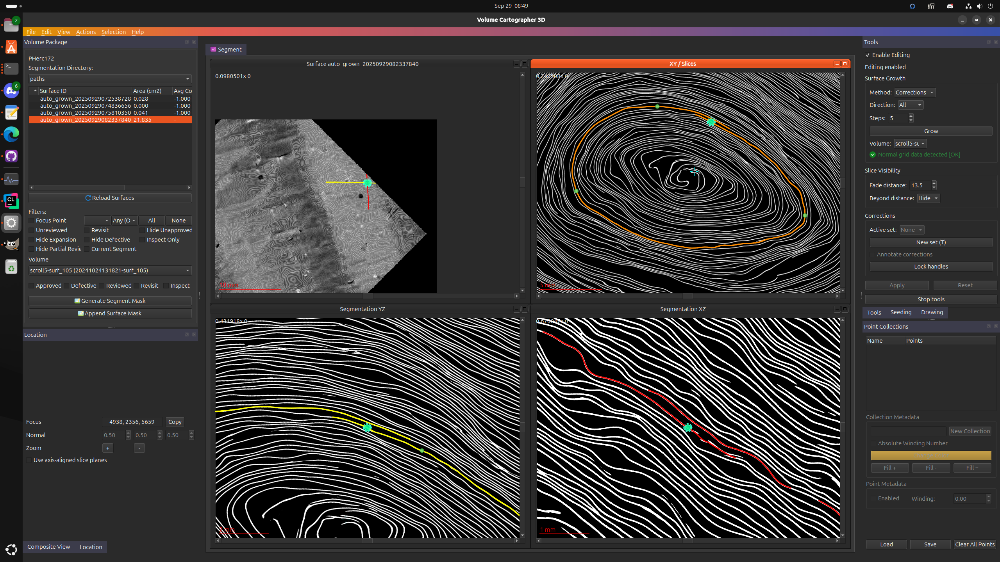
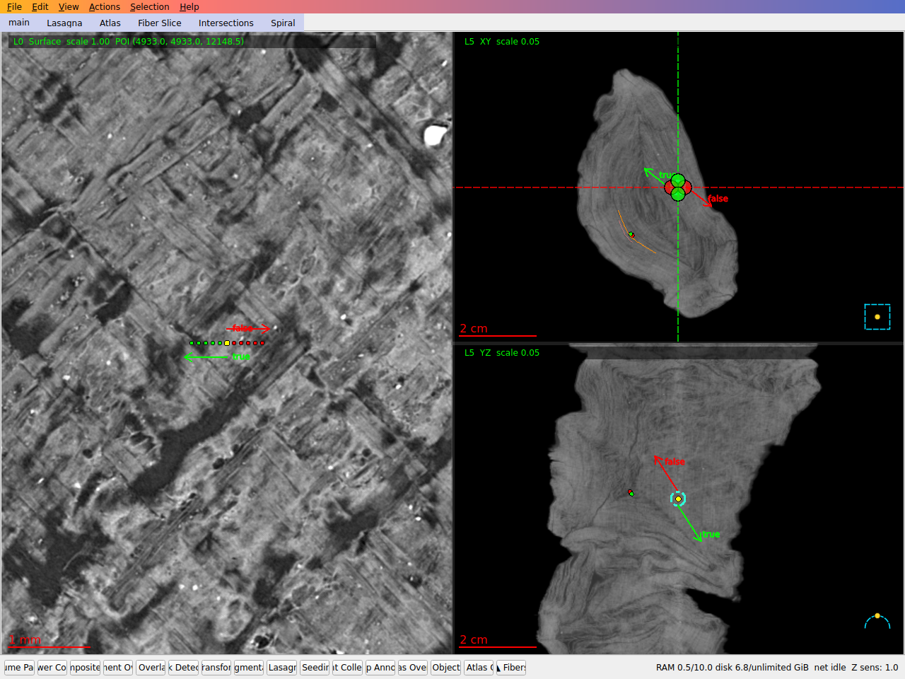
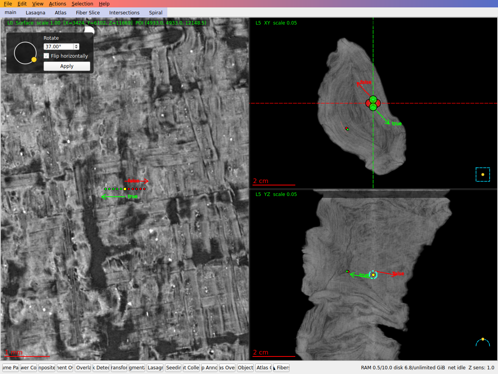
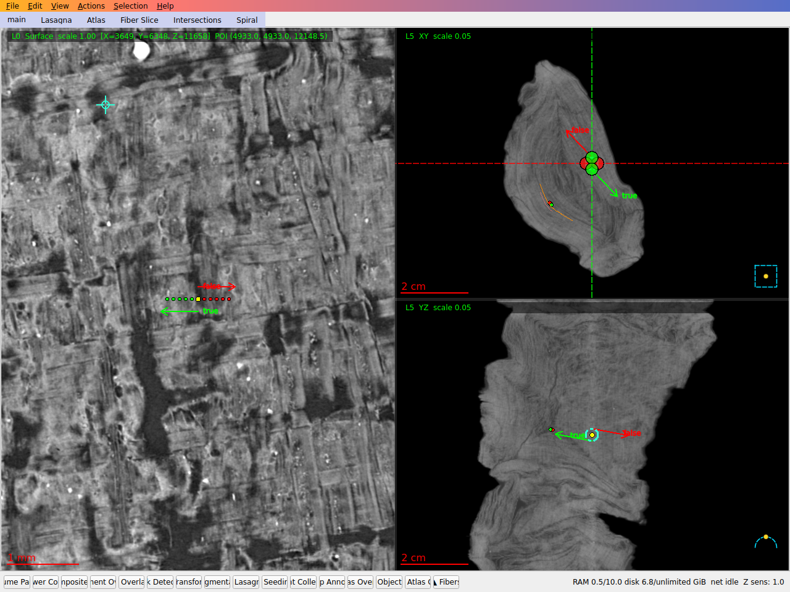
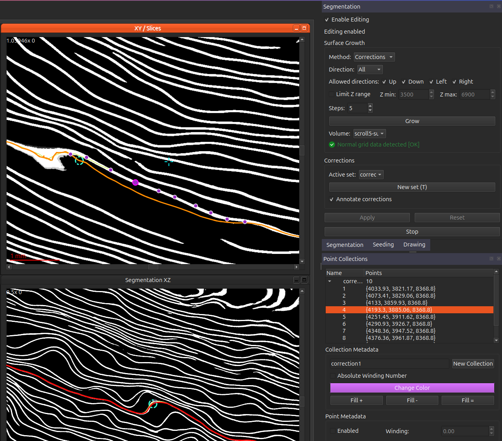

Segmentation growth and editing is now supported within the segmentation widget. Starting from a seed patch (or any surface in the attached object store), you can grow them using the tracing method used during regular patch growth, and influence the direction it grows or modify its underlying geoemetry right in vc3d.

This is relatively untested, but (should) work. It's possible to easily create relatively large segmentations rather quickly -- i created this nearly 22cm segmentation in less than 5 minutes. 

**rotate and flip a surface**

Select a segmentation, then open `Actions > Transforms > Rotate`. Rotating an Open Data catalog surface rotates it in your object store; its catalog version stays its first revision there (surface panel context menu, `Reset to Open Data Version`). Adjust the angle and, if needed, enable `Flip horizontally`; the segmentation view previews rotation followed by the horizontal flip. Select `Apply` to commit the transformed surface to the store as a new geometry revision. Rotation and flip preview remain available for surfaces with disconnected component ranges, but `Apply` is disabled because those cannot yet be transformed safely.

The captures below were made with an earlier build using sample `PHerc0800`, segment `20251028220955`, from the Vesuvius Challenge Open Data catalog. They demonstrate the transform output.

| Original | Preview: 37° + horizontal flip | Transformed result after Apply (earlier build) |
| --- | --- | --- |
|  |  |  |

**prerequisites** 
- you must have normal grids for the volume attached to the project (`File > Attach Normal Grid...`, a `normal_grids` root with `xy/`, `xz/` and `yz/` subdirectories)
  - to compute these, run `/path/to/build/bin/vc_gen_normalgrids -i /path/to/volume.zarr -o /path/to/normal_grids`; run it without arguments (or with `--help`) to see the options
  - a store published under a URL can be streamed instead of copied: create the local directory you pass as the grid path and write `normal-grids-remote.json` into it, containing `{"url": "https://.../....normal-grids"}`; the loader then fetches each slice it needs on demand and caches it there. VC3D writes that file when you pick a remote store in its Open Data dialog; on the command line there is no flag for it, so write it by hand.
  - while tracing, the slices that were opened stay in a cache bounded by `VC_GRID_CACHE_BYTES` (default 2 GiB, and never fewer than the 512 slices kept before). The default holds a patch of about 1 cm² on PHerc1447's 8.64 µm store; larger patches and runs on many threads gain from a larger budget (at eight threads a 200-generation patch there stops gaining at about 8 GiB, `VC_GRID_CACHE_BYTES=8589934592`). The count is of each slice's whole mapped file plus what it has decoded from it (paths and bucket indices). On the stores measured the file is nearly all of it and is more than what is resident: about twice on PHerc1447, about nine times on PHercParis4's 2.4 µm store, whose slices run to about 5 MiB each and are read a small window at a time; a store like that wants more still, for example `VC_GRID_CACHE_BYTES=17179869184`. `VC_GRID_CACHE_BYTES=0` restores the older limit of 512 slices.
- you must have an existing surface in the attached object store (File > Object Store > Attach Object Store...), or create one using the seeding widget

**methods**

there are two main ways to influence growth of a segmentation:
- mesh deformation (done by simply clicking near the segmentation to pull its vertices)
- correction points

these can be used together, or independently -- the mesh deformation at times creates some undesirable geometry, so it's recommended for now to stick mostly with correction points, but this is something we're continuing to work on. 

**useage**

1. open a project and attach its object store
2. click on the surface you want to edit in the surface panel (a catalog surface must be copied first)
3. ensure `enable editing` is checked
4. ensure the mode is set to `corrections`
5. inspect the patch and see if there are any areas that have strayed from the correct path and require corrections
   6. if you find one , press `T` to begin a new point collection. each point collection is itself a single "correction". The first point you place is "special" and should be placed on the spot where the patch strayed off course, and the remaining should be placed on the path that the patch should have followed. 
   7. find any other areas to correct (if they exist) and press `T` again to create a new collection
   8. if you desire , you can deform the mesh by clicking near the segmentation line , the mesh should "pull" towards the clicked location
9. once you've completed all your corrections, set the number of `steps` (aka generations) you would like to grow, the directions you'd like to grow in , and any z limits you may want to apply. 
10. click the `grow` button , and the patch will grow for that number of generations. i'd stick with a small number of steps for now, likely somewhere between 5-20, as its easier to correct a small error than one that has gone on for some time
11. repeat steps 9-10 until you feel like stopping. Edits, corrections and growth are committed to the surface in the store as you go; its revision history replaces backups.
