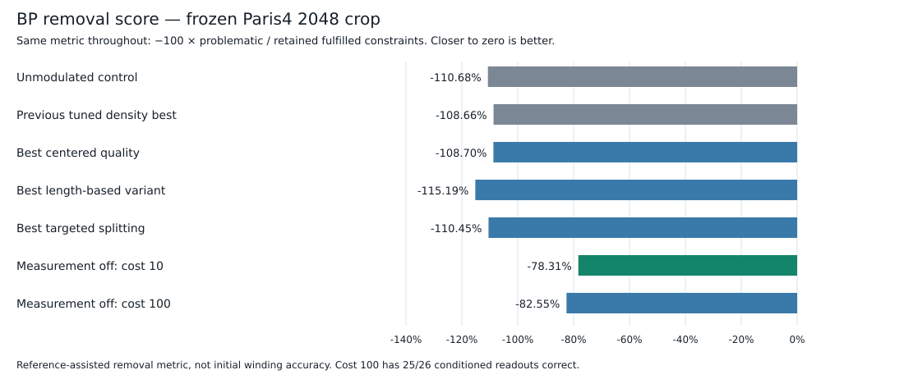

# Alternative retention policies — 2026-09-27

Status: complete, 31 recorded trials. No production defaults changed. **Individual ordinary-measurement disablement is the only substantial removal-score gain.** Other proposals are retained as opt-in experiments, not recommended defaults.

| Method | Removal score ↑ | Initial independent accuracy ↑ |
|---|---:|---:|
| Unmodulated control | -110.68% | 38.46% |
| Previous tuned density best | -108.66% | 38.46% |
| Best centered quality | -108.70% | 38.46% |
| Best length-based variant | -115.19% | 34.62% |
| Best targeted splitting | -110.45% | 30.77% |
| Measurement off: cost 10 | -78.31% | 38.46% |
| Measurement off: cost 100 | -82.55% | 42.31% |

Cost 100's separate conditioned-reference readout is 25/26, versus 26/26 for cost 10. See Stage D before interpreting its removal score. These are in-sample, fixed-message-budget trials, not converged global optima or validation on other crops.



Machine-readable complete results and initial ladders: [results JSON](2026-09-27-density-alternatives-results.json).

## Protocol

Frozen Paris4 2048 crop, new beam8 traces, 40/80 coverage ellipse, 45° duplicate-angle limit, reverse consistency. Reuses the exact trace artifact and reference set from [the density sweep](2026-09-24-density-sweep.md); no inference or tracing rerun. RelWithDebInfo native build, 32 threads per case, unchanged BP message budgets. Centered/length use four concurrent cases; cuts/measurement use two each and overlap as CPU slots become available (at most seven native jobs). Every invocation records command, binary/input hashes, source patch, log and wall time. Runtime is descriptive under this concurrent load, not a controlled throughput comparison.

Primary score is the existing **−100 × problematic constraints / retained fulfilled constraints** (closer to zero is better). This is not an accuracy percentage and can be below −100%. Independent winding accuracy is read from the initial unconditioned solve; reference-conditioned accuracy is not claimed as inference accuracy. Defect-piece percentages refer to the initial BP's final classification, not the later removal fraction. Measurement `eligible` counters count eligible factors with both decoded endpoints active, not all potentially eligible input factors.

## Trials

1. **Centered quality:** tuned mean/median/worst density factors raised to powers 0.5, 1, 2, normalized to initial incident-measurement-weighted mean 1. Also repeat each original mapping and a uniform multiplier with its same weighted mean. Centered mappings therefore share the original control's total defect budget.
2. **Length rather than degree:** blend incident count with baseline-calibrated piece length at 50% and 100%. Baseline incident-count/length rate remains fixed across reference conditioning and pruning. Test plain factors and the best centered mapping, renormalized to the blended measure.
3. **Localized splitting:** boundaries around sustained high tracer-cost intervals, using length-weighted 90th percentile/64-vx and 95th percentile/128-vx settings. No GT informs boundaries. Shared native interval extraction subdivides each partition; continuity remains. Controls shuffle partition lengths along the same trace, preserving the exact length multiset. Constraint graph and counts change, so raw counts are not directly comparable to unchanged-graph variants.
4. **Individual measurement disablement:** binary on/off choice marginalized in sum-product with off costs 10, 100, 1000. For enabled energy E and off cost C, normalized effective energy is `min(E,C) - T*log1p(exp(-abs(E-C)/T)) + T*log1p(exp(-C/T))`. Hard continuity and reference evidence cannot disable. Ordinary off constraints no longer force endpoint pruning, but still count as problematic in the original benchmark. Report MAP-off counts and conditional off probabilities at decoded endpoints—not a full marginal posterior over endpoint assignments.

## Reproduction

Build using `bash /home/hendrik/villa2/vesuvius/scripts/run_fiber3d_native_build`.

Run the existing approved runner, choosing the stage configuration:

```
/home/hendrik/.venv_las/bin/python /home/hendrik/villa2/vesuvius/scripts/run_classic_fiber_evaluation.py crop-benchmark --config /home/hendrik/villa2/vesuvius/src/vesuvius/neural_tracing/fiber_trace_3d/configs/crop_benchmark_density_alternatives_20260927.json
```

Subsequent stage configs insert `_length`, `_cuts`, or `_measurement` before `_20260927.json`. Length reads the completed centered summary. Each stage first runs the native winding regression suite. Outputs are `/ephemeral/hendrik/fiber_crop_bench/20260927_density_alternatives_{centered,length,cuts,measurement}`.

Python helper validation: `/home/hendrik/.venv_las/bin/python -m pytest -q vesuvius/tests/neural_tracing/test_density_alternatives.py`.

## Stage A results

| Variant | Removal score | Independent winding correct | Initial BP defects |
|---|---:|---:|---:|
| control | -110.6766% | 38.46% | 15.60% |
| mean-original | -109.6787% | 38.46% | 16.35% |
| mean-uniform | -111.4091% | 38.46% | 15.17% |
| mean-centered-0p5 | -109.2539% | 34.62% | 15.86% |
| mean-centered-1p0 | -109.6024% | 38.46% | 16.32% |
| mean-centered-2p0 | -124.9152% | 34.62% | 16.10% |
| median-original | -109.1046% | 38.46% | 15.91% |
| median-uniform | -111.3675% | 38.46% | 15.17% |
| median-centered-0p5 | -109.6405% | 34.62% | 15.88% |
| median-centered-1p0 | -109.1154% | 38.46% | 15.92% |
| median-centered-2p0 | -127.3075% | 34.62% | 16.04% |
| max-original | -108.6632% | 38.46% | 15.91% |
| max-uniform | -110.6794% | 38.46% | 15.60% |
| max-centered-0p5 | -109.4307% | 34.62% | 15.86% |
| max-centered-1p0 | -108.7038% | 38.46% | 15.95% |
| max-centered-2p0 | -115.7744% | 38.46% | 15.61% |

## Stage B results

| Variant | Removal score | Independent winding correct | Initial BP defects |
|---|---:|---:|---:|
| control | -110.6766% | 38.46% | 15.60% |
| centered-control | -108.7038% | 38.46% | 15.95% |
| length-0p5-quality | -126.4546% | 30.77% | 15.26% |
| length-0p5-plain | -115.1866% | 34.62% | 15.39% |
| length-1p0-plain | -131.7237% | 38.46% | 15.13% |
| length-1p0-quality | -133.9543% | 30.77% | 15.57% |

All four length blends worsen the removal score. Baseline calibration rate: 0.08826965450612854 incident measurements per base voxel. No promotion.

## Stage C results

| Variant | Removal score | Independent winding correct | Initial BP defects |
|---|---:|---:|---:|
| control | -110.6766% | 38.46% | 15.60% |
| cuts-q90-targeted | -110.4545% | 30.77% | 14.93% |
| cuts-q90-relocated | -121.9107% | 30.77% | 15.79% |
| cuts-q95-targeted | -112.0278% | 38.46% | 15.79% |
| cuts-q95-relocated | -111.4166% | 38.46% | 16.02% |

The q90 targeted setting beats its relocated control but barely improves on unsplit control, and lowers independent accuracy. The q95 targeted setting loses to both controls. No promotion. q90 adds 1,283 boundaries on 569/2,778 source traces; q95 adds 169 on 115. Initial constraint counts change: control 161,136; q90 targeted 175,115 / relocated 174,444; q95 targeted 162,426 / relocated 162,461.

## Stage D results

| Variant | Removal score | Initial independent winding correct | Conditioned reference readout correct | Initial BP defects |
|---|---:|---:|---:|---:|
| control | -110.6766% | 38.46% | 100.00% | 15.60% |
| measurement-cap-10 | -78.3149% | 38.46% | 100.00% | 0.01% |
| measurement-cap-1000 | -111.5617% | 34.62% | 100.00% | 15.46% |
| measurement-cap-100 | -82.5469% | 42.31% | 96.15% | 4.85% |

Cost 10 is the best removal result, improving 32.3618 percentage points against unmodulated control and 30.3484 against the earlier tuned density winner. It does **not** improve initial independent winding accuracy. Cost 100 improves that separate accuracy by one reference (10/26→11/26), but its post-conditioning readout only matches 25/26 references; do not treat its removal score as a completely reference-matching outcome.

| Off cost | Initial MAP-off / eligible active factors | Conditioned MAP-off / eligible active factors | Fresh MAP-off / eligible active factors | Retained off constraints charged in score |
|---|---:|---:|---:|---:|
| 10 | 5,004 / 116,859 (4.2821%) | 4,785 / 115,256 (4.1516%) | 4,815 / 115,256 (4.1777%) | 4,785 |
| 100 | 1,707 / 110,148 (1.5497%) | 1,571 / 106,288 (1.4781%) | 1,610 / 105,117 (1.5316%) | 1,571 |
| 1000 | 7 / 85,232 (0.0082%) | 2 / 87,478 (0.0023%) | 1 / 83,085 (0.0012%) | 2 |

## Why cost 10 improves the removal score

All percentages below use the unchanged original 161,136-constraint graph. Off measurements are excluded from fulfilled counts and charged as problematic, once—not hidden or double-counted.

| Constraint disposition | Control | Cost 10 |
|---|---:|---:|
| Removed-incident | 24.3267% (39,199) | 1.5608% (2,515) |
| Retained infringed | 28.2072% (45,452) | 39.3891% (63,470) |
| Retained explicitly off | 0.0000% (0) | 2.9695% (4,785) |
| Retained fulfilled | 47.4661% (76,485) | 56.0806% (90,366) |

Pieces retained: control 5,706/6,790 (84.04%), cost 10 6,716/6,790 (98.91%). More individual infringements remain, but far fewer useful constraints disappear incidentally when removing whole pieces. This is a removal-objective improvement, not evidence of better unconstrained winding recovery.

## Validation and limitations

- Approved native build succeeded; 107 native winding tests passed, plus 24 Python helper/CLI checks. `git diff --check` passed.
- Every rebuilt control reproduced the original removal score exactly and has a byte-identical consistency CSV; centered-control also reproduced byte-for-byte. Baseline graph/input counts remain fixed outside cut experiments.
- Independent review covered calibration, cut controls, disabling versus pruning/scoring, and protected reference factors.
- Stage A used its initial binary throughout. B–D source edits were made while A ran but only built afterwards. Binary hashes identify the actual artifacts; some later A source-patch records also include unbuilt next-stage edits. Rebuilt controls match A.
- All results are in-sample on one frozen crop, under the existing finite message limits. Several solves reach their limit. No claim of globally optimal costs or cross-crop generalization.
- No default promotion, no commit performed. All four proposed mechanisms were implemented and tested. Relocated span-length controls replace the initially proposed uniform-cut control, preserving a tighter subdivision match.
- The existing planning tree has no `spec.md`; optional API contracts are documented in `fiber_chunk_tracing.md` and this report.

Observed per-case wall times (seconds; concurrent load, not an isolated speed benchmark):

| Stage | Runs | Min | Median | Max |
|---|---:|---:|---:|---:|
| centered | 16 | 266.6 | 295.9 | 348.3 |
| length | 6 | 341.3 | 354.9 | 460.7 |
| cuts | 5 | 312.5 | 353.0 | 384.8 |
| measurement | 4 | 285.7 | 315.8 | 473.2 |
