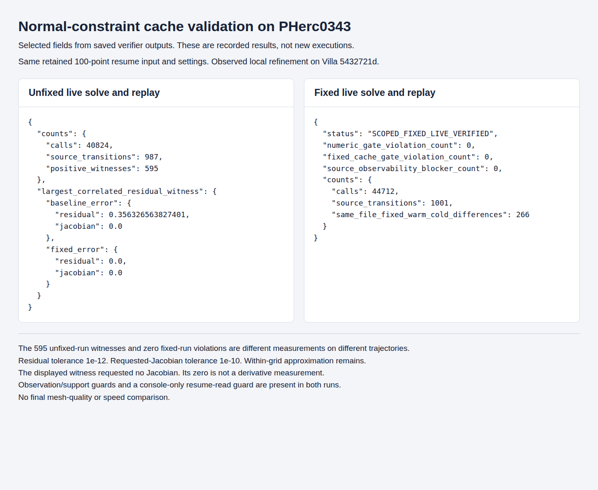
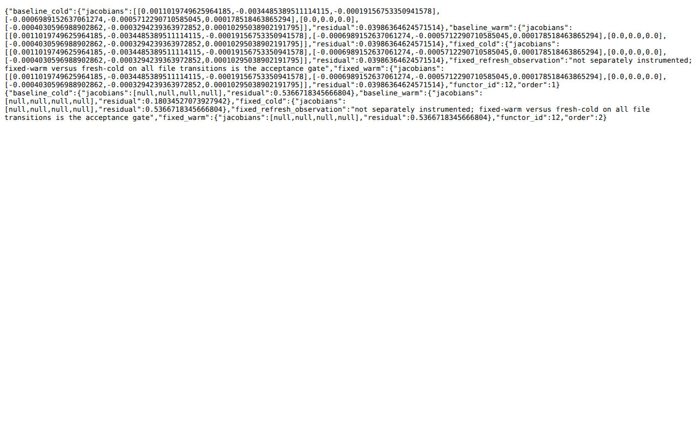
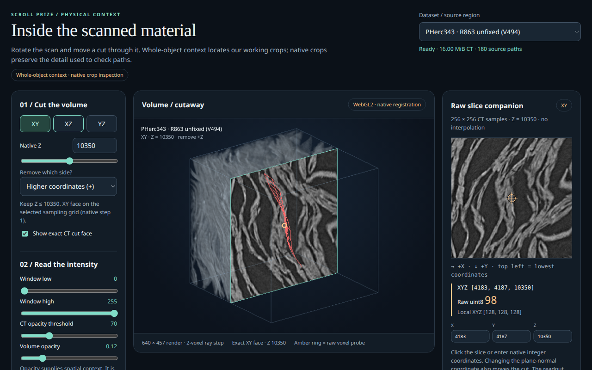

# Normal-constraint cache invalidation

`NormalConstraintPlane` can reuse a path or snap result from a different selected grid during normal-guided surface growth and local refinement.

## Cause and correction

Ceres keeps cost objects while it evaluates new trial point positions. Moving a point along the axis dropped by the 2D projection can select another grid slice without moving the projected endpoints. The old cache checked the parent volume and endpoint distance, but omitted the selected store.

The correction adds a weak reference to the selected `GridStore` to both cache keys. A hit requires the same live object and ownership identity. Weak ownership does not keep grid payloads alive. Two resident stores suffice to trigger the bug. Memory pressure and cache eviction are not required.

## Real-data evidence

The observed case uses a retained 100-point PHerc0343 resume surface and normal grids for `20250521140437-surface-20260413222639-surface-m7-L0-th0.2`. Both runs refine the first structurally eligible local problem with the same input and settings. They use level 0, normal weight 10, snap weight 0.1, step 16, local radius 32, up to 1,000 Cholesky iterations, one thread and `resume_opt=local`.

The source lineage is Villa `5432721d`. Both runs include observation/support checks and a console-only guard that skips an unused seed-voxel debug read during resume. The fixed run adds the selected-store cache correction. These are instrumented runs, not untouched current-main executions. The fixed capture rebuilds the Grow translation unit and tracer library against the same core and seven other tracer objects.



The image shows selected fields from saved verifier outputs. It is not a new execution or a screenshot of an application crash. This is a silent wrong-result bug.

- The unfixed solve made 40,824 cost calls across 987 source transitions. At 595 transitions, a stale-origin result differed from a fresh cost and the correction removed that discrepancy in replay at the recorded states. The largest residual discrepancy was 0.356326563827401. That particular call requested no Jacobian.
- The fixed solve made 44,712 cost calls across 1,001 source transitions. Every live call matched fixed replay within residual `1e-12` and requested-Jacobian `1e-10` tolerances. Numeric, selected-source cache and source-observability checks had no violations.
- The runs have different trajectories. The 595 witnesses and zero validation failures are different measurements, not a matched event-count reduction. Call counts do not measure output quality or speed.

Replay checks every recorded call using its actual parameters and requested Jacobian blocks. It evaluates persistent and fresh costs with both unfixed and fixed headers. A fresh cost resets its own caches, not the shared volume byte cache. Cold cross-arm residual and Jacobian differences are zero. Maximum live-to-corresponding-replay residual errors are 1.584843367652411e-14 before and 1.6035783811929605e-14 after. The maximum requested-Jacobian error is 8.430756093247282e-16 in both runs.

The existing within-grid approximation remains. There are 223 fixed persistent/fresh differences on the unfixed trajectory and 266 on the fixed trajectory. On the latter, the maximum residual/Jacobian differences are 0.006082969957827648 and 0.01164391557648927. These do not fail the selected-source transition check. No final mesh-quality, convergence-speed or recovered-writing improvement was measured.

## Regression test

`test_normal_constraint_grid_change` creates two synthetic stores and one volume. It compares persistent and fresh costs through A-to-B-to-A and B-to-A-to-B sequences. Repeated-store and projected-motion controls remain included. The 12 configurations cover direct evaluation, Ceres AutoDiff, inversion, normal-only, combined and snap-only weights.

| Check | Original header | Fixed header |
| --- | ---: | ---: |
| Evaluations / comparisons | 156 / 108 | 156 / 108 |
| Ordinary controls passed | 60 / 60 | 60 / 60 |
| History failures out of 48 comparisons | 24 | 0 |
| Requested AutoDiff Jacobian values checked | 936 | 936 |

Exact saved summary lines are below. The fields are comparisons, ordinary failures and history failures.

```text
Before: 73: summary,108,0,24
After:  73: summary,108,0,0
```

The original matched before/after harness was run on the pinned source. A fresh PCH-enabled build and CTest also pass with the final named fixture entry point. That latest fixed run is compared with the preserved original baseline, not a newly executed final-entry-point baseline. The compiled header and both C++ test files match the contribution. The tested CMake registration differs only by a comment.

With native dependencies installed, run the focused target from the repository root:

```sh
cmake -S volume-cartographer -B build-normal-cache -G Ninja \
  -DCMAKE_BUILD_TYPE=Release -DVC_TESTING=ON -DVC_USE_PCH=ON \
  -DVC_BUILD_APPS=OFF -DVC_BUILD_UI_TRACER=OFF \
  -DVC_BUILD_FLATBOI=OFF -DVC_BUILD_PYTHON=OFF
cmake --build build-normal-cache --target test_normal_constraint_grid_change --parallel 1
ctest --test-dir build-normal-cache -R '^test_normal_constraint_grid_change$' --verbose
```

These are reproduction commands for a dependency-equipped checkout. Completed validation used GCC 15.2, Ceres 2.2, OpenCV 4.10, PCH enabled and an offline SDK with explicit dependency overrides. The commands above have not been run verbatim on a new general-purpose host. The test creates and removes its own temporary grids. A setup or compile failure is not the expected unfixed failure.

The cost header on the checked submission base is identical to the tested original header. The later focused build and CTest below supersede the earlier pending status for that target. They do not cover the whole application. macOS and arm64 are untested. Real-data payloads and raw capture streams are not included. The synthetic regression requires no data download. Formulas, weights and within-grid movement thresholds are unchanged.

## Subsequent focused validation

Subsequent agent-run local validation completed the focused target build and one CTest run against pinned upstream base `1db9cd94487c2fb5e759cc4ee72018dcb7359984` with the cache correction applied. The test passed 1/1 registered test, covering 12 configurations, 156 evaluations and 108 comparisons, with `summary,108,0,0`. This supersedes the earlier pending build and test status for this target only. It does not establish full CI, whole-application correctness, physical geometry improvement or speed.

The tested `CostFunctions.hpp` is byte-identical to the public contribution header, SHA256 `bc057f48c68a02874c3f1421e6adf9e8e472e664412c45b6e5bb12e1d76c4818`. The two test sources and CMake registration also match the R823 source bindings. The whole-main revision was not rebuilt as an application.

## Recorded numerical result

This is a screenshot of retained native replay output recorded on October 15, 2026. It was captured for presentation on October 18; the native program was not rerun for this screenshot. The result is a numerical error, so the program exits successfully rather than crashing.

For the same second recorded call, the unfixed warm cache returns residual `0.18034527073927942`. A fresh unfixed cost returns `0.5366718345666804`; both warm and fresh fixed costs return `0.5366718345666804`. This residual contributes to the optimizer's objective. It is not the total geometric cost or a confidence score.



The retained source is `isolated-prefix-replay-v473/family/replay.jsonl`, 1,795 bytes, SHA256 `585cedafd06f9044f9bcbd0e821ce795a0ff057ba70ddc55f00071f1353b316d`. It contains two calls across four arms. This compact example supplements the larger instrumented-solve and regression results above.

## Retained PHerc0343 mesh views

These screenshots show the retained unfixed V494 and fixed V501 outputs on the same CT crop with the same default camera and display settings: XY at native Z=10350, window 0–255, threshold 70, opacity 0.12, zoom 1. Red identifies the unfixed output; green identifies the fixed output. The overlay uses their original coordinates without amplifying displacement.




The views illustrate different optimization trajectories. They do not establish which mesh better follows the physical sheet. The numerical cache checks and regression tests establish the correction. These are views in our local CT inspection tool, not screenshots of the Villa GUI, and they do not depict a PHerc1447 solve.

The exported meshes each contain 100 valid points, 81 quads and 180 unique quad edges. They came from the retained `x.tif`, `y.tif`, `z.tif`, `generations.tif` and `meta.json` files. Export and screenshot provenance are recorded separately; the screenshots themselves are unmodified browser captures.
