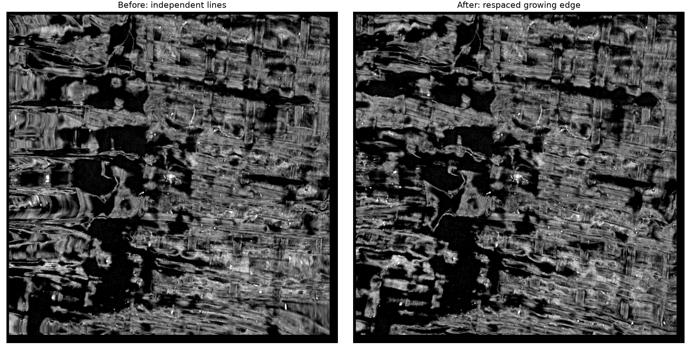

# Keep sheet growth lines spaced along the advancing edge

Long Manual Grow extensions and seeded GrowPatch streamlines could form seams
and overlapping strips. In the reported PHerc0175A run, individual growth lines
never reversed. Neighboring lines crossed: transverse spacing ranged from
0.16 to 233 voxels despite a nominal 20-voxel mesh spacing. Normal sign handling
was already correct; tracing every row independently was the problem.

Both seed growth and Manual Grow now use `vc::sheet::walkSheetStrip`:

1. Compute growth directions perpendicular to the current edge in the local
   CT tangent plane, oriented toward the previous growth direction.
2. Advance every edge vertex by one output mesh step, using the selected
   projection/streamline integrator and maximum internal integration step.
3. Redistribute the new edge at the source edge's arc-length spacing, keeping
   its middle vertex as the parameterization anchor. Contracting ends are
   extended along the sheet; they are not clamped to one endpoint.
4. Repeat from this new edge instead of continuing the original independent
   rays. Integration within a step remains parallel; redistribution happens
   after joining the workers, in a deterministic order.

Only contiguous stretches of the same grid edge are coupled. Missing rows
or staggered edge endpoints start separate fronts, so respacing cannot bridge
a hole. Existing surface vertices and the seeded patch's center column stay fixed.
The raw one-line integration routines remain available for the center column
and tests. This intentionally changes long-growth geometry; default GrowPatch
optimization and manual click correction behavior are unchanged.

## Real-data reproduction

The user supplied a screenshot and confirmed this exact run:

- CT: PHerc0175A, `20250521115057-8.640um-1.2m-116keV-masked.zarr`.
- Seed: `(5826.711426, 5268.912109, 6671.941406)` at level 0.
- Streamline/Midpoint; 30 cells per side; mesh spacing 20; internal step 4;
  eight workers. The resulting grid is 61×61.
- Ubuntu arm64, existing RelWithDebInfo build.



The same CT was rendered at one pixel per voxel, with the same contrast in
both panels. The repeated seams on the left disappear on the right.

| Measurement | Seed before | Seed after | Extension before | Extension after |
| --- | ---: | ---: | ---: | ---: |
| Reversed row ordering | 180 | 0 | 179 | 0 |
| Crossed quads (opposed triangle normals) | 7 | 0 | 7 | 0 |
| Opposed normals across neighboring rows | 185 | 0 | 182 | 0 |
| Minimum transverse spacing (voxels) | 0.16 | 16.83 | 0.74 | 16.43 |
| Maximum transverse spacing (voxels) | 232.62 | 20.00 | 231.85 | 20.96 |

The extension case starts with all 61 rows and columns 28–32 (inclusive) of the
original seed output. Extending its left edge by 28 cells gives a 61×33 grid.
The five input columns remain byte-for-byte unchanged in the output. A
9-row crop extended by eight cells produced byte-identical XYZ TIFFs with one
and four workers, for both Projection and Streamline/Midpoint. The
before extension used the retained `vc_extend_edge-pass2-before` binary;
normal-estimator behavior is the same.

VC3D and the two CLI tools build successfully. All four focused test suites
below pass, including converging rays, contracting fronts, missing normals,
and disconnected/staggered grid edges. The final build's real-data extension
also reproduces the validated XYZ TIFFs byte-for-byte.

Reproduce from `volume-cartographer` with this params JSON:

```json
{
  "mode": "seed", "growth_method": "streamline", "generations": 30,
  "step_size": 20, "walk_step_size": 4, "walk_integrator": "midpoint",
  "thread_limit": 8, "min_area_cm": 0, "voxelsize": 8.64
}
```

```sh
ninja -C build VC3D vc_grow_seg_from_seed vc_extend_edge test_sheet_seed test_manual_add_extend
ctest --test-dir build -R '^(test_sheet_seed|manual_add_extend|grow_patch_seed_dialog|test_grow_seg_store_mode)$' --output-on-failure
build/bin/vc_grow_seg_from_seed \
  --volume https://vesuvius-challenge-open-data.s3.us-east-1.amazonaws.com/PHerc0175A/volumes/20250521115057-8.640um-1.2m-116keV-masked.zarr \
  --params build/sheet-seam-validation/params.json \
  --seed 5826.711426 5268.912109 6671.941406 \
  --target-dir /tmp/sheet-front-check --segment-name sheet-front-check
python scripts/check_sheet_grid.py /tmp/sheet-front-check --require-no-folds
```

The checker needs NumPy and tifffile (both already available in the validation
environment). It reports spacing percentiles and local orientation checks;
it is not a general detector of distant self-intersections. On patches with a
real sharp bend, opposed normals may be legitimate, so the strict option is
intended for known regression patches like this one. Original outputs, crops,
rendered TIFFs, and measurements are retained in `build/sheet-seam-validation`.

This prevents the reported local bunching/crossing; it does not prove that a
large patch stays on the correct papyrus surface or avoids every distant
overlap. Respacing follows polygonal edge arc length, so chord lengths can
be shorter in strongly curved regions. Already-folded saved geometry is not
repaired automatically: regenerate it from the seed or a clean edge. macOS
and amd64 have not been tested here.
