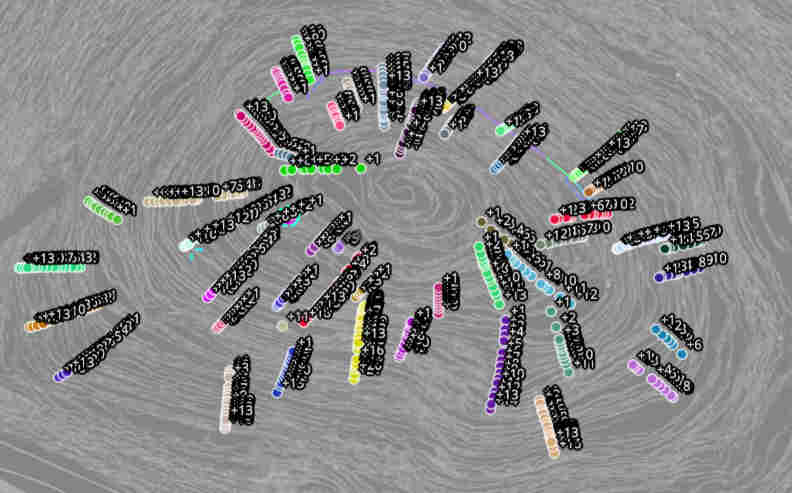
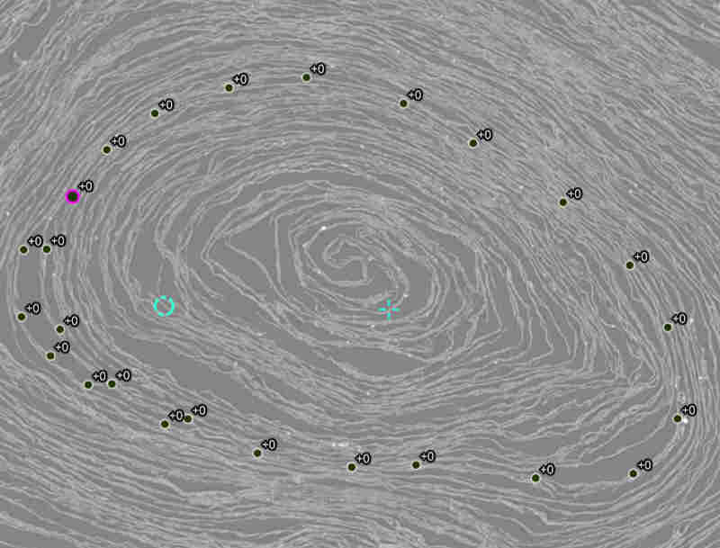

# Intro
vc_calc_surface_metrics can calculate surface metrics from point collection ground truth. The ground truth point collections can be created in VC3D gui and annotated with relative winding numbers, to enable GT annotations without any priors by human annotators.

# Workflow
- annotate sets of relative windings (intra and inter winding), see below
- take a surface that should be evaluated; the metric tools read tifxyz directories, so export a stored surface first:
    ```shell
    vc_object_export --db <objects.vcobj> --uuid <surface uuid> --output <tifxyz_path>
    ```
- run vc_calc_surface_metrics on the surface (and, for the inter winding metrics, a per-cell relative winding number `.tif` of the same size) to get metrics json
    ```shell
    vc_calc_surface_metrics --surface <tifxyz_path> --winding <winding.tif> --collection <annnotated_gt.json> --output <metrics.json>
    ```
    This will create the json file with the metrics:
    - surface_missing_fraction : fraction of inter-winding GT points that were completely missing in surface
    - winding_error_fraction : fraction of inter winding GT points that were incorrect (missing points are also incorrect)
    - in_surface_metric : fraction of intra-winding GT points that were correct

## Annotation

### Inter Winding
Annotate points roughly along the surface normal. Annotation can be performed with the point collection tool (shift-click to add a new point to the selected collection), or the drawing tool. Save the collections as JSON (Point Collections → Save) to pass them to `--collection`. Multiple annotations should overlap by several windings if possible.



### Intra Winding (in-sheet)

Follow the surface along its length in any direction. Points are evaluated in-order they were added so just add along the surface, don't add points in the middle later. The annotation can follow multiple wraps but for visual clarity this should be minimized.


